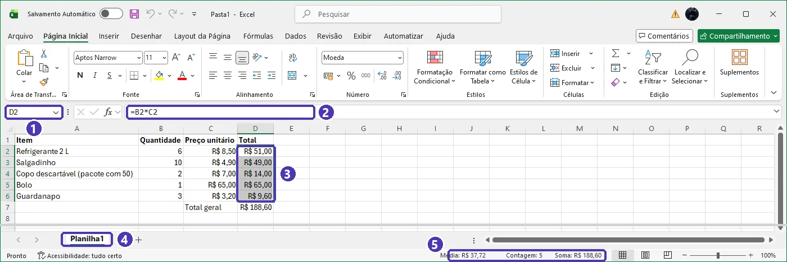
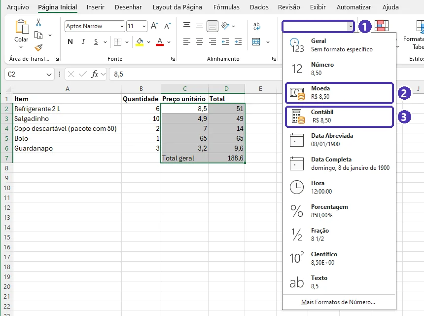
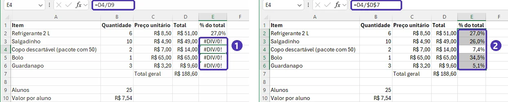
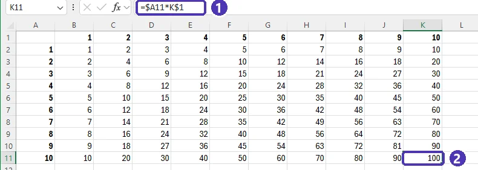

# 01 — Primeiros passos: células, fórmulas e referências

> **Curso:** Pacote Office  
> **Módulo:** 02 — Excel  
> **Tempo estimado:** 1 h 30 min  

---

## Objetivos

Ao final desta aula, você será capaz de:

- Reconhecer as partes da tela do Excel: **pasta de trabalho**, **planilhas**, **células** e **Barra de Fórmulas**.
- Digitar dados e formatar números como **moeda**, **porcentagem** e com casas decimais.
- Escrever **fórmulas** com operadores e com as funções `SOMA`, `MÉDIA`, `MÁXIMO` e `MÍNIMO`.
- Copiar fórmulas com a **alça de preenchimento** e entender a diferença entre referência **relativa** e **absoluta** (`$`).
- Reconhecer os erros mais comuns (`#DIV/0!`, `#NOME?`, `####`).

## Pré-requisitos

- Saber usar mouse e teclado e salvar arquivos em pastas.
- Ter acesso ao Excel do Microsoft 365 (no computador ou em [office.com](https://www.office.com) com o e-mail da escola).

---

## A tela do Excel

Um arquivo do Excel é uma **pasta de trabalho** (`.xlsx`). Dentro dela ficam as **planilhas**, as abas na parte de baixo da tela.

| Parte | Para que serve |
|---|---|
| **Célula** | O “quadradinho” onde fica cada dado. O endereço é a **coluna + a linha**: `A1`, `C5`, `F12`. |
| **Caixa de Nome** | À esquerda, acima da coluna A. Mostra o endereço da célula selecionada — e leva a qualquer célula se você digitar o endereço e der `Enter`. |
| **Barra de Fórmulas** | Ao lado da Caixa de Nome. Mostra o **conteúdo real** da célula (a fórmula), não só o resultado. |
| **Abas das planilhas** | Embaixo. Clique com o botão direito para renomear, mudar a cor, duplicar ou excluir. O **+** cria uma planilha nova. |
| **Barra de status** | Embaixo, à direita. Selecione números e ela mostra a **soma**, a **média** e a **contagem** na hora, sem fórmula. |

<figure markdown="span">
  { loading=lazy }
  <figcaption>(1) Caixa de Nome · (2) Barra de Fórmulas: mostra a fórmula, não o resultado · (3) intervalo selecionado · (4) aba da planilha · (5) barra de status: Média R$ 37,72, Contagem 5, Soma R$ 188,60.</figcaption>
</figure>

!!! tip "Intervalo"
    Um bloco de células é um **intervalo**, escrito com dois-pontos: `A1:A10` é da A1 até a A10; `B2:D6` é o retângulo da B2 até a D6. Você vai usar intervalos o tempo todo nas funções.

---

## Digitar e formatar dados

- `Enter` confirma e desce; `Tab` confirma e vai para a direita. `F2` edita a célula sem apagar o que já está nela.
- **Texto** fica alinhado à esquerda; **números** e **datas**, à direita. Se um número “grudou” à esquerda, o Excel o entendeu como texto — e ele não vai entrar nas contas.
- Decimais com **vírgula** (`8,50`) e datas com barra (`15/03/2026`), porque o Excel segue a configuração regional do Brasil.
- Coluna estreita demais? Clique duas vezes na divisa entre as letras das colunas: ela se ajusta ao conteúdo (**AutoAjuste**).

### Formato de número

Na *Página Inicial*, grupo **Número**: a **lista de formatos** (onde está escrito *Geral*) tem **Moeda**, **Porcentagem**, **Data Abreviada** e outros. Ao lado ficam os botões **%** (porcentagem) e de **aumentar/diminuir casas decimais**.

<figure markdown="span">
  { loading=lazy }
  <figcaption>(1) A lista de formatos · (2) <strong>Moeda</strong>: R$ colado ao número · (3) <strong>Contábil</strong>: R$ encostado na borda esquerda da célula.</figcaption>
</figure>

!!! info "O botão de dinheiro é o Contábil"
    O botão com o desenho de notas e moedas, ao lado do **%**, aplica o formato **Contábil**: o `R$` fica encostado na borda esquerda da célula e o número, na direita. Para o `R$` colado ao número, escolha **Moeda** na lista de formatos. Os dois servem para valores em dinheiro; nas aulas usamos **Moeda**.

!!! warning "Formato muda a aparência, não o valor"
    Uma célula com `7,544` formatada com duas casas decimais **mostra** `7,54`, mas o Excel continua calculando com `7,544`. Olhe a Barra de Fórmulas para ver o valor de verdade.

---

## Fórmulas

Toda fórmula começa com **`=`**. Depois vêm valores, endereços de células e operadores:

| Operador | Conta | Exemplo |
|---|---|---|
| `+` `-` | soma e subtração | `=B2+B3` |
| `*` | multiplicação | `=B2*C2` |
| `/` | divisão | `=D7/25` |
| `^` | potência | `=2^10` |
| `( )` | muda a ordem das contas | `=(B2+B3)/2` |

Use **endereços**, não os números: `=B2*C2`, e não `=6*8,5`. Assim, se a quantidade mudar, o total muda sozinho.

!!! tip "Clique em vez de digitar o endereço"
    Digite `=`, **clique** na célula B2, digite `*`, clique na C2 e dê `Enter`. O Excel escreve os endereços para você e evita erro de digitação.

### Funções

Uma **função** é uma conta pronta: o nome, e entre parênteses os **argumentos**, separados por **ponto e vírgula** (`;`).

| Função | O que faz | Exemplo |
|---|---|---|
| `SOMA` | soma um intervalo | `=SOMA(D2:D6)` |
| `MÉDIA` | média aritmética | `=MÉDIA(B2:B9)` |
| `MÁXIMO` / `MÍNIMO` | maior / menor valor | `=MÁXIMO(C2:C6)` |
| `CONT.NÚM` | quantas células têm número | `=CONT.NÚM(B2:B9)` |

O atalho **`Alt + =`** (AutoSoma) escreve o `=SOMA(...)` sozinho, já com o intervalo de cima selecionado. Confira o intervalo e dê `Enter`.

!!! info "Comece a digitar e escolha da lista"
    Ao digitar `=SO`, o Excel mostra a lista de funções que começam assim. Use as setas e `Tab` para escolher — e veja a dica com os argumentos logo abaixo da célula.

    ![Em cima, a célula D7 com =SO e a lista de funções SOMA, SOMAQUAD, SOMASE e outras, com a descrição da SOMA ao lado; embaixo, depois do Tab, a célula com =SOMA( e a dica SOMA(núm1; [núm2]; ...)](assets/01_lista_de_funcoes.webp){ loading=lazy }

---

## Copiar fórmulas: a alça de preenchimento

O quadradinho no canto inferior direito da célula selecionada é a **alça de preenchimento**. Arraste-o para baixo (ou dê **dois cliques** nele) e a fórmula é copiada para as linhas de baixo.

Ao copiar, o Excel **ajusta os endereços**: `=B2*C2` na linha 2 vira `=B3*C3` na linha 3, `=B4*C4` na 4... Isso é a **referência relativa** — e é o que você quer na maioria das vezes.

A alça também continua sequências: digite `Jan` e arraste para ter `fev`, `mar`, `abr`...; digite `1` e `2`, selecione as duas e arraste para ter 3, 4, 5...

---

## Referência absoluta: o `$`

Às vezes um endereço **não pode** mudar ao copiar. Exemplo: o total de cada item dividido pelo total geral, que está sempre em `D7`.

- `=D2/D7` copiado para baixo vira `=D3/D8`, `=D4/D9`... — e `D8`, `D9` estão vazias: erro `#DIV/0!`.
- `=D2/$D$7` copiado vira `=D3/$D$7`, `=D4/$D$7`... — o `$` **trava** a coluna e a linha.

<figure markdown="span">
  { loading=lazy }
  <figcaption>(1) Sem o <code>$</code>, a fórmula da E4 virou <code>=D4/D9</code> e divide por uma célula vazia · (2) com <code>$D$7</code>, todas as linhas dividem pelo total geral.</figcaption>
</figure>

Com o cursor em cima do endereço, na Barra de Fórmulas, aperte **`F4`** para alternar entre os quatro tipos:

| Escrita | Ao copiar... |
|---|---|
| `D7` | coluna e linha mudam (relativa) |
| `$D$7` | nada muda (absoluta) |
| `D$7` | só a coluna muda (linha travada) |
| `$D7` | só a linha muda (coluna travada) |

---

## Erros comuns nas células

| O que aparece | O que significa | Como resolver |
|---|---|---|
| `####` | A coluna está estreita para o número. | Alargue a coluna (dois cliques na divisa). |
| `#DIV/0!` | Divisão por zero ou por célula vazia. | Confira o endereço do divisor — muitas vezes falta um `$`. |
| `#NOME?` | Nome de função escrito errado (`=SOMMA`) ou texto sem aspas. | Corrija o nome; escolha a função na lista. |
| `#VALOR!` | Conta com texto no lugar de número. | Veja se algum “número” está alinhado à esquerda (é texto). |
| `#REF!` | A fórmula apontava para uma célula que foi excluída. | Refaça a fórmula ou desfaça a exclusão (`Ctrl + Z`). |

---

## Atalhos do Excel em português

| Atalho | Ação | Atalho | Ação |
|---|---|---|---|
| `Ctrl + B` | **Salvar** | `F2` | Editar a célula |
| `Ctrl + N` | **Negrito** | `F4` | Alternar `$` no endereço |
| `Ctrl + Z` | Desfazer | `Alt + =` | AutoSoma |
| `Ctrl + Y` | Refazer | `Ctrl + D` | Copiar a célula de cima para baixo |
| `Ctrl + ;` | Data de hoje | `` Ctrl + ` `` | Mostrar as fórmulas em vez dos resultados |

!!! info "Excel em inglês?"
    Como no Word, os atalhos de letra acompanham o idioma do Office: em inglês, `Ctrl + S` salva e `Ctrl + B` é negrito. Os **nomes das funções** também mudam: `SOMA` vira `SUM`, `MÉDIA` vira `AVERAGE` — e o separador pode ser vírgula. As aulas usam o Excel em português.

---

## Salvar e exportar

- **Salvar:** *Arquivo ➔ Salvar como* ➔ formato **Pasta de Trabalho do Excel (`.xlsx`)**. No **OneDrive** da escola, o *Salvamento Automático* fica ligado.
- **PDF:** *Arquivo ➔ Exportar ➔ Criar Documento PDF/XPS*. Antes, confira em *Arquivo ➔ Imprimir* se a planilha cabe na página — em *Configurações*, escolha **Ajustar Todas as Colunas em Uma Página**.

---

??? note "Equivalentes gratuitos: LibreOffice Calc e Google Planilhas"
    | Tarefa | LibreOffice Calc | Google Planilhas |
    |---|---|---|
    | Funções básicas | Mesmos nomes: `SOMA`, `MÉDIA`, `MÁXIMO`, `MÍNIMO` | Mesmos nomes em português |
    | Separador dos argumentos | `;` | `;` com a planilha na localidade *Brasil* (*Arquivo ➔ Configurações*) |
    | Referência absoluta | `$` e `F4` | `$` e `F4` |
    | Formato moeda | *Formatar ➔ Células ➔ Números ➔ Moeda* | *Formatar ➔ Número ➔ Moeda* |
    | Exportar PDF | *Arquivo ➔ Exportar como PDF* | *Arquivo ➔ Fazer download ➔ PDF* |

---

## ⚠️ Erros comuns

- **Digitar o resultado em vez da fórmula.** Se você escreve `51` na célula do total, ele nunca mais muda. Escreva `=B2*C2`.
- **Esquecer o `$` ao copiar.** Se a coluna inteira deu `#DIV/0!` ou zeros, quase sempre falta travar uma célula.
- **Somar com a calculadora e digitar o total.** Use `SOMA` — se alguém mudar um valor, o total confere sozinho.
- **Arredondar “no olho”.** Diminuir as casas decimais muda só a aparência; o valor guardado continua o mesmo.

---

## Exercícios

Para os exercícios, copie a tabela abaixo (selecione no site, `Ctrl + C`) e cole no Excel na célula **A1** (`Ctrl + V`). Se a formatação do site vier junto, clique no ícone que aparece ao lado e escolha **Corresponder à Formatação de Destino**.

| Item | Quantidade | Preço unitário |
|---|---|---|
| Refrigerante 2 L | 6 | 8,50 |
| Salgadinho | 10 | 4,90 |
| Copo descartável (pacote com 50) | 2 | 7,00 |
| Bolo | 1 | 65,00 |
| Guardanapo | 3 | 3,20 |

### Básico (fixação)

Monte a lista de compras da festa da turma:

1. Em **D1** escreva `Total`; em **D2** calcule o total do refrigerante (quantidade × preço) e copie a fórmula até **D6**.
2. Em **C7** escreva `Total geral` e em **D7** some os totais.
3. Formate as colunas C e D como **Moeda** e deixe o cabeçalho em negrito.

<!-- gabarito -->
??? success "Gabarito — Básico"
    1. Em **D2**: `=B2*C2` ➔ `Enter`. Selecione D2 e dê dois cliques na alça de preenchimento (ou arraste até D6).
    2. Em **D7**: `=SOMA(D2:D6)` — ou clique em D7 e aperte `Alt + =`, confira o intervalo e dê `Enter`.
    3. Selecione **C2:D7** ➔ *Página Inicial* ➔ lista de formatos do grupo *Número* ➔ **Moeda**. Selecione **A1:D1** ➔ `Ctrl + N`.

    **Confira:** os totais são R$ 51,00 · R$ 49,00 · R$ 14,00 · R$ 65,00 · R$ 9,60, e o **total geral é R$ 188,60**. Clique em D4: a Barra de Fórmulas deve mostrar `=B4*C4`, não um número.

### Intermediário (aplicação)

Continue na mesma planilha:

1. Em **A9** escreva `Alunos` e em **B9** o número `25`. Em **A10** escreva `Valor por aluno` e calcule, em **B10**, quanto cada aluno vai pagar.
2. Em **E1** escreva `% do total`. Em **E2**, calcule quanto o item representa do total geral e **copie até E6** — sem dar erro.
3. Formate a coluna E como porcentagem com uma casa decimal.

<!-- gabarito -->
??? success "Gabarito — Intermediário"
    1. Em **B10**: `=D7/B9` e formato **Moeda**. Resultado: **R$ 7,54** (o valor guardado é 7,544 — veja na Barra de Fórmulas).
    2. Em **E2**: `=D2/$D$7` ➔ copie até E6. O `$` trava o total geral; sem ele, a fórmula copiada viraria `=D3/D8` e daria `#DIV/0!`.
    3. Selecione **E2:E6** ➔ botão **%** ➔ **Aumentar Casas Decimais** uma vez.

    **Confira:** 27,0% · 26,0% · 7,4% · 34,5% · 5,1%. Selecione E2:E6 e olhe a barra de status: a **Soma** deve ser **100,0%**.

### Avançado (desafio)

1. Na mesma planilha, os preços vão subir. Em **G1** escreva `Reajuste` e em **H1** `10%`. Na coluna **F** (`Preço novo`), calcule cada preço reajustado usando a célula H1 — de forma que, se H1 mudar para 15%, todos os preços novos mudem.
2. Em uma **planilha nova**, monte uma **tabuada de 1 a 10**: os números 1 a 10 em **B1:K1** e em **A2:A11**. Escreva **uma única fórmula** em B2 que, copiada para todo o quadro B2:K11, calcule todas as multiplicações.

<!-- gabarito -->
??? success "Gabarito — Avançado"
    1. Em **F2**: `=C2*(1+$H$1)` ➔ copie até F6 e formate como Moeda. Com 10%: R$ 9,35 · R$ 5,39 · R$ 7,70 · R$ 71,50 · R$ 3,52. Troque H1 para `15%` e confira que a coluna F inteira muda.
    2. Digite `1` em B1 e `2` em C1, selecione as duas e arraste até K1; faça o mesmo de A2 até A11. Em **B2**: `=$A2*B$1` ➔ copie para a direita até K2 e, com B2:K2 selecionado, para baixo até a linha 11.

    { loading=lazy }

    **Por que funciona:** `$A2` trava a **coluna A** (o número da linha vem sempre de lá) e `B$1` trava a **linha 1** (o número da coluna vem sempre de lá). É a **referência mista**. **Confira:** a célula **K11** deve mostrar **100** e a **F6**, **25**.

---

## 💡 Resumo

- Endereço = coluna + linha (`C5`); intervalo = `A1:A10`.
- Toda fórmula começa com `=`; funções separam os argumentos com `;`.
- Use **endereços** nas fórmulas, nunca o número digitado.
- A alça de preenchimento copia ajustando os endereços (**relativa**); o `$` trava (**absoluta**); `F4` alterna.
- O formato muda a aparência; o valor real está na Barra de Fórmulas.

## ➡️ Próximo passo

**[02 — Funções essenciais: SE, CONT.SE, SOMASE e PROCX](02_funcoes_essenciais.md)**: fórmulas que tomam decisões, contam o que interessa e buscam dados em outra parte da planilha.
