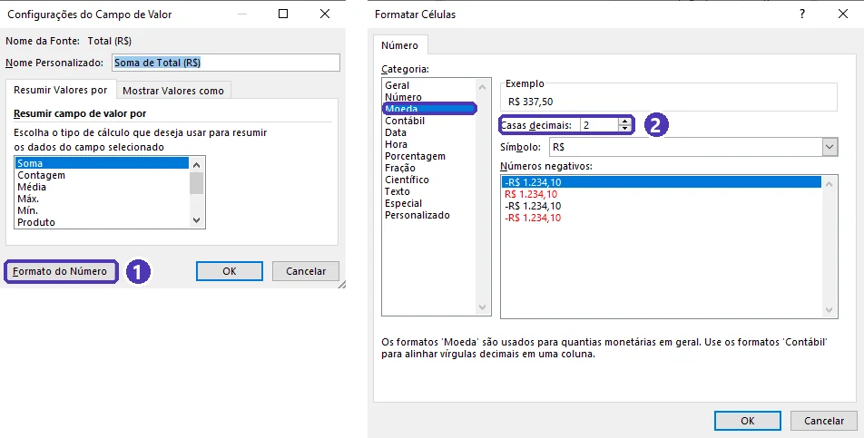
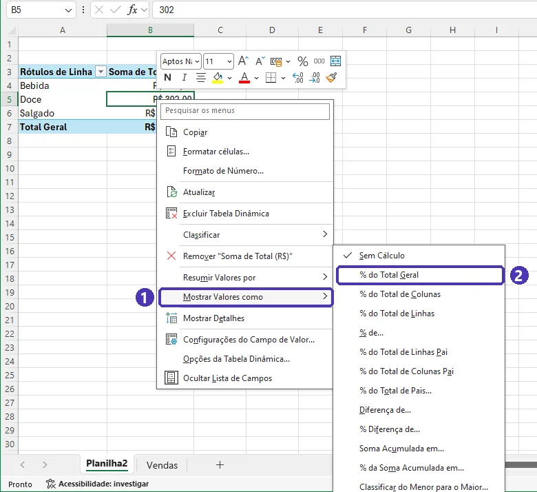
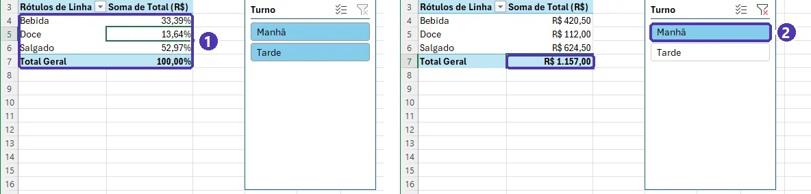
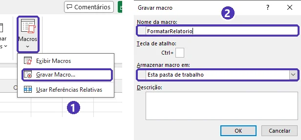
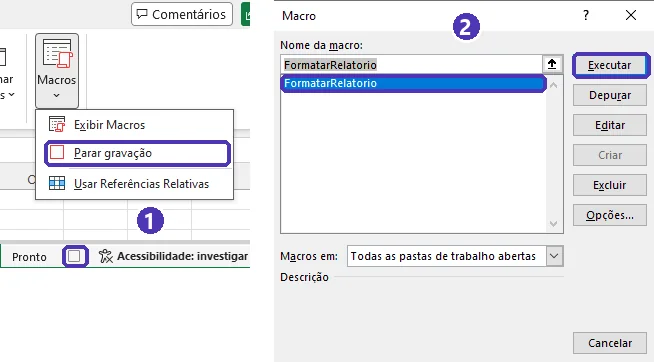

# 04 — Tabela dinâmica, funções modernas e automação

> **Curso:** Pacote Office  
> **Módulo:** 02 — Excel  
> **Tempo estimado:** 2 h  

---

## Objetivos

Ao final desta aula, você será capaz de:

- Resumir uma lista grande em segundos com a **tabela dinâmica** — arrastando campos, sem escrever fórmula.
- Filtrar a tabela dinâmica com **segmentação de dados** e mostrar valores em **porcentagem do total**.
- Usar as **funções de matriz dinâmica** do Microsoft 365: `ÚNICO`, `CLASSIFICAR`, `CLASSIFICARPOR` e `FILTRO`.
- **Gravar uma macro** que repete uma tarefa e salvá-la no formato certo (`.xlsm`).
- Saber o que são os **Scripts do Office** e por que só se abre macro de quem você confia.

## Pré-requisitos

- [Aula 03](03_tabelas_graficos_e_formatacao.md): dados organizados, tabelas e gráficos.
- [Aula 02](02_funcoes_essenciais.md): `SOMASE`.

---

## A planilha desta aula

Vendas da cantina da escola em fevereiro e março. Copie e cole na célula **A1** de uma planilha nova.

| Mês | Turno | Produto | Categoria | Quantidade | Total (R$) |
|---|---|---|---|---|---|
| Fevereiro | Manhã | Suco | Bebida | 32 | 128,00 |
| Fevereiro | Manhã | Água | Bebida | 25 | 62,50 |
| Fevereiro | Manhã | Pão de queijo | Salgado | 48 | 168,00 |
| Fevereiro | Manhã | Coxinha | Salgado | 20 | 120,00 |
| Fevereiro | Manhã | Brigadeiro | Doce | 30 | 60,00 |
| Fevereiro | Tarde | Suco | Bebida | 18 | 72,00 |
| Fevereiro | Tarde | Água | Bebida | 30 | 75,00 |
| Fevereiro | Tarde | Pão de queijo | Salgado | 22 | 77,00 |
| Fevereiro | Tarde | Coxinha | Salgado | 28 | 168,00 |
| Fevereiro | Tarde | Brigadeiro | Doce | 45 | 90,00 |
| Março | Manhã | Suco | Bebida | 40 | 160,00 |
| Março | Manhã | Água | Bebida | 28 | 70,00 |
| Março | Manhã | Pão de queijo | Salgado | 55 | 192,50 |
| Março | Manhã | Coxinha | Salgado | 24 | 144,00 |
| Março | Manhã | Brigadeiro | Doce | 26 | 52,00 |
| Março | Tarde | Suco | Bebida | 21 | 84,00 |
| Março | Tarde | Água | Bebida | 35 | 87,50 |
| Março | Tarde | Pão de queijo | Salgado | 30 | 105,00 |
| Março | Tarde | Coxinha | Salgado | 33 | 198,00 |
| Março | Tarde | Brigadeiro | Doce | 50 | 100,00 |

São só 20 linhas para você conferir as contas — mas tudo o que você vai fazer funciona igual com 20 mil.

---

## Tabela dinâmica

A tabela dinâmica responde perguntas como “quanto vendeu cada categoria em cada mês?” **arrastando campos**.

1. Clique em qualquer célula dos dados ➔ *Inserir* ➔ **Tabela Dinâmica** ➔ *Da Tabela/Intervalo* ➔ **Nova Planilha** ➔ *OK*.
2. À direita abre o painel **Campos da Tabela Dinâmica**: em cima, as colunas dos seus dados; embaixo, quatro áreas.

| Área | O que faz | Exemplo |
|---|---|---|
| **Linhas** | um item em cada linha | *Categoria* |
| **Colunas** | um item em cada coluna | *Mês* |
| **Valores** | o que é somado (ou contado) | *Total (R$)* vira **Soma de Total (R$)** |
| **Filtros** | filtra o relatório inteiro | *Turno* |

Arraste os campos entre as áreas e o relatório se remonta na hora. Errou? Arraste o campo para fora do painel.

<figure markdown="span">
  { loading=lazy }
  <figcaption>(1) Com a tabela dinâmica selecionada, aparece a guia <strong>Análise de Tabela Dinâmica</strong> · (2) o relatório · (3) os campos (as colunas dos dados) · (4) as quatro áreas.</figcaption>
</figure>

### Ajustes que você vai usar sempre

- **Soma, Contagem ou Média:** clique no campo em *Valores* ➔ *Configurações do Campo de Valor*. Texto em *Valores* vira **Contagem** automaticamente.
- **Formato de número:** na mesma janela, botão **Formato do Número** ➔ *Moeda*. (Formatar as células direto se perde quando a tabela é remontada.)

<figure markdown="span">
  { loading=lazy }
  <figcaption>(1) <em>Formato do Número</em>, no canto da janela · (2) <strong>Moeda</strong>, com 2 casas decimais.</figcaption>
</figure>
- **Porcentagem:** clique com o botão direito em um valor ➔ *Mostrar Valores como* ➔ **% do Total Geral**.

<figure markdown="span">
  { loading=lazy }
  <figcaption>(1) <em>Mostrar Valores como</em> · (2) <strong>% do Total Geral</strong>. Para voltar aos reais, escolha <em>Sem Cálculo</em>, a primeira da lista.</figcaption>
</figure>
- **Segmentação de Dados:** com a tabela dinâmica selecionada, *Análise de Tabela Dinâmica* ➔ **Inserir Segmentação de Dados** ➔ marque *Turno*. Aparecem botões que filtram o relatório com um clique.

<figure markdown="span">
  { loading=lazy }
  <figcaption>(1) As categorias como % do total geral · (2) um clique em <em>Manhã</em> filtra o relatório: R$ 1.157,00. O botão com o funil e o X, no canto da segmentação, limpa o filtro.</figcaption>
</figure>
- **Gráfico Dinâmico:** *Análise de Tabela Dinâmica ➔ Gráfico Dinâmico*. O gráfico acompanha os filtros da tabela.

!!! warning "A tabela dinâmica não se atualiza sozinha"
    Se você mudar os dados de origem, clique com o botão direito na tabela dinâmica ➔ **Atualizar** (ou `Alt + F5`). Se os dados forem uma **Tabela** do Excel (aula 03), as linhas novas entram na atualização; se forem um intervalo comum, não.

---

## Funções de matriz dinâmica

No Microsoft 365, uma fórmula pode devolver **vários resultados**, que **se espalham** pelas células vizinhas. A borda azul em volta mostra a área ocupada.

| Função | O que faz | Exemplo |
|---|---|---|
| `ÚNICO` | lista sem repetições | `=ÚNICO(C2:C21)` ➔ os 5 produtos |
| `CLASSIFICAR` | ordena uma lista | `=CLASSIFICAR(ÚNICO(C2:C21))` ➔ em ordem alfabética |
| `CLASSIFICARPOR` | ordena uma lista pelos valores de outra | `=CLASSIFICARPOR(H2#;I2#;-1)` ➔ do maior para o menor |
| `FILTRO` | as linhas que atendem a uma condição | `=FILTRO(A2:F21;A2:A21="Março";"Nada encontrado")` |

- **O `#` (referência de despejo):** `H2#` quer dizer “tudo o que se espalhou a partir de H2”. Se a lista crescer, as fórmulas que usam `H2#` crescem junto.
- **Duas condições no `FILTRO`:** multiplique os testes para **E** — `(A2:A21="Março")*(E2:E21>=30)` — e some para **OU** — `(D2:D21="Doce")+(D2:D21="Bebida")`.
- **`#DESPEJAR!`:** o resultado não tem onde se espalhar porque alguma célula do caminho não está vazia. Clique na fórmula: a borda tracejada mostra a área; apague o que estiver lá.
- **Fórmula em cinza:** clique em uma célula do meio do resultado (I3, por exemplo) e a Barra de Fórmulas mostra a fórmula **em cinza** — ela mora só na primeira célula (I2); as outras apenas recebem o que se espalhou. Para mudar, edite a primeira.

<figure markdown="span">
  { loading=lazy }
  <figcaption>(1) Em I3, a fórmula aparece em cinza: ela está em I2 · (2) <code>CLASSIFICAR(ÚNICO(...))</code> e o <code>SOMASE</code> com <code>H2#</code> · (3) <code>CLASSIFICARPOR</code>: Coxinha em primeiro · (4) <code>FILTRO</code> com duas condições: 6 linhas.</figcaption>
</figure>

!!! info "E nas versões antigas?"
    Essas funções existem no Microsoft 365 e no Excel 2021 ou mais novo. Em versões anteriores, a célula mostra `#NOME?`. Se a sua escola usa um Excel antigo, a tabela dinâmica resolve a maior parte dessas perguntas.

---

## Introdução à automação: gravar uma macro

Uma **macro** grava o que você faz — cliques, formatações, digitação — e repete tudo com um comando. É ótima para tarefas que você faz toda semana do mesmo jeito.

1. *Exibir ➔ Macros* ➔ **Gravar Macro**.
2. Dê um nome **sem espaços** (`FormatarRelatorio`), escolha *Armazenar macro em:* **Esta pasta de trabalho** ➔ *OK*. A partir daqui, tudo é gravado.
3. Faça a tarefa com calma (os erros também são gravados).
4. *Exibir ➔ Macros* ➔ **Parar gravação**.
5. Para executar: *Exibir ➔ Macros* ➔ **Exibir Macros** (`Alt + F8`) ➔ escolha a macro ➔ **Executar**.

<figure markdown="span">
  { loading=lazy }
  <figcaption>(1) <em>Exibir ➔ Macros ➔ Gravar Macro...</em> · (2) nome sem espaços e <em>Esta pasta de trabalho</em>.</figcaption>
</figure>

<figure markdown="span">
  { loading=lazy }
  <figcaption>(1) Enquanto grava, o menu troca para <strong>Parar gravação</strong> — e o quadradinho na barra de status, ao lado de <em>Pronto</em>, também para · (2) <code>Alt + F8</code>: escolha a macro e <strong>Executar</strong>.</figcaption>
</figure>

!!! warning "Salve como `.xlsm`"
    Um arquivo `.xlsx` **não guarda macros**. Use *Arquivo ➔ Salvar como* ➔ **Pasta de Trabalho Habilitada para Macro do Excel (`.xlsm`)**. Se você salvar como `.xlsx`, o Excel avisa que a macro será perdida.

### Por dentro da macro

A macro é gravada na linguagem **VBA**. Para ver o código: `Alt + F11` (ou guia *Desenvolvedor ➔ Visual Basic*). O código gravado costuma ser longo; uma versão enxuta da macro do exercício ficaria assim:

```vb
Sub FormatarRelatorio()
    With Range("A1").CurrentRegion
        .Rows(1).Font.Bold = True
        .Columns.AutoFit
    End With
End Sub
```

!!! tip "Guia Desenvolvedor"
    Ela vem escondida. Para mostrar: *Arquivo ➔ Opções ➔ Personalizar Faixa de Opções* ➔ marque **Desenvolvedor**. Lá ficam os botões de macro e o editor do VBA.

!!! danger "Macro de origem desconhecida é risco"
    Uma macro pode apagar arquivos ou instalar programas. Por isso o Excel **bloqueia** as macros de arquivos baixados da internet ou recebidos por e-mail. Só habilite macros em arquivos que **você** criou ou de quem você confia — e nunca porque a própria planilha “pede” para habilitar.

### Scripts do Office e Python

- **Scripts do Office:** algumas contas de escola e de empresa têm a guia **Automatizar**, que grava ações como **scripts** (em TypeScript) e funciona também no Excel na web. Ela não aparece em todas as contas — depende da licença da instituição.
- **Python:** quem fizer o curso de Python pode automatizar planilhas de fora do Excel com a biblioteca `openpyxl` — gerar boletins, juntar planilhas, criar relatórios.

---

??? note "Equivalentes gratuitos: LibreOffice Calc e Google Planilhas"
    | Tarefa | LibreOffice Calc | Google Planilhas |
    |---|---|---|
    | Tabela dinâmica | *Inserir ➔ Tabela dinâmica* (arraste os campos para *Campos de linha*, *Campos de coluna* e *Campos de dados*) | *Inserir ➔ Tabela dinâmica* (painel *Editor* ao lado) |
    | Segmentação de dados | Use o *Filtro* da própria tabela dinâmica | *Dados ➔ Adicionar um controle de filtros* |
    | `ÚNICO`, `CLASSIFICAR`, `FILTRO` | A partir do LibreOffice **24.8** | `UNIQUE`, `SORT`, `FILTER` |
    | Macros | *Ferramentas ➔ Macros ➔ Gravar macro* (linguagem Basic, **não** é igual ao VBA) | *Extensões ➔ Macros ➔ Gravar macro* (gera Apps Script) |

    Macros gravadas no Excel **não funcionam** no Google Planilhas e nem sempre funcionam no LibreOffice.

---

## ⚠️ Erros comuns

- **Formatar a tabela dinâmica célula por célula.** Na próxima atualização, a formatação some. Use *Configurações do Campo de Valor ➔ Formato do Número*.
- **Esquecer de atualizar.** Mudou os dados? Botão direito ➔ *Atualizar*.
- **Escrever embaixo de uma fórmula que se espalha.** Ela vira `#DESPEJAR!`. Deixe espaço livre embaixo e ao lado.
- **Salvar a macro em `.xlsx`.** A macro se perde. Use `.xlsm`.

---

## Exercícios

Use a planilha de vendas da cantina desta aula.

### Básico (fixação)

1. Crie uma tabela dinâmica em uma planilha nova com as **categorias nas linhas** e a **soma do Total (R$)** nos valores, em formato **Moeda**.
2. Coloque o **Mês nas colunas**.
3. Responda olhando a tabela: qual categoria vendeu mais? Qual mês vendeu mais?

<!-- gabarito -->
??? success "Gabarito — Básico"
    1. Clique nos dados ➔ *Inserir ➔ Tabela Dinâmica ➔ Nova Planilha*. Arraste **Categoria** para *Linhas* e **Total (R$)** para *Valores*. Clique em *Soma de Total (R$)* ➔ *Configurações do Campo de Valor ➔ Formato do Número ➔ Moeda*.
    2. Arraste **Mês** para *Colunas*. A tabela fica assim:

        | Categoria | Fevereiro | Março | Total Geral |
        |---|---|---|---|
        | Bebida | R$ 337,50 | R$ 401,50 | R$ 739,00 |
        | Doce | R$ 150,00 | R$ 152,00 | R$ 302,00 |
        | Salgado | R$ 533,00 | R$ 639,50 | R$ 1.172,50 |
        | **Total Geral** | **R$ 1.020,50** | **R$ 1.193,00** | **R$ 2.213,50** |

    3. **Salgado** vendeu mais (R$ 1.172,50); **março** vendeu mais (R$ 1.193,00).

### Intermediário (aplicação)

Na planilha dos dados, a partir da coluna **H** (deixe a G vazia):

1. Em **H1** escreva `Produto` e, em **H2**, liste os produtos **sem repetição**, em **ordem alfabética**, com uma única fórmula.
2. Em **I1** escreva `Vendido` e, em **I2**, uma única fórmula que some o total vendido de **cada** produto da lista.
3. Em **K2**, mostre os produtos do **maior** para o **menor** total vendido.
4. Em **H10**, mostre as vendas de **março** com **30 unidades ou mais**.

<!-- gabarito -->
??? success "Gabarito — Intermediário"
    1. **H2:** `=CLASSIFICAR(ÚNICO(C2:C21))` ➔ Água, Brigadeiro, Coxinha, Pão de queijo, Suco (se espalha até H6).
    2. **I2:** `=SOMASE(C2:C21;H2#;F2:F21)` ➔ R$ 295,00 · R$ 302,00 · R$ 630,00 · R$ 542,50 · R$ 444,00. O `H2#` faz o `SOMASE` calcular um resultado para cada produto da lista.
    3. **K2:** `=CLASSIFICARPOR(H2#;I2#;-1)` ➔ **Coxinha**, Pão de queijo, Suco, Brigadeiro, Água. O `-1` é ordem decrescente.
    4. **H10:** `=FILTRO(A2:F21;(A2:A21="Março")*(E2:E21>=30);"Nada encontrado")` ➔ **6 linhas**: Suco 40, Pão de queijo 55 (manhã); Água 35, Pão de queijo 30, Coxinha 33, Brigadeiro 50 (tarde).

    **Repare:** a coxinha é o produto que **menos** vendeu em quantidade (105 unidades), mas o que **mais** vendeu em dinheiro — custa R$ 6,00.

### Avançado (desafio)

1. Na tabela dinâmica do exercício básico, tire o *Mês* das colunas e mostre cada categoria como **% do total geral**. Depois, adicione uma **segmentação de dados** por *Turno* e anote o total vendido de manhã e à tarde.
2. **Grave uma macro** chamada `FormatarRelatorio` que, na planilha ativa, deixe a primeira linha em **negrito** com **preenchimento colorido**, aplique **Moeda** à coluna F e **ajuste a largura** das colunas. Teste em uma planilha nova com os dados colados sem formatação e salve o arquivo no formato certo.

<!-- gabarito -->
??? success "Gabarito — Avançado"
    1. Arraste **Mês** para fora do painel. Botão direito em um valor ➔ *Mostrar Valores como ➔ % do Total Geral*: **Bebida 33,39%** · **Doce 13,64%** · **Salgado 52,97%** (total 100%). *Análise de Tabela Dinâmica ➔ Inserir Segmentação de Dados ➔ Turno*. Volte para *Mostrar Valores como ➔ Sem Cálculo* para ver em reais: **Manhã R$ 1.157,00** e **Tarde R$ 1.056,50** (soma: R$ 2.213,50). Para tirar o filtro, use o botão de **limpar** no canto da segmentação.
    2. Na planilha dos dados: *Exibir ➔ Macros ➔ Gravar Macro* ➔ nome `FormatarRelatorio` ➔ *Esta pasta de trabalho* ➔ *OK*. Selecione a linha 1 (clique no **1**) ➔ `Ctrl + N` ➔ uma cor de preenchimento. Clique no **F** da coluna ➔ *Moeda*. Clique no canto entre o **A** e o **1** (seleciona tudo) ➔ dois cliques em qualquer divisa entre colunas. *Exibir ➔ Macros ➔ Parar gravação*.
        - **Teste:** planilha nova ➔ cole os dados com *Colar Valores* ➔ `Alt + F8` ➔ `FormatarRelatorio` ➔ *Executar*.
        - **Salvar:** *Arquivo ➔ Salvar como ➔ Pasta de Trabalho Habilitada para Macro do Excel (`.xlsm`)*.

    **Se a macro formatou a planilha errada:** a gravação guardou o nome da planilha em que você clicou. Grave de novo sem trocar de planilha durante a gravação — ou abra o código (`Alt + F11`) e compare com a versão enxuta da aula, que trabalha na planilha ativa.

---

## 💡 Resumo

- **Tabela dinâmica:** Linhas, Colunas, Valores e Filtros; formate pelo campo de valor; **atualize** quando os dados mudarem.
- **Segmentação de dados** e **% do total** respondem perguntas novas sem fórmula.
- `ÚNICO`, `CLASSIFICAR`, `CLASSIFICARPOR` e `FILTRO` **se espalham**; `H2#` aponta para o resultado inteiro; `#DESPEJAR!` = falta espaço.
- **Macro** grava e repete tarefas; salve em `.xlsm` e só habilite macros de quem você confia.

## ➡️ Próximo passo

**[05 — Projeto do módulo: controle de notas da turma](05_projeto_controle_de_notas.md)**: juntar tudo em uma planilha de verdade — e usar a lista de aprovados na mala direta do Word.
