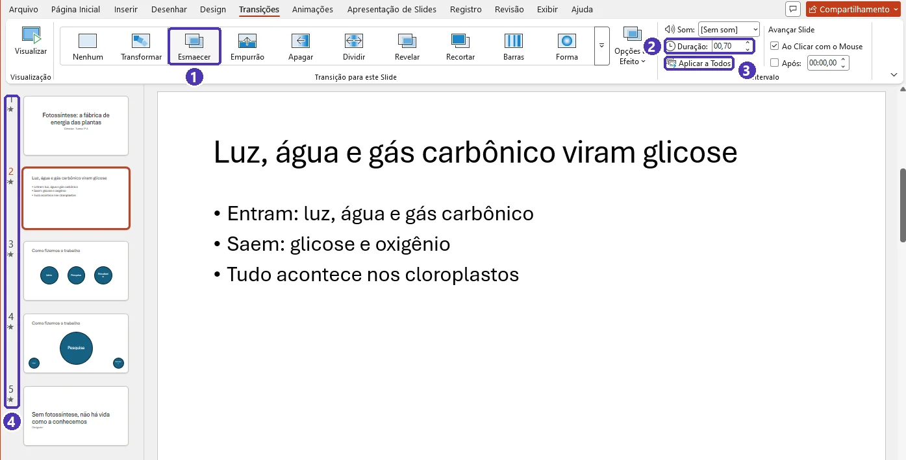
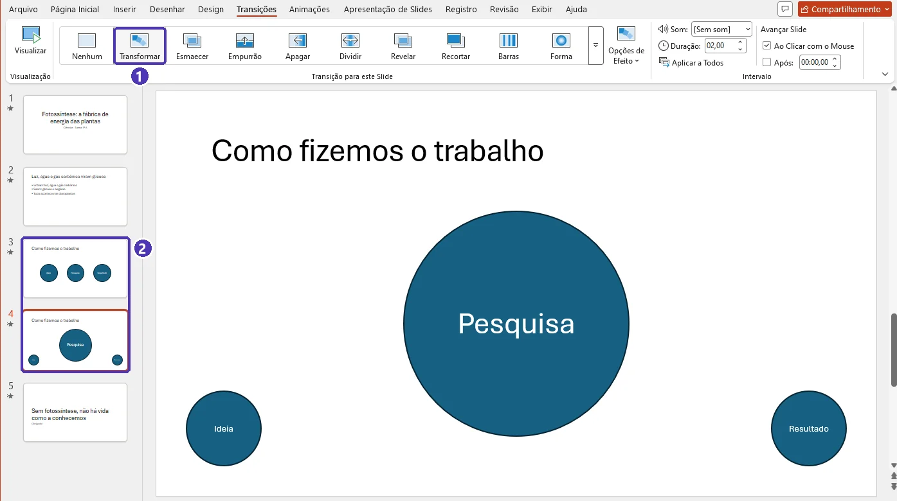
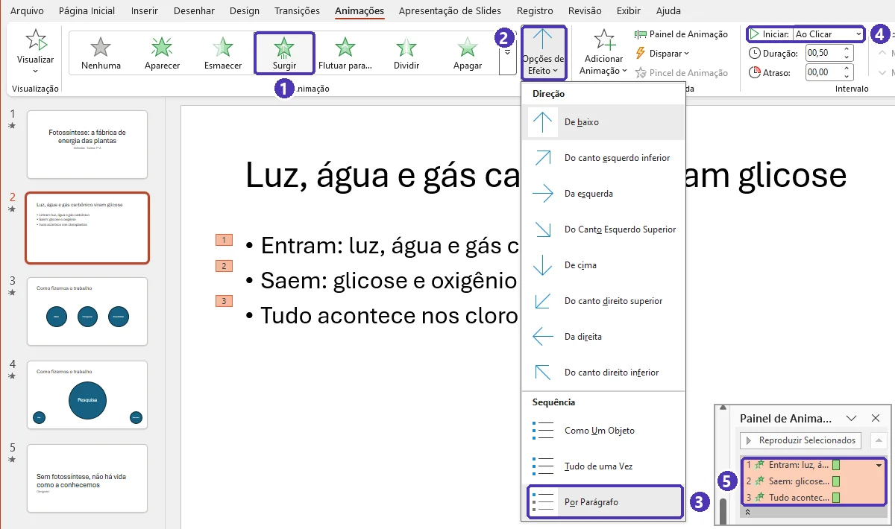
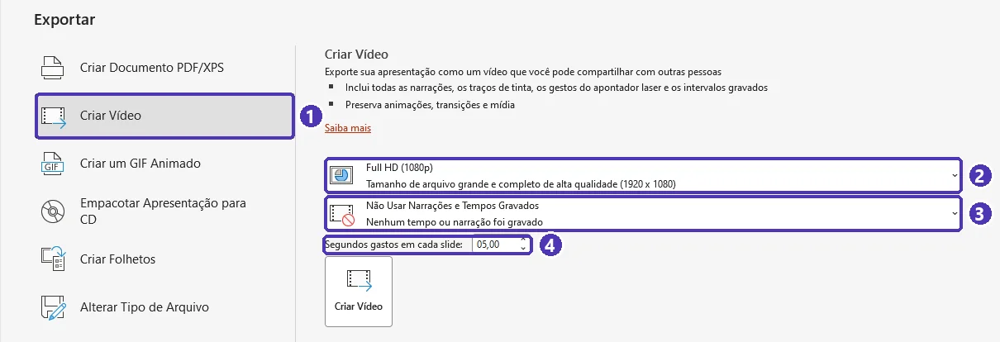

# 04 — Transições, animações e a hora de apresentar

> **Curso:** Pacote Office  
> **Módulo:** 03 — PowerPoint  
> **Tempo estimado:** 2 h  

---

## Objetivos

Ao final desta aula, você será capaz de:

- Usar **transições** e **animações** com moderação — para revelar, não para enfeitar.
- Controlar a ordem e o momento das animações no **Painel de Animação**.
- Criar movimento suave entre slides com a transição **Transformar**.
- Apresentar com o **Modo de Exibição do Apresentador**: anotações, próximo slide e cronômetro só na sua tela.
- Ensaiar com **Testar Intervalos**, ligar **legendas** ao vivo e exportar a apresentação em **vídeo**.

## Pré-requisitos

- [Aula 01](01_slides_layouts_e_texto.md): anotações e `F5`.
- [Aula 02](02_design_de_slides.md): uma ideia por slide.

---

## Transições: a passagem entre slides

Aba **Transições**: escolha o efeito, a **Duração** e clique em **Aplicar a Todos** para usar o mesmo efeito na apresentação inteira.

- Prefira os **sutis**: *Esmaecer*, *Empurrão*, *Revelar*. Um efeito discreto e igual em todos os slides passa a sensação de cuidado.
- Deixe os chamativos (*Vórtice*, *Cortina*, *Origami*...) para nada — ou para **um** momento especial.
- *Avançar Slide*: deixe **Ao Clicar com o Mouse**. Avançar sozinho depois de X segundos é para quiosques e vídeos, não para aulas.

<figure markdown="span">
  { loading=lazy }
  <figcaption>(1) <em>Esmaecer</em> · (2) <em>Duração</em> em segundos · (3) <strong>Aplicar a Todos</strong> · (4) a estrelinha ao lado do número mostra que o slide tem transição.</figcaption>
</figure>

### Transformar

A transição **Transformar** anima os objetos que aparecem **nos dois slides**: eles “deslizam”, crescem ou mudam de cor de um slide para o outro.

1. Monte o slide 1.
2. Botão direito na miniatura ➔ **Duplicar Slide**.
3. No slide 2, **mude** os mesmos objetos: posição, tamanho, cor (pode também apagar ou acrescentar).
4. Selecione o slide 2 ➔ *Transições* ➔ **Transformar**.

Fica ótimo para aproximar uma parte de uma imagem (um mapa, um diagrama) ou para destacar um item de uma lista.

<figure markdown="span">
  { loading=lazy }
  <figcaption>(1) <em>Transformar</em>, aplicado ao <strong>segundo</strong> slide · (2) o slide 4 é uma cópia do 3 com os mesmos círculos em outro tamanho e lugar: na apresentação, eles deslizam e crescem.</figcaption>
</figure>

!!! info "Transformar no Microsoft 365"
    A transição Transformar existe no PowerPoint do Microsoft 365 (e nas versões 2019 em diante). Em versões antigas, ela aparece como *Esmaecer*.

---

## Animações: o que aparece dentro do slide

Selecione o objeto ➔ aba **Animações** ➔ escolha o efeito.

| Tipo | Cor do ícone | Para quê |
|---|---|---|
| **Entrada** | verde | fazer algo **aparecer** (*Aparecer*, *Esmaecer*, *Surgir*) |
| **Ênfase** | amarelo | chamar atenção para algo que já está lá (*Pulso*, *Cor de Preenchimento*) |
| **Saída** | vermelho | fazer algo **sumir** |
| **Trajetórias de Animação** | — | mover um objeto por um caminho |

### Os controles que importam

- **Opções de Efeito ➔ Por Parágrafo:** os tópicos aparecem **um de cada vez**, a cada clique — a plateia acompanha você em vez de ler tudo adiantado. É o uso mais útil de animação.
- **Iniciar:** *Ao Clicar* (espera o seu clique), *Com o Anterior* (junto com a animação anterior), *Após o Anterior* (logo depois dela).
- **Duração** e **Atraso:** em segundos. Animações rápidas (0,5 s) incomodam menos.
- **Painel de Animação:** mostra todas as animações do slide em ordem. Arraste para reordenar; clique na seta de um item para mudar o início ou removê-lo.
- **Pincel de Animação:** copia a animação de um objeto para outro, como o pincel de formatação.

<figure markdown="span">
  { loading=lazy }
  <figcaption>(1) <em>Surgir</em> · (2) <em>Opções de Efeito</em> · (3) <strong>Por Parágrafo</strong> · (4) <em>Iniciar: Ao Clicar</em> · (5) no <em>Painel de Animação</em>, um item por tópico (o grupo vem recolhido: clique na setinha embaixo dele para ver os itens).</figcaption>
</figure>

!!! warning "Animação com propósito"
    Pergunte: **essa animação ajuda a entender?** Revelar tópicos um a um, mostrar as etapas de um processo, destacar um número do gráfico — sim. Título girando, texto quicando, cada slide com um efeito diferente — não: a plateia presta atenção no efeito, não na ideia.

---

## O Modo de Exibição do Apresentador

Com um projetor ou uma segunda tela ligados, o PowerPoint mostra **o slide** para a plateia e, **só na sua tela**:

- o slide atual e o **próximo**;
- as suas **anotações** (com botões para aumentar a letra);
- o **cronômetro** e o relógio;
- ferramentas: **caneta** e **ponteiro laser**, **ver todos os slides**, **lupa** (zoom em uma parte do slide) e **tela preta**.

Para ativar: *Apresentação de Slides ➔* grupo *Monitores* ➔ marque **Usar Modo de Exibição do Apresentador** e, em *Monitor*, escolha a tela do projetor (com a janela estreita, os dois ficam dentro do botão **Monitores**). Para treinar sem projetor: `Alt + F5` abre a apresentação já no modo do apresentador; ou comece com `F5` e, no menu **…** do canto inferior esquerdo, escolha **Mostrar Modo de Exibição do Apresentador**.

<figure markdown="span">
  { loading=lazy }
  <figcaption>Só na sua tela: (1) o cronômetro, com pausar e reiniciar (o relógio fica à direita) · (2) o próximo slide · (3) as anotações e os botões para aumentar a letra · (4) caneta, todos os slides, lupa, tela preta, legendas e o menu <strong>…</strong>.</figcaption>
</figure>

!!! tip "No Windows, `Windows + P`"
    Se o projetor está mostrando a mesma imagem do seu computador (anotações à vista de todos!), aperte `Windows + P` e escolha **Estender**. *Duplicar* mostra a mesma tela nos dois.

### Teclas durante a apresentação

| Tecla | Ação |
|---|---|
| `→`, `Enter`, `Espaço` | próximo slide ou próxima animação |
| `←`, `Backspace` | volta |
| número + `Enter` | vai direto para o slide (ex.: `5` `Enter`) |
| `.` (ponto) | **tela preta** — a plateia olha para você; aperte de novo para voltar |
| `,` (vírgula) | tela branca |
| `Esc` | encerra |

---

## Ensaiar, legendas e vídeo

- **Testar Intervalos:** *Apresentação de Slides* ➔ **Testar Intervalos**. A apresentação começa com um cronômetro; ao final, o PowerPoint mostra o tempo total e pergunta se quer **salvar os intervalos**. Responda **Não** se você vai apresentar ao vivo — senão os slides passam sozinhos. Para ver o tempo de cada slide: *Exibir ➔ Classificação de Slides*.
- **Legendas ao vivo:** *Apresentação de Slides* ➔ **Configurações de Legendas** ➔ escolha o idioma falado (*Português (Brasil)*) e o das legendas ➔ marque **Sempre Usar Legendas**. Durante a apresentação, o PowerPoint escreve na tela o que você fala — ajuda quem tem deficiência auditiva e quem está no fundo da sala. Precisa de internet e de um microfone.
- **Gravar:** *Apresentação de Slides* ➔ **Registro** (em outras versões, *Gravar*): grava a sua voz (e, se quiser, a câmera) junto com os slides — bom para aulas a distância.
- **Vídeo:** *Arquivo ➔ Exportar* ➔ **Criar Vídeo**: escolha a qualidade e se usa os intervalos e as narrações gravados.

<figure markdown="span">
  { loading=lazy }
  <figcaption>(1) <em>Testar Intervalos</em> · (2) <em>Usar Intervalos</em>: desmarque se salvou os intervalos sem querer · (3) <em>Usar Modo de Exibição do Apresentador</em>, dentro de <em>Monitores</em> · (4) os idiomas das legendas, em <em>Configurações de Legendas</em>.</figcaption>
</figure>

!!! info "Ensaio com treinador"
    O PowerPoint do Microsoft 365 também tem um ensaio com treinador automático, que comenta o ritmo da fala e as palavras repetidas. Por enquanto ele só funciona com o Office em **inglês**; em português, peça a um colega para fazer o papel de treinador.

---

## Na hora de apresentar

- **Leve dois formatos**, em dois lugares: `.pptx` e PDF, no pendrive **e** na nuvem (OneDrive, e-mail).
- **Chegue antes** e teste o projetor, o cabo, o som e o passador de slides.
- **Comece pela mensagem principal** e termine voltando a ela.
- **Fale para a plateia**, não para a tela. Olhe a tela do computador, não o projetor atrás de você.
- **Respeite o tempo.** Passou do tempo nos ensaios? Corte slides, não aumente a velocidade.
- **Perguntas:** se não souber, diga que vai pesquisar e responda depois. Faz parte.

---

??? note "Equivalentes gratuitos: LibreOffice Impress e Google Apresentações"
    | Tarefa | LibreOffice Impress | Google Apresentações |
    |---|---|---|
    | Transições | Painel *Transição de slides* (*Slide ➔ Transição de slides*) | *Slide ➔ Transição* |
    | Animação por tópico | Painel *Animação* ➔ *Opções de efeito ➔ Animação de texto* | *Inserir ➔ Animação* ➔ *Por parágrafo* |
    | Parecido com Transformar | Não tem | Transição *Magic Motion* (*Slide ➔ Transição*) |
    | Modo do apresentador | *Apresentação de slides ➔ Configurações* ➔ *Console do apresentador* | Setinha de *Apresentação de slides ➔ Visualização do apresentador* |
    | Legendas ao vivo | Não tem | Botão *CC* durante a apresentação (`Ctrl + Shift + C`) |
    | Ensaiar com tempo | *Apresentação de slides ➔ Cronometrar* | Não tem; use o cronômetro da visualização do apresentador |

---

## ⚠️ Erros comuns

- **Uma transição diferente em cada slide.** Parece desorganizado. Uma só, discreta, em todos.
- **Animação “Ao Clicar” em tudo.** Você passa a apresentação clicando sem parar. Use *Com o Anterior* e *Após o Anterior* para juntar o que pode aparecer junto.
- **Salvar os intervalos do ensaio sem querer.** Na apresentação real, os slides passam sozinhos. Desmarque em *Apresentação de Slides ➔ Usar Intervalos*.
- **Projetor duplicando a tela.** Suas anotações aparecem para todos. `Windows + P` ➔ *Estender*.
- **Depender só da internet.** Rede da escola caiu, apresentação na nuvem não abre. Leve uma cópia no pendrive.

---

## Exercícios

### Básico (fixação)

Na sua apresentação (do exercício intermediário da aula 01):

1. Aplique a transição **Esmaecer** com duração de **0,7 s** em **todos** os slides.
2. Em um slide de tópicos, faça os tópicos aparecerem **um por clique**, com a entrada **Surgir**.

<!-- gabarito -->
??? success "Gabarito — Básico"
    1. Qualquer slide ➔ *Transições ➔ Esmaecer* ➔ *Duração:* `00,70` ➔ **Aplicar a Todos**. As miniaturas ganham um pequeno ícone de estrela, indicando que têm transição.
    2. Clique na **borda** da caixa dos tópicos (não dentro do texto) ➔ *Animações ➔ Surgir* ➔ *Opções de Efeito* ➔ **Por Parágrafo** ➔ *Iniciar:* **Ao Clicar**.

    **Confira:** `Shift + F5` nesse slide ➔ cada clique mostra um tópico. No *Painel de Animação*, os tópicos aparecem agrupados; clique na setinha embaixo do grupo para ver os itens numerados 1, 2, 3...

### Intermediário (aplicação)

1. Crie um slide com **três círculos** pequenos e lado a lado, cada um com uma palavra (*Ideia*, *Pesquisa*, *Resultado*). Duplique o slide e, na cópia, deixe **um** círculo grande no centro e os outros dois pequenos no canto. Use **Transformar** para passar de um slide para o outro.
2. Em um slide com um gráfico, faça o gráfico aparecer **por categoria** (uma série ou categoria de cada vez) e, junto com a última, um texto com a conclusão.

<!-- gabarito -->
??? success "Gabarito — Intermediário"
    1. *Inserir ➔ Formas ➔ Elipse* (segure `Shift` ao desenhar para sair um círculo) ➔ escreva a palavra ➔ com `Ctrl` + arrastar, faça mais duas cópias e troque as palavras. Botão direito na miniatura ➔ *Duplicar Slide*. No slide novo: aumente o círculo *Pesquisa* e leve-o ao centro; diminua e mova os outros dois. Com o slide novo selecionado: *Transições* ➔ **Transformar**. Teste com `Shift + F5` a partir do primeiro.
        - Os objetos precisam ser **os mesmos** (vindos da duplicação). Um círculo desenhado de novo não “desliza”: ele só aparece com esmaecimento.
    2. Selecione o gráfico ➔ *Animações ➔ Esmaecer* ➔ *Opções de Efeito* ➔ **Por Categoria** (ou *Por Série*). Insira a caixa de texto da conclusão ➔ *Animações ➔ Esmaecer* ➔ *Iniciar:* **Com o Anterior**. No *Painel de Animação*, arraste a conclusão para logo **depois** da última parte do gráfico.

### Avançado (desafio)

Prepare o ensaio final da sua apresentação:

1. Ensaie com **Testar Intervalos** e anote o tempo total e o slide mais demorado — **sem** salvar os intervalos.
2. Treine no **Modo de Exibição do Apresentador**: use a **lupa** em um detalhe, vá para o último slide pela **visão de todos os slides** e use a **tela preta**.
3. Ligue as **legendas ao vivo** em português e apresente um slide falando.
4. Exporte a apresentação em **vídeo** e em **PDF**.

<!-- gabarito -->
??? success "Gabarito — Avançado"
    1. *Apresentação de Slides ➔ Testar Intervalos* ➔ apresente normalmente ➔ no fim, anote o tempo que o PowerPoint mostra ➔ responda **Não** à pergunta sobre salvar. (Se respondeu Sim: desmarque *Apresentação de Slides* ➔ **Usar Intervalos**.) Para saber o slide mais demorado, ensaie com o cronômetro do Modo do Apresentador e anote por slide.
    2. `Alt + F5` (ou `F5` ➔ menu **…** ➔ *Mostrar Modo de Exibição do Apresentador*). Lupa: ícone de **lupa** embaixo do slide ➔ clique na área ➔ `Esc` sai do zoom. Todos os slides: ícone de **grade** ➔ clique no último. Tela preta: tecla **`.`** (ponto) ou o ícone correspondente; aperte de novo para voltar.
    3. *Apresentação de Slides ➔ Configurações de Legendas* ➔ *Idioma Falado:* **Português (Brasil)** ➔ *Idioma da Legenda:* **Português (Brasil)** ➔ **Sempre Usar Legendas** ➔ `F5` e fale. Se não aparecer: confira o microfone e a internet.
    4. *Arquivo ➔ Exportar ➔ Criar Vídeo* ➔ qualidade **Full HD (1080p)** ➔ *Não Usar Narrações e Tempos Gravados* (cada slide fica o tempo de *Segundos gastos em cada slide*: 5 s, se você não mudar) ➔ botão *Criar Vídeo*. E *Arquivo ➔ Exportar ➔ Criar Documento PDF/XPS*.

        { loading=lazy }

    **Meta para uma apresentação de 5 minutos:** tempo de ensaio entre **4 min 30 s** e **5 min 30 s**. Se um slide sozinho leva mais de 1 min 30 s, ele provavelmente tem duas ideias.

---

## 💡 Resumo

- **Transição:** uma só, discreta, em todos os slides (*Aplicar a Todos*). **Transformar** anima o que existe nos dois slides.
- **Animação** para revelar: tópicos **Por Parágrafo**, gráfico por categoria. Ordem no **Painel de Animação**.
- **Modo do Apresentador:** anotações, próximo slide e cronômetro só para você; `Windows + P` ➔ *Estender*.
- `.` tela preta · número + `Enter` vai ao slide · `Esc` encerra.
- **Testar Intervalos** para ensaiar (sem salvar); **legendas** para incluir; **vídeo** e **PDF** para compartilhar.

## ➡️ Próximo passo

**[05 — Projeto do módulo: apresentação do trabalho escolar](05_projeto_apresentacao_do_trabalho.md)**: juntar o trabalho do Word e o gráfico do Excel em uma apresentação de 5 a 7 minutos — e apresentar.
