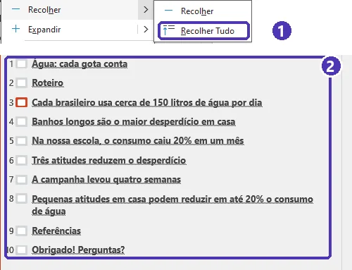
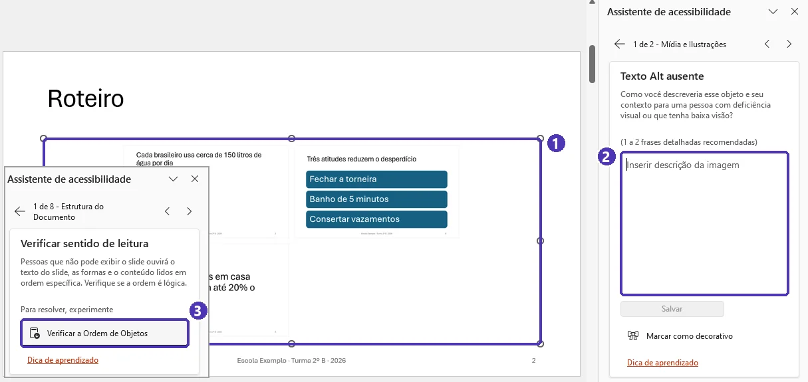

# 05 — Projeto do módulo: apresentação do trabalho escolar

> **Curso:** Pacote Office  
> **Módulo:** 03 — PowerPoint  
> **Tempo estimado:** 2 h 30 min (mais o tempo de ensaiar)  

---

## Objetivos

Ao final deste projeto, você terá:

- Uma apresentação de **5 a 7 minutos** sobre o seu trabalho escolar — o mesmo do [projeto do Módulo 01](../modulo_01_word/05_projeto_trabalho_abnt.md) ou outro combinado com o professor.
- Os slides padronizados pelo **Slide Mestre**, com número, rodapé e títulos que contam a história.
- Pelo menos um **gráfico ou tabela** vindo do Excel e um **diagrama** (SmartArt).
- **Anotações** com a sua fala, slides **acessíveis** e a apresentação **ensaiada** dentro do tempo.
- A apresentação feita para a turma, com **avaliação de um colega**, e a entrega em **PDF**.

## Pré-requisitos

- [Aulas 01 a 04](index.md) deste módulo.
- Um tema com conteúdo pronto. O ideal é o trabalho escrito no Word; se não tiver, combine um tema com o professor.

---

## A estrutura da apresentação

| Slide | O que tem | Dica |
|---|---|---|
| **1. Capa** | Título, seu nome, turma, disciplina e data | Layout *Slide de Título* |
| **2. Roteiro** | As 3 ou 4 partes da apresentação | Pode ser um SmartArt de processo ou um *Zoom de Resumo* |
| **3. Introdução** | O tema e **por que importa** | Comece com uma pergunta, um número ou uma imagem forte |
| **4 a 7. Desenvolvimento** | Uma ideia por slide | Pelo menos um gráfico/tabela e um diagrama |
| **8. Conclusão** | A **mensagem principal**, em uma frase | É o slide que a plateia deve lembrar |
| **9. Referências** | As obras citadas, no padrão ABNT | Letra menor é aceitável aqui (mínimo 16 pt) |
| **10. Perguntas** | “Obrigado! Perguntas?” e seu contato da escola | Opcional |

<figure markdown="span">
  { loading=lazy }
  <figcaption>Um exemplo montado com dados inventados. Repare nos títulos: lidos em sequência, contam a história do trabalho.</figcaption>
</figure>

!!! info "Citação no slide"
    Dado ou frase de um autor no slide leva a fonte curta: (Sobrenome, ano). A referência completa vai no slide de **Referências**, como no trabalho escrito (aula 03 do Módulo 01).

!!! tip "Zoom de Resumo"
    *Inserir ➔ Zoom* ➔ **Zoom de Resumo** cria um slide com miniaturas das seções. Na apresentação, clicar em uma miniatura leva até a seção e volta ao resumo no final — ótimo para o slide de roteiro. Antes, divida a apresentação em **seções** (aula 01). O slide novo vem numa seção própria (*Seção do Resumo*) e **sem título**: escreva “Roteiro” e dê um **texto alternativo** ao zoom.

<figure markdown="span">
  { loading=lazy }
  <figcaption>(1) <em>Inserir ➔ Zoom ➔ Zoom de Resumo</em> · (2) o PowerPoint já marca o primeiro slide de cada seção (desmarque a capa, se quiser) · (3) o slide de roteiro, com uma miniatura clicável por seção · (4) a seção nova criada para ele.</figcaption>
</figure>

---

## Passo a passo

### 1. Roteiro (aula 01)

- Escreva **a mensagem principal** em uma frase. Exemplo: “Pequenas atitudes em casa podem reduzir em até 20% o consumo de água”.
- Monte o roteiro no **Modo de Exibição de Estrutura de Tópicos**: só títulos e palavras-chave.
- Escreva as **anotações** de cada slide com o que você vai falar.

### 2. Padrão visual (aulas 02 e 03)

- Tema e variante; fontes e cores do tema.
- **Slide Mestre:** faixa ou logotipo da escola; *Cabeçalho e Rodapé* com número e rodapé, menos na capa.
- **Títulos que afirmam**; letra de pelo menos 24 pt.

### 3. Elementos visuais (aulas 02 e 03)

- Um **gráfico** ou **tabela** do Excel, com título que diz a conclusão.
- Um **SmartArt** (processo, ciclo, comparação...).
- Imagens com **licença** e **crédito**; **texto alternativo** em todas.

### 4. Movimento e ensaio (aula 04)

- Uma **transição** discreta em todos os slides; tópicos aparecendo **por parágrafo** onde fizer sentido.
- Ensaie com **Testar Intervalos** (sem salvar) e no **Modo de Exibição do Apresentador**.

### 5. Apresentação e entrega

- Apresente para a turma; um colega preenche a ficha de avaliação.
- Corrija o que a avaliação apontou e entregue o **PDF**.

---

## ✅ Checklist de entrega

- [ ] De 8 a 10 slides, com **capa**, **roteiro**, **conclusão** e **referências**.
- [ ] Lendo **só os títulos**, dá para entender a história.
- [ ] Nenhum slide com parágrafo inteiro; letra de pelo menos 24 pt (16 pt nas referências).
- [ ] Padrão pelo **Slide Mestre**: número e rodapé em todos, menos na capa.
- [ ] Pelo menos **um gráfico ou tabela** e **um SmartArt**.
- [ ] Imagens com crédito e texto alternativo; *Verificar Acessibilidade* com **todos os problemas resolvidos** (✔).
- [ ] Uma transição só, discreta; animações apenas para revelar.
- [ ] **Anotações** em todos os slides de conteúdo.
- [ ] Ensaiada entre **5 e 7 minutos**, **sem** intervalos salvos.
- [ ] Entregue em **PDF**, com o `.pptx` guardado.

---

## Ficha de avaliação do colega

Copie para um papel ou para um formulário. Cada item vale de 1 (precisa melhorar) a 3 (muito bom).

| Critério | 1 | 2 | 3 |
|---|---|---|---|
| Entendi a **mensagem principal** |   |   |   |
| Os slides eram **fáceis de ler** do meu lugar |   |   |   |
| O apresentador **falou para a turma**, sem ler os slides |   |   |   |
| O **gráfico ou tabela** ajudou a entender |   |   |   |
| Respeitou o **tempo** (5 a 7 minutos) |   |   |   |
| **Uma coisa para melhorar:** | | | |

---

## Exercícios

O projeto tem três entregas, uma por nível. Faça na ordem.

### Básico (fixação)

Monte o **esqueleto**: mensagem principal escrita nas anotações da capa, todos os slides da estrutura com títulos que afirmam e palavras-chave, **anotações** com a sua fala e o padrão visual pelo **Slide Mestre**.

<!-- gabarito -->
??? success "Gabarito — Básico"
    Confira o esqueleto contra esta lista:

    1. **Estrutura de Tópicos** (*Exibir*) com 8 a 10 linhas sem recuo — uma por slide — na ordem da tabela da aula.
    2. Títulos que **afirmam**: “Banhos longos são o maior desperdício em casa” em vez de “Desperdício”.
    3. *Exibir ➔ Normal*: layouts certos (capa com *Slide de Título*; divisões com *Cabeçalho da Seção*).
    4. *Exibir ➔ Slide Mestre*: fonte do título e faixa/logotipo no **slide grande do topo**. *Inserir ➔ Cabeçalho e Rodapé*: número ✓, rodapé ✓, *Não mostrar no slide de título* ✓, *Aplicar a todas*.
    5. Anotações em todos os slides de conteúdo — frases completas, como você vai falar.

    **Teste rápido:** na Estrutura de Tópicos, botão direito na lista ➔ setinha de *Recolher* ➔ **Recolher Tudo** (clicar no próprio *Recolher* recolhe só o slide atual). Leia só os títulos em voz alta: deve soar como um resumo do trabalho. Slides com gráfico, SmartArt ou tabela aparecem ali só com o título — mais um motivo para o título dizer a conclusão.

    { loading=lazy }

### Intermediário (aplicação)

Complete o **conteúdo visual**: o gráfico ou a tabela do Excel, o SmartArt, as imagens com crédito e texto alternativo, a transição e as animações. Termine com o **Verificador de Acessibilidade** sem erros.

<!-- gabarito -->
??? success "Gabarito — Intermediário"
    1. **Gráfico:** monte os dados no Excel ➔ gráfico ➔ `Ctrl + C` ➔ no PowerPoint, *Colar* ➔ **Usar Tema de Destino e Inserir Pasta de Trabalho** (para entregar, é mais seguro que vincular). Título do slide = a conclusão do gráfico; letras do gráfico com 18 pt ou mais.
    2. **SmartArt:** nos tópicos de um slide de processo ou comparação ➔ *Página Inicial ➔ Converter em SmartArt*.
    3. **Imagens:** *Imagens de Banco de Imagens* ou *Imagens Online* com **Somente Creative Commons**; crédito no canto; *Exibir Texto Alt* em cada uma.
    4. **Movimento:** *Transições ➔ Esmaecer ➔ Aplicar a Todos*; nos slides de tópicos, *Animações ➔ Surgir ➔ Por Parágrafo*.
    5. *Revisão ➔ Verificar Acessibilidade* ➔ no *Assistente de acessibilidade*, corrija até todos os tipos de problema ficarem com ✔. Atenção: o **Zoom de Resumo** e o **SmartArt** também pedem texto alternativo. O item **Verificar sentido de leitura** não é um erro: é um pedido para você conferir, em cada slide, a ordem em que o leitor de tela lê os objetos (botão *Verificar a Ordem de Objetos*).

    { loading=lazy }

    (1) O Zoom de Resumo sem texto alternativo · (2) escreva a descrição ali mesmo e clique em *Salvar* · (3) a conferência da ordem de leitura.

    **Se o slide de referências não passar no verificador** por causa do contraste ou da letra: aumente para 16 pt e use a cor de texto do tema.

### Avançado (desafio)

1. Ensaie até ficar entre **5 e 7 minutos**, usando o **Modo de Exibição do Apresentador**.
2. **Apresente para a turma.** Um colega preenche a **ficha de avaliação**.
3. Faça **pelo menos uma melhoria** apontada na ficha e entregue o **PDF** final.

<!-- gabarito -->
??? success "Gabarito — Avançado"
    - **Ensaio:** *Testar Intervalos* para medir o total (responda **Não** ao salvar). Passou de 7 minutos? Corte o slide menos importante do desenvolvimento ou junte dois. Ficou abaixo de 5? Falta explicar algo — veja nas anotações o que você está pulando.
    - **No dia:** `.pptx` e PDF no pendrive **e** na nuvem; teste o projetor antes; `Windows + P` ➔ **Estender**; `F5`. Comece pela mensagem principal, termine voltando a ela.
    - **Depois:** leia a ficha. Os pontos mais comuns e a correção:
        - *“Não entendi a mensagem principal”* ➔ ela não estava clara na conclusão. Escreva-a como título do slide final.
        - *“Letra pequena”* ➔ cortar texto, não diminuir a letra.
        - *“Leu os slides”* ➔ menos texto no slide; mais nas anotações; ensaiar olhando para a plateia.
        - *“Gráfico confuso”* ➔ menos séries, rótulos de dados, título com a conclusão.
    - **Entrega:** *Arquivo ➔ Exportar ➔ Criar Documento PDF/XPS* e abra o PDF para conferir.

    **Critérios que o professor costuma olhar:** mensagem clara; títulos que contam a história; slides limpos e acessíveis; uso de dados (gráfico/tabela) com fonte; fala para a turma, dentro do tempo; melhoria feita depois do retorno do colega.

---

## 💡 Resumo do módulo

Você saiu da apresentação em branco para uma apresentação que comunica — e para a coragem de apresentar:

- **Roteiro antes do visual:** público, tempo e mensagem principal.
- **Slides claros:** uma ideia por slide, título que afirma, letra grande, imagens com crédito.
- **Padrão em um lugar só:** tema, **Slide Mestre**, modelos.
- **Dados que convencem:** gráficos e tabelas do Excel e diagramas SmartArt.
- **Movimento com propósito** e o **Modo do Apresentador** para falar com segurança.
- **Acessibilidade** e **entrega em PDF**.

## ➡️ Próximo passo

**[Módulo 04 — Trabalho em equipe e alternativas gratuitas](../modulo_04_equipe_e_alternativas/index.md)**: OneDrive, Teams e Outlook no dia a dia — e como fazer tudo isso no LibreOffice e no Google Workspace.
