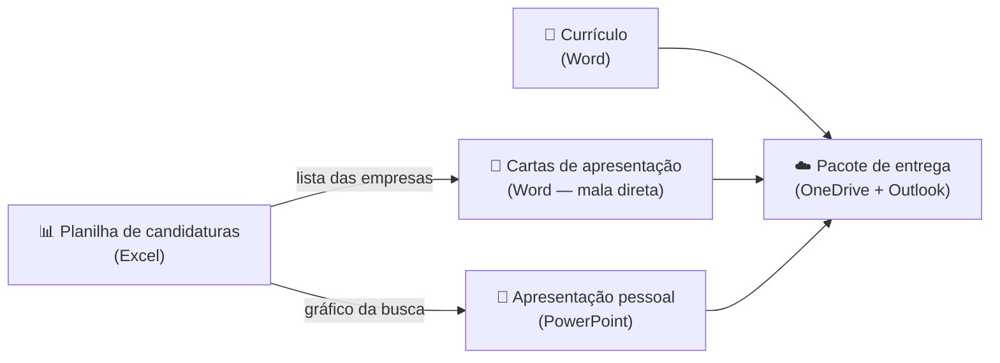

# 01 — O projeto e o planejamento

> **Curso:** Pacote Office  
> **Módulo:** 05 — Projeto final integrado  
> **Tempo estimado:** 1 h 30 min  

---

## Objetivos

Ao final desta aula, você será capaz de:

- Entender o **cenário** do projeto final e as **quatro entregas**.
- Ver como **Word**, **Excel**, **PowerPoint** e as ferramentas de **equipe** se ligam em um único trabalho.
- Definir o seu **objetivo profissional** e as palavras-chave das vagas que você procura.
- Montar a **pasta** do projeto na nuvem e um **cronograma** com prazos.
- Conhecer os **critérios de avaliação** antes de começar.

## Pré-requisitos

- Os módulos [01 — Word](../modulo_01_word/index.md), [02 — Excel](../modulo_02_excel/index.md), [03 — PowerPoint](../modulo_03_powerpoint/index.md) e [04 — Trabalho em equipe](../modulo_04_equipe_e_alternativas/index.md).

---

## O cenário: a sua primeira candidatura

Você vai se preparar para buscar uma vaga de **Jovem Aprendiz**, **estágio** ou **primeiro emprego** — de verdade ou como simulação. Para isso, vai produzir o “kit” que qualquer pessoa precisa para procurar trabalho:

| Entrega | Ferramenta | O que é |
|---|---|---|
| **1. Planilha de candidaturas** | Excel | Controle das vagas: para onde você mandou, quando, o que respondeu, quem precisa ser cobrado |
| **2. Currículo e carta de apresentação** | Word | Um currículo de uma página e cartas personalizadas para cada empresa, geradas por **mala direta** a partir da planilha |
| **3. Apresentação pessoal** | PowerPoint | Um *pitch* de 3 minutos: quem você é, o que sabe fazer e o que procura |
| **4. Pacote de entrega** | OneDrive + Outlook | Tudo em uma pasta na nuvem, em PDF, e o e-mail de candidatura |

Como as peças se ligam:



!!! info "Simulação também vale"
    Se você ainda não pode (ou não quer) se candidatar a uma vaga real, faça como simulação: as empresas podem ser de verdade, mas o e-mail de candidatura vai para o **professor** ou para um **colega**. O que importa é o kit pronto para quando precisar.

---

## Seus dados, seu cuidado

Um currículo tem dados pessoais. Antes de começar:

- **Coloque:** nome, cidade e estado, e-mail **profissional** (algo como `nome.sobrenome@...`), telefone e, se tiver, link de portfólio ou LinkedIn.
- **Não coloque:** CPF, RG, endereço completo, data de nascimento completa, estado civil, religião, foto (a não ser que a vaga peça). Eles não são necessários para a seleção e expõem você.
- **Compartilhe com cuidado:** a pasta do projeto deve ficar com **Pessoas específicas** (aula 01 do Módulo 04) — nunca “Qualquer pessoa com o link”.

!!! warning "E-mail profissional"
    `gatinha_2009@...` ou `matador.gamer@...` não passam pela primeira triagem. Se precisar, crie um e-mail só para estudos e trabalho.

---

## Planejamento

### 1. Objetivo profissional

Uma ou duas frases que dizem **o que você procura** e **o que oferece**. Exemplo:

> Busco vaga de Jovem Aprendiz na área administrativa, onde possa aplicar meus conhecimentos de Word, Excel e organização para apoiar a equipe.

### 2. Palavras-chave das vagas

Leia anúncios de vagas parecidas com a que você quer (sites de emprego, programas de aprendizagem, murais da escola) e anote as **palavras que se repetem**: “atendimento ao público”, “Excel”, “organização”, “comunicação”, “trabalho em equipe”. Elas vão aparecer no currículo, na carta e na apresentação — **sempre com uma prova** (um curso, um projeto, uma experiência).

### 3. Pasta do projeto

```text
Projeto Final - Seu Nome/
├── 01 Planilha/        candidaturas.xlsx
├── 02 Word/            curriculo.docx · carta_modelo.docx · cartas (PDF)
├── 03 PowerPoint/      apresentacao_pessoal.pptx
├── 04 Entrega/         os PDFs finais
└── Cronograma          (planilha com as etapas e os prazos)
```

### 4. Cronograma sugerido

| Etapa | Aula | Tempo |
|---|---|---|
| Planejamento e pasta | 01 | 1 h 30 min |
| Planilha de candidaturas | 02 | 2 h |
| Currículo e cartas | 03 | 2 h |
| Apresentação pessoal e ensaio | 04 | 2 h |
| Integração, revisão e entrega | 05 | 1 h 30 min |

---

## Como o projeto é avaliado

| Critério | O que conta |
|---|---|
| **Planilha** | Tabela, fórmulas no lugar de contas à mão, lista suspensa, destaques, painel com gráfico |
| **Currículo** | Uma página, estilos, nada de dado sensível, palavras-chave com prova, PDF |
| **Cartas** | Geradas por mala direta, personalizadas, sem erros |
| **Apresentação** | 3 minutos, slides limpos, gráfico da planilha, anotações, ensaio |
| **Entrega** | Pasta organizada e com permissões certas, e-mail formal, tudo em PDF |
| **Integração** | Os mesmos dados e a mesma mensagem nas três peças |

---

??? note "Sem Microsoft Office? O projeto também funciona de graça"
    | Entrega | LibreOffice | Google Workspace |
    |---|---|---|
    | Planilha | Calc | Planilhas |
    | Currículo e cartas | Writer (mala direta em *Ferramentas ➔ Assistente de mala direta*) | Docs (sem mala direta nativa: faça as cartas copiando o modelo) |
    | Apresentação | Impress | Apresentações |
    | Pasta e e-mail | Pasta no computador ou no Google Drive; qualquer e-mail | Drive e Gmail |

---

## ⚠️ Erros comuns

- **Começar pelo currículo “bonito”** sem saber que vaga você procura. O objetivo e as palavras-chave vêm primeiro.
- **Copiar um objetivo genérico** (“busco uma oportunidade para crescer profissionalmente”). Diga **qual** vaga e **o que** você oferece.
- **Listar habilidades sem prova.** “Sei Excel” convence menos que “Fiz uma planilha de controle de notas com tabela dinâmica (curso Pacote Office)”.
- **Pasta com o link aberto para qualquer pessoa**, com o seu telefone dentro.

---

## Exercícios

### Básico (fixação)

Escreva, em um documento do Word, o seu **perfil profissional**:

1. Seu **objetivo profissional** em até duas frases.
2. **Três tipos de vaga** que combinam com você.
3. **Cinco palavras-chave** que aparecem nos anúncios dessas vagas.

<!-- gabarito -->
??? success "Gabarito — Básico"
    Um exemplo (o seu será diferente):

    1. **Objetivo:** “Busco vaga de Jovem Aprendiz na área administrativa, onde possa aplicar meus conhecimentos de Word, Excel e organização para apoiar a equipe.”
    2. **Vagas:** Jovem Aprendiz administrativo · auxiliar de atendimento · estágio em escritório.
    3. **Palavras-chave:** atendimento ao público · pacote Office · organização · comunicação · trabalho em equipe.

    **Confira:** o objetivo diz **qual vaga** e **o que você oferece**; as palavras-chave vieram de **anúncios reais**, não da sua cabeça.

### Intermediário (aplicação)

1. Crie a **pasta do projeto** no OneDrive (ou no Google Drive), com as subpastas da aula, compartilhada **só com o professor**, como leitor.
2. Na pasta, crie uma planilha **Cronograma** com as etapas, o **prazo** de cada uma e um **status** em lista suspensa (*A fazer*, *Fazendo*, *Concluída*). Destaque em vermelho as etapas atrasadas.

<!-- gabarito -->
??? success "Gabarito — Intermediário"
    1. OneDrive: *Adicionar novo ➔ Pasta* ➔ `Projeto Final - Seu Nome` ➔ dentro dela, as quatro subpastas. *Compartilhar* a pasta principal ➔ **Pessoas específicas** ➔ **Pode exibir** ➔ e-mail do professor.
    2. Planilha `Cronograma`: colunas `Etapa`, `Prazo`, `Status` (A1:C1) e as cinco etapas da tabela da aula. Em C2:C6, *Dados ➔ Validação de Dados ➔ Lista* ➔ `A fazer;Fazendo;Concluída`. Em A2:C6, *Formatação Condicional ➔ Nova Regra ➔ Usar uma fórmula*:

        ```text
        =E($C2<>"Concluída";$B2<HOJE())
        ```

        com preenchimento vermelho claro. (É a mesma ideia do projeto do Módulo 04.)

### Avançado (desafio)

Escolha **cinco anúncios de vaga** e monte uma **matriz de evidências**: em uma tabela, liste os **requisitos** que mais aparecem e, ao lado de cada um, **uma prova** concreta que você tem (curso, projeto da escola, trabalho voluntário, atividade em casa). Marque os requisitos para os quais você ainda **não tem** prova e escreva como poderia conseguir uma.

<!-- gabarito -->
??? success "Gabarito — Avançado"
    Um exemplo de matriz:

    | Requisito (aparece em) | Minha prova | Falta? |
    |---|---|---|
    | Pacote Office (5 de 5 anúncios) | Curso Pacote Office: trabalho ABNT no Word, controle de notas no Excel, apresentação no PowerPoint | — |
    | Atendimento ao público (4 de 5) | Ajudo na loja da família aos sábados | — |
    | Organização (3 de 5) | Planilha de candidaturas e cronograma deste projeto | — |
    | Inglês básico (2 de 5) | — | Sim: fazer um curso on-line gratuito e citar no currículo |
    | Trabalho em equipe (3 de 5) | Trabalho em grupo na nuvem (Módulo 04), com papéis e ata | — |

    **Para que serve:** cada linha com prova vira um item do **currículo**, uma frase da **carta** e um slide da **apresentação**. As linhas com “Falta” viram o seu plano de estudo.

---

## 💡 Resumo

- O projeto tem **quatro entregas**: planilha, currículo e cartas, apresentação e pacote de entrega.
- A **planilha** alimenta as **cartas** (mala direta) e a **apresentação** (gráfico).
- Comece pelo **objetivo** e pelas **palavras-chave**; cada habilidade precisa de uma **prova**.
- Dados pessoais com cuidado: nada de CPF, RG ou endereço completo; pasta só para **pessoas específicas**.

## ➡️ Próximo passo

**[02 — Planilha de candidaturas](02_planilha_de_candidaturas.md)**: a planilha que controla a sua busca e alimenta as outras peças.
