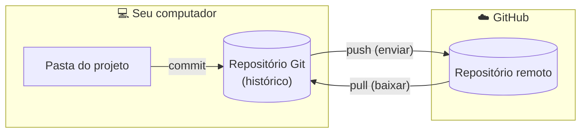
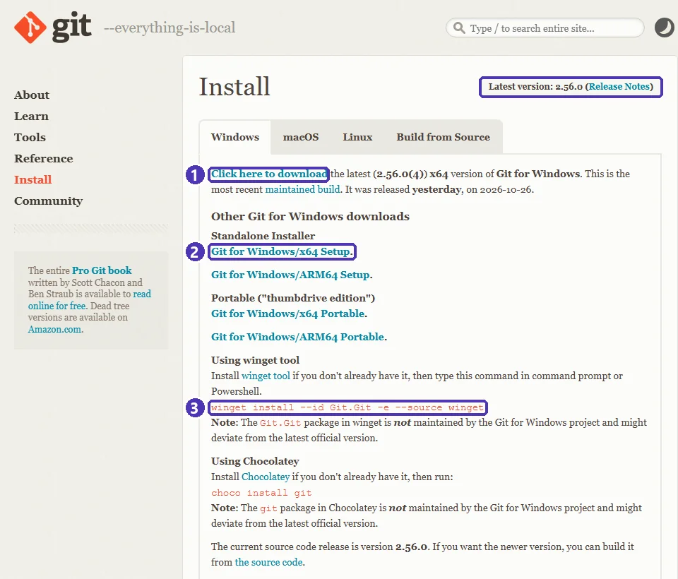
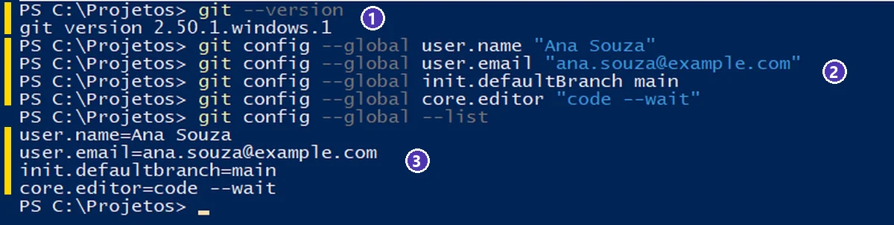

# 01 — Git e GitHub: conceitos, conta e instalação

> **Curso:** Python para Desktop  
> **Módulo:** 06 — Git & GitHub (bônus)  
> **Tempo estimado:** 1 h 30 min  

---

## 🎯 Objetivos

Ao final desta aula, você será capaz de:

- Explicar o que é **controle de versão** e a diferença entre **Git** e **GitHub**.
- Reconhecer as palavras do dia a dia: **repositório**, **commit**, **histórico**, **remoto**, **push** e **pull**.
- Criar uma **conta no GitHub** com segurança (verificação em duas etapas).
- **Instalar** o Git no Windows e conferir a versão.
- Fazer a **configuração inicial** do Git: nome, e-mail, nome da branch principal e editor.

## Pré-requisitos

- [Módulo 00 — VS Code e ambiente](../modulo_06_vscode_config/index.md): abrir o terminal no VS Code.
- Um e-mail que você acessa (o seu ou o da escola).

---

## 📍 Por que versionar?

Você já viu (ou fez) isto:

```text
sistema_escolar.zip
sistema_escolar_v2.zip
sistema_escolar_final.zip
sistema_escolar_final_AGORA_VAI.zip
sistema_escolar_final_corrigido_joao.zip
```

Qual é a versão certa? O que mudou entre uma e outra? Quem mexeu? E se o colega e você editaram o mesmo arquivo ao mesmo tempo?

Um **sistema de controle de versão** responde essas perguntas. Em vez de copiar a pasta, você registra **pontos de salvamento** do projeto, cada um com data, autor e uma frase dizendo o que mudou. Dá para ver o histórico, comparar versões, voltar atrás e juntar o trabalho de várias pessoas.

---

## Git e GitHub não são a mesma coisa

| | **Git** | **GitHub** |
|---|---|---|
| O que é | Um **programa** de controle de versão | Um **site** (serviço na nuvem) que guarda repositórios Git |
| Onde roda | No **seu computador** | Na **internet** |
| Precisa de internet? | Não | Sim |
| Para que serve | Registrar e consultar o histórico do projeto | Guardar uma cópia na nuvem, trabalhar em equipe, publicar o portfólio |
| Alternativas | — (o Git é o padrão) | GitLab, Bitbucket, Codeberg |

O Git foi criado em 2005 por Linus Torvalds, o criador do Linux, e hoje é usado em praticamente todas as empresas de software. O GitHub é o serviço mais usado para guardar projetos Git — e é lá que recrutadores costumam olhar o portfólio de quem está começando.



### As palavras que você vai usar o tempo todo

| Palavra | O que é | Comparação |
|---|---|---|
| **Repositório** (*repo*) | A pasta do projeto **mais** o histórico guardado pelo Git | O caderno com todas as versões |
| **Commit** | Um ponto de salvamento, com autor, data e mensagem | Uma foto do projeto naquele momento |
| **Histórico** | A lista de commits, do mais novo ao mais antigo | O álbum de fotos |
| **Remoto** | A cópia do repositório em outro lugar (no GitHub) | A cópia do caderno guardada na escola |
| **Push** | Enviar os seus commits para o remoto | Levar as fotos novas para a escola |
| **Pull** | Trazer os commits do remoto para o seu computador | Buscar as fotos que os colegas tiraram |
| **Branch** | Uma linha de trabalho paralela | Um rascunho que depois entra no caderno (aula 05) |

!!! note "Git funciona sem internet"
    Commits, histórico e comparação de versões acontecem **no seu computador**. A internet só entra quando você quer enviar (`push`) ou baixar (`pull`) do GitHub.

---

## Passo 1 — Criar a conta no GitHub

1. Acesse **github.com** ➔ **Sign up**.
2. Informe o e-mail, crie uma senha forte e escolha o **nome de usuário**.
3. Confirme o e-mail com o código que o GitHub envia.

!!! warning "Idade mínima e dados pessoais"
    Os termos do GitHub exigem **13 anos ou mais** (ou a idade mínima do seu país, se for maior). Se você é menor de idade, combine com o professor e com os responsáveis antes de criar a conta. O que você publica em um repositório público fica visível para qualquer pessoa: nunca coloque endereço, telefone, documentos ou senhas.

**Nome de usuário:** ele aparece no endereço do seu perfil (`github.com/seu-usuario`) e em todos os seus projetos. Prefira algo simples e profissional — o seu nome ou uma variação (`ana-souza`, `anasouza-dev`), e não `xX_gamer_2010_Xx`.

### Verificação em duas etapas (2FA)

O GitHub exige a **verificação em duas etapas** de quem contribui com código. Além da senha, você confirma o login com um código que muda a cada 30 segundos.

- Configure em *foto do perfil ➔ Settings ➔ Password and authentication ➔ Enable two-factor authentication*.
- O método recomendado é um **aplicativo autenticador** no celular (Google Authenticator, Microsoft Authenticator, 2FAS...). O GitHub mostra um QR code; você lê com o app e digita o código.
- **Guarde os códigos de recuperação** (*recovery codes*) que o GitHub mostra no fim: são a única forma de entrar se você perder o celular. Imprima ou anote em papel e guarde em casa.

!!! danger "Código por e-mail não é 2FA"
    Receber um código no e-mail **não** conta como verificação em duas etapas para o GitHub. Use o app autenticador (e, se quiser, o app GitHub Mobile ou uma chave de segurança como reserva).

### E-mail privado nos commits

Cada commit grava o e-mail do autor, e em repositórios públicos qualquer pessoa pode vê-lo. Para não expor o seu e-mail:

1. *Settings ➔ Emails* ➔ marque **Keep my email addresses private**.
2. Logo abaixo, o GitHub mostra um e-mail no formato `12345678+seu-usuario@users.noreply.github.com`. **Copie**: é ele que você vai usar no Passo 4.

---

## Passo 2 — Instalar o Git no Windows

Escolha **um** dos caminhos.

=== "Pelo terminal (winget)"

    No terminal do VS Code (ou no PowerShell), rode o comando indicado no site oficial:

    ```powershell
    winget install --id Git.Git -e --source winget
    ```

    Aceite os termos se o `winget` perguntar e espere terminar. Depois, **feche e abra o terminal de novo** — o terminal antigo não “enxerga” programas instalados depois que ele abriu.

    !!! info "Sobre o pacote do winget"
        O próprio site do Git avisa que o pacote do `winget` não é mantido pelo projeto Git para Windows e pode chegar com alguns dias de atraso em relação à versão mais nova. Para a aula, tanto faz.

=== "Pelo instalador do site"

    1. Acesse **git-scm.com** ➔ **Install** ➔ **Windows** e baixe o **Git for Windows/x64 Setup**.
    2. Execute o instalador. Pode aceitar quase tudo como vem (*Next*), com atenção a duas telas:
        - **Choosing the default editor used by Git:** escolha **Use Visual Studio Code as Git's default editor**.
        - **Adjusting the name of the initial branch in new repositories:** escolha **Override the default branch name for new repositories** e deixe **main**.
    3. *Install* ➔ *Finish*.

<figure markdown="span">
  { loading=lazy }
  <figcaption>A página oficial (<strong>git-scm.com ➔ Install ➔ Windows</strong>): o instalador e, mais abaixo, o comando do <code>winget</code>. Baixe sempre do site oficial.</figcaption>
</figure>

### Conferir a instalação

Num terminal **novo**:

```powershell
git --version
```

Deve aparecer algo como `git version 2.56.0.windows.1` — o número muda a cada atualização, e qualquer versão recente serve para o curso. Se aparecer *“git” não é reconhecido como nome de cmdlet...*, feche o VS Code inteiro e abra de novo; se continuar, reinstale.

---

## Passo 3 — Por que configurar o Git?

Todo commit guarda **quem** fez. Antes do primeiro commit, o Git precisa saber o seu nome e o seu e-mail — se você pular este passo, ele recusa o commit com o aviso *“Please tell me who you are”*.

A configuração com `--global` vale para **todos** os projetos do seu usuário no computador; você faz uma vez só.

---

## Passo 4 — A configuração inicial

No terminal, um comando por vez (troque pelos seus dados):

```powershell
git config --global user.name "Ana Souza"
git config --global user.email "12345678+ana-souza@users.noreply.github.com"
git config --global init.defaultBranch main
git config --global core.editor "code --wait"
```

| Comando | O que configura |
|---|---|
| `user.name` | O nome que aparece nos seus commits. Use o seu nome real. |
| `user.email` | O e-mail dos commits. Use o e-mail privado do GitHub (Passo 1) ou o mesmo e-mail da conta. |
| `init.defaultBranch main` | Repositórios novos começam com a branch **main** — o mesmo nome que o GitHub usa. |
| `core.editor "code --wait"` | Quando o Git precisar que você escreva uma mensagem longa, ele abre o **VS Code** (e espera você fechar a aba). |

**Confira** o que ficou gravado:

```powershell
git config --global --list
```

<figure markdown="span">
  { loading=lazy }
  <figcaption>(1) A versão do Git · (2) a configuração inicial, um comando por linha · (3) a conferência com <code>--list</code>. Se um valor saiu errado, é só rodar o comando de novo com o valor certo.</figcaption>
</figure>

!!! tip "Computador da escola ou compartilhado"
    Em um computador que outras pessoas usam, a configuração `--global` fica no **usuário do Windows**. Se o laboratório usa um usuário só para todo mundo, confira o `user.name` antes de começar (`git config --global user.name`) — senão os seus commits saem com o nome do colega.

---

??? note "Equivalentes: Linux, macOS e GitHub Codespaces"
    | Tarefa | Linux (Ubuntu/Debian) | macOS | Codespaces (no navegador) |
    |---|---|---|---|
    | Instalar o Git | `sudo apt install git` | `xcode-select --install` ou `brew install git` | Já vem instalado |
    | Configurar | Os mesmos `git config --global` | Os mesmos `git config --global` | Nome e e-mail vêm da conta do GitHub |

---

## ⚠️ Erros comuns

- **“git” não é reconhecido** — o terminal foi aberto **antes** da instalação. Feche e abra de novo (às vezes, o VS Code inteiro).
- **“Please tell me who you are”** ao fazer o primeiro commit — faltou o Passo 4. Rode os dois primeiros `git config --global` e tente de novo.
- **Commits aparecem no GitHub sem a sua foto, como outra pessoa** — o `user.email` não é nenhum e-mail da sua conta. Use o e-mail da conta ou o `noreply` do Passo 1.
- **Errou o nome com aspas faltando** (`git config --global user.name Ana Souza` grava só “Ana”) — nomes com espaço precisam de aspas. Rode de novo com aspas.
- **Perdeu o celular do 2FA e não guardou os códigos de recuperação** — você pode perder a conta. Guarde os *recovery codes* no dia em que ativar.

---

## Exercícios

### Básico (fixação)

Responda com as suas palavras:

1. Qual é a diferença entre Git e GitHub?
2. O que é um commit? Quais informações ele guarda?
3. Dá para fazer commits sem internet? E `push`?

<!-- gabarito -->
??? success "Gabarito — Básico"
    1. O **Git** é um programa que roda no seu computador e registra o histórico do projeto. O **GitHub** é um site que guarda uma cópia do repositório na nuvem e permite trabalhar em equipe e publicar. Dá para usar o Git sem o GitHub; o contrário, não.
    2. Um **commit** é um ponto de salvamento do projeto. Ele guarda **o que mudou**, o **autor** (nome e e-mail do `git config`), a **data e hora** e a **mensagem** que explica a mudança.
    3. **Commits, sim**: acontecem no seu computador. O **`push`**, não: ele envia os commits para o GitHub, então precisa de internet.

### Intermediário (aplicação)

1. Instale o Git (se ainda não tiver) e mostre a versão.
2. Faça a configuração inicial completa: nome, e-mail, branch `main` e VS Code como editor.
3. Mostre a lista de configurações e confira cada valor.

<!-- gabarito -->
??? success "Gabarito — Intermediário"
    ```powershell
    winget install --id Git.Git -e --source winget   # se ainda não tiver o Git
    # feche e abra o terminal
    git --version
    git config --global user.name "Seu Nome"
    git config --global user.email "seu-email-ou-noreply@users.noreply.github.com"
    git config --global init.defaultBranch main
    git config --global core.editor "code --wait"
    git config --global --list
    ```

    **Confira:** a lista mostra `user.name`, `user.email`, `init.defaultbranch=main` e `core.editor=code --wait`. (O Git mostra o nome das opções em letras minúsculas: `defaultbranch`.) Para ver um valor só: `git config --global user.email`.

### Avançado (desafio)

1. Crie a conta no GitHub (se puder, conforme a idade), ative a **verificação em duas etapas** com um app autenticador e guarde os códigos de recuperação.
2. Ative o **e-mail privado** e configure o Git com o e-mail `noreply`.
3. Explique por que o `user.email` do Git precisa ser um e-mail ligado à sua conta do GitHub.

<!-- gabarito -->
??? success "Gabarito — Avançado"
    1. *Sign up* ➔ confirmar o e-mail. *Settings ➔ Password and authentication ➔ Enable two-factor authentication* ➔ ler o QR code com o app ➔ digitar o código de 6 dígitos ➔ **baixar ou anotar os recovery codes** ➔ concluir.
    2. *Settings ➔ Emails* ➔ **Keep my email addresses private** ➔ copiar o e-mail `...@users.noreply.github.com` ➔ no terminal: `git config --global user.email "o-email-copiado"`.
    3. O GitHub liga cada commit a uma conta **pelo e-mail** gravado no commit. Se o e-mail não pertence a nenhuma conta, o commit aparece sem foto e não conta nas suas contribuições do perfil. Com o `noreply`, o commit é ligado à sua conta e o seu e-mail real não fica público.

    **Dica de professor:** se a escola usa contas do GitHub Education, combine com a turma qual e-mail usar — o da escola facilita conferir as entregas.

---

## 💡 Resumo

- **Git** = histórico no seu computador; **GitHub** = cópia na nuvem, equipe e portfólio.
- **Commit** é um ponto de salvamento com autor, data e mensagem; **push** envia, **pull** traz.
- Conta no GitHub: **13 anos ou mais**, nome de usuário profissional, **2FA com app** e códigos de recuperação guardados.
- Instale pelo `winget` ou pelo site oficial e confira com `git --version`.
- Configure uma vez: `user.name`, `user.email`, `init.defaultBranch main` e `core.editor "code --wait"`.

## ➡️ Próximo passo

**02 — Primeiro repositório: status, add, commit e histórico** (próxima aula, em preparação): criar um repositório, fazer os primeiros commits e voltar no tempo.
