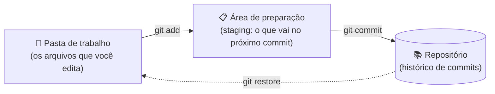
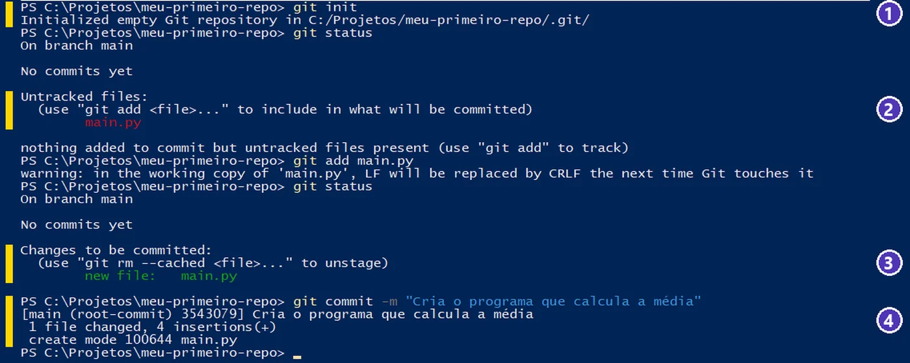
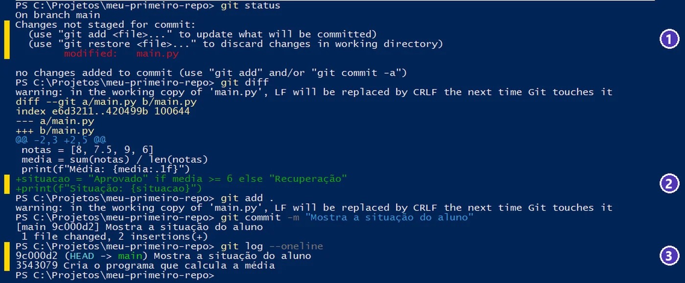
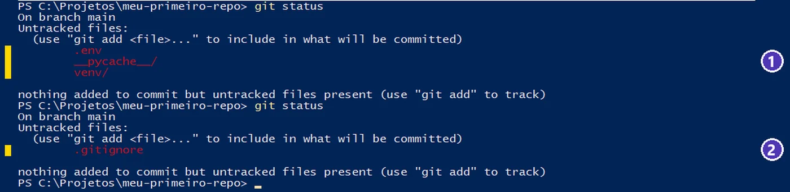
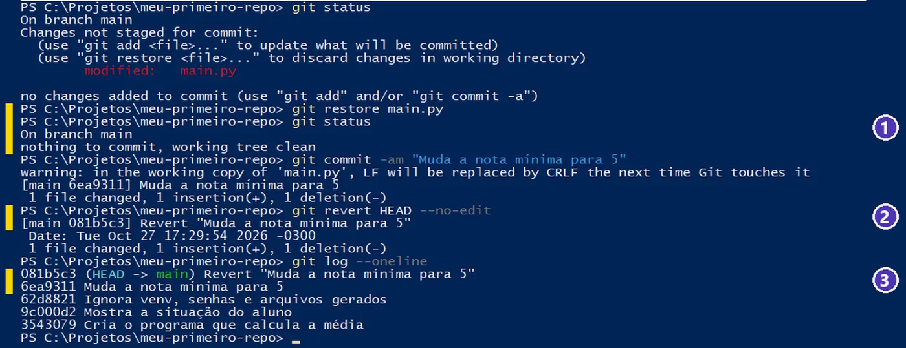

# 02 — Primeiro repositório: status, add, commit e histórico

> **Curso:** Python para Desktop  
> **Módulo:** 06 — Git & GitHub (bônus)  
> **Tempo estimado:** 2 h  

---

## 🎯 Objetivos

Ao final desta aula, você será capaz de:

- Criar um repositório com `git init` e entender o que é a pasta `.git`.
- Explicar as **três áreas** do Git: pasta de trabalho, área de preparação (*staging*) e repositório.
- Usar o ciclo do dia a dia: `git status` ➔ `git add` ➔ `git commit`.
- Ver o histórico (`git log`) e o que mudou (`git diff`).
- Proteger o repositório com o **`.gitignore`** (nada de `venv`, `.env` ou `__pycache__` no histórico).
- **Desfazer** com segurança: `git restore` e `git revert`.

## Pré-requisitos

- [Aula 01](01_git_e_github_conceitos_e_instalacao.md): Git instalado e configurado (`user.name` e `user.email`).
- Abrir o terminal do VS Code (`Ctrl + '`) e navegar entre pastas com `cd`.

!!! info "Por que começar pelo terminal?"
    Nas próximas aulas você vai fazer tudo isso com **botões** no VS Code e no GitHub Desktop. Os botões só fazem sentido quando você sabe o que acontece por trás deles: cada botão roda um destes comandos.

---

## As três áreas do Git

Antes dos comandos, a ideia mais importante do Git: um arquivo passa por **três lugares**.



| Área | O que é | Comparação |
|---|---|---|
| **Pasta de trabalho** | Os arquivos como estão agora no seu computador | A mesa onde você trabalha |
| **Área de preparação** (*staging*) | O que você **escolheu** para entrar no próximo commit | A caixa onde você separa o que vai mandar |
| **Repositório** | Todos os commits já feitos, guardados na pasta `.git` | O arquivo morto com tudo que já foi mandado |

Por que existe a área do meio? Porque nem tudo que você mudou precisa entrar no mesmo commit. Você pode ter corrigido um erro **e** começado uma tela nova: dá para fazer um commit só com a correção e deixar a tela para depois.

---

## Passo 1 — Criar o repositório

Crie uma pasta para o exercício e abra no VS Code (*Arquivo ➔ Abrir Pasta*). No terminal:

```powershell
git init
```

O Git responde `Initialized empty Git repository in .../.git/` — ele criou uma pasta **oculta** chamada `.git`. É ali que fica **todo** o histórico.

!!! danger "Nunca apague nem edite a pasta `.git`"
    Apagar a `.git` apaga o histórico inteiro do projeto (os arquivos continuam, mas viram uma pasta comum). E **não** rode `git init` dentro de uma pasta que já está dentro de outro repositório, nem na sua pasta de usuário inteira: crie uma pasta por projeto.

## Passo 2 — `git status`: a pergunta que você vai fazer o tempo todo

Crie o arquivo `main.py` no VS Code:

```python
# Calcula a média de quatro notas
notas = [8, 7.5, 9, 6]
media = sum(notas) / len(notas)
print(f"Média: {media:.1f}")
```

E pergunte ao Git o que está acontecendo:

```powershell
git status
```

As mensagens do Git vêm em **inglês**. As que você mais vai ver:

| Mensagem | Tradução | O que fazer |
|---|---|---|
| `Untracked files` | Arquivos **não rastreados**: o Git nunca registrou | `git add` para começar a acompanhar |
| `Changes not staged for commit` | Mudou, mas **não está preparado** | `git add` se quiser no próximo commit |
| `Changes to be committed` | **Preparado**: vai entrar no próximo commit | `git commit` |
| `nothing to commit, working tree clean` | Nada para registrar: tudo igual ao último commit | Pode trabalhar tranquilo |

## Passo 3 — `git add` e `git commit`

```powershell
git add main.py
git status
git commit -m "Cria o programa que calcula a média"
```

- `git add main.py` coloca **esse arquivo** na área de preparação. `git add .` (com ponto) coloca **tudo** que mudou na pasta.
- `git commit -m "mensagem"` grava o commit. A mensagem diz **o que** a mudança faz, no presente: “Cria...”, “Corrige...”, “Adiciona...”.

<figure markdown="span">
  { loading=lazy }
  <figcaption>(1) <code>git init</code> cria o repositório · (2) <em>Untracked files</em>: o Git ainda não conhece o <code>main.py</code> · (3) depois do <code>git add</code>, <em>Changes to be committed</em> · (4) o commit: a branch (<em>main</em>), o código curto do commit e a mensagem.</figcaption>
</figure>

!!! tip "Commits pequenos e frequentes"
    Um commit para cada mudança que faz sentido sozinha: “Cria a tela de login”, “Corrige o cálculo da média”. Fica fácil de entender o histórico e de desfazer só o que deu errado. Um commit gigante no fim do dia (“mudanças”) não ajuda ninguém.

## Passo 4 — `git diff` e `git log`

Mude o `main.py`, acrescentando a situação do aluno:

```python
situacao = "Aprovado" if media >= 6 else "Recuperação"
print(f"Situação: {situacao}")
```

Antes de fazer o commit, **veja o que mudou**:

```powershell
git diff
```

Linhas com **`+`** (verdes) foram acrescentadas; linhas com **`-`** (vermelhas) foram apagadas. Se a lista for longa, o Git mostra uma tela por vez: use as setas e aperte **`q`** para sair.

Grave e veja o histórico:

```powershell
git add .
git commit -m "Mostra a situação do aluno"
git log --oneline
```

<figure markdown="span">
  { loading=lazy }
  <figcaption>(1) <em>modified</em>: o arquivo mudou desde o último commit · (2) o <code>git diff</code> mostra as linhas novas com <strong>+</strong> · (3) o histórico, do mais novo para o mais antigo. <em>HEAD -&gt; main</em> marca onde você está.</figcaption>
</figure>

| Comando | O que mostra |
|---|---|
| `git log --oneline` | Um commit por linha: código curto e mensagem |
| `git log` | Completo: autor, data e mensagem (`q` para sair) |
| `git diff` | O que mudou e **ainda não** foi para a área de preparação |
| `git diff --staged` | O que já está preparado e vai entrar no próximo commit |
| `git show` | O último commit, com as mudanças |

## Passo 5 — `.gitignore`: o que **não** vai para o repositório

Num projeto Python de verdade, aparecem arquivos que **não** devem entrar no histórico:

| Arquivo ou pasta | Por que fica de fora |
|---|---|
| `venv/` (ou `.venv/`) | São milhares de arquivos das bibliotecas; cada um recria com `pip install -r requirements.txt` |
| `.env` | Guarda **senhas** e chaves (a `DATABASE_URL` do Neon, por exemplo) |
| `__pycache__/` e `*.pyc` | O Python gera sozinho ao rodar o programa |
| `*.db` de teste | Dados de teste (e às vezes dados pessoais) |

Crie, na raiz do projeto, um arquivo chamado exatamente **`.gitignore`** (com o ponto, sem extensão):

```text
# Ambiente virtual
venv/
.venv/

# Senhas e configurações locais
.env

# Gerados pelo Python
__pycache__/
*.pyc

# Bancos de teste
*.db
```

<figure markdown="span">
  { loading=lazy }
  <figcaption>(1) Sem <code>.gitignore</code>, o Git oferece a senha do <code>.env</code>, o <code>venv</code> e o <code>__pycache__</code> · (2) com o <code>.gitignore</code>, eles somem da lista. O próprio <code>.gitignore</code> <strong>deve</strong> entrar no commit.</figcaption>
</figure>

!!! danger "Crie o `.gitignore` antes do primeiro `git add .`"
    O `.gitignore` só impede que arquivos **novos** entrem. Se o `.env` já foi para um commit, ele continua no histórico — e, se esse histórico for para o GitHub, a senha fica pública. Nesse caso: **troque a senha** (no Neon, *Reset password*) e tire o arquivo do Git com `git rm --cached .env`. Trocar a senha é obrigatório: apagar o arquivo depois não apaga o histórico.

!!! tip "Modelo pronto"
    O GitHub mantém modelos de `.gitignore` por linguagem (o de Python é bem completo). Na aula 04, ao criar um repositório pelo site, basta escolher **Python** na lista.

## Passo 6 — Desfazer sem medo

| Situação | Comando | O que acontece |
|---|---|---|
| Estraguei um arquivo e **ainda não** fiz `add` | `git restore main.py` | O arquivo volta a ser como no último commit (**a mudança é perdida**) |
| Fiz `add` de um arquivo por engano | `git restore --staged main.py` | Sai da área de preparação; a mudança continua no arquivo |
| Esqueci de pôr um arquivo no último commit (e **ainda não** enviei ao GitHub) | `git add arquivo` ➔ `git commit --amend --no-edit` | O último commit é refeito com o arquivo |
| Um commit antigo estava errado | `git revert <código>` | Cria um **commit novo** que desfaz aquele. O histórico fica intacto |

<figure markdown="span">
  { loading=lazy }
  <figcaption>(1) <code>git restore</code> descarta uma mudança que ainda não foi para o commit · (2) <code>git revert HEAD</code> desfaz o último commit criando um commit novo · (3) no histórico, o erro e a correção ficam registrados.</figcaption>
</figure>

!!! warning "Por que `revert` e não apagar commits?"
    Existem comandos que **reescrevem** o histórico (como `git reset --hard`). Em um projeto só seu, no seu computador, eles funcionam. Mas, quando o histórico já está no GitHub e os colegas baixaram, reescrever causa confusão para todo mundo. O `git revert` desfaz **acrescentando** um commit — é o jeito seguro de trabalhar em equipe.

---

??? note "Os comandos desta aula, numa tabela só"
    | Comando | Para quê |
    |---|---|
    | `git init` | Criar um repositório na pasta atual |
    | `git status` | Ver o estado dos arquivos |
    | `git add arquivo` / `git add .` | Preparar um arquivo / tudo |
    | `git commit -m "mensagem"` | Gravar um commit |
    | `git log --oneline` | Ver o histórico resumido |
    | `git diff` / `git diff --staged` | Ver o que mudou / o que está preparado |
    | `git restore arquivo` | Descartar mudanças não preparadas |
    | `git restore --staged arquivo` | Tirar da área de preparação |
    | `git revert <código>` | Desfazer um commit com um commit novo |

---

## ⚠️ Erros comuns

- **`warning: ... LF will be replaced by CRLF`** — não é erro. O Windows e o Linux marcam o fim de linha de jeitos diferentes (`CRLF` e `LF`), e o Git para Windows ajusta isso sozinho. Pode seguir normalmente.
- **`fatal: not a git repository`** — você está fora da pasta do projeto (ou esqueceu o `git init`). Confira o caminho no terminal e use `cd` até a pasta certa.
- **Commit sem `-m` abriu o VS Code** — é o editor configurado na aula 01 pedindo a mensagem. Escreva na primeira linha, **salve e feche a aba**; o commit termina sozinho.
- **O terminal ficou “preso” com `:` no fim** — é a tela de rolagem do `git log` ou do `git diff`. Aperte **`q`**.
- **`git add .` levou o `venv` inteiro** — faltou o `.gitignore`. Rode `git restore --staged venv` (ou, se já fez commit, `git rm -r --cached venv`), crie o `.gitignore` e faça um commit novo.
- **`.gitignore.txt`** — o Bloco de Notas acrescenta `.txt` e o Git não reconhece. Crie o arquivo pelo VS Code.

---

## Exercícios

### Básico (fixação)

Em uma pasta nova chamada `lista-de-compras`:

1. Crie o repositório.
2. Crie `compras.txt` com três itens e faça o primeiro commit.
3. Acrescente dois itens, veja a diferença com `git diff` e faça o segundo commit.
4. Mostre o histórico em uma linha por commit.

<!-- gabarito -->
??? success "Gabarito — Básico"
    ```powershell
    mkdir lista-de-compras
    cd lista-de-compras
    git init
    # crie compras.txt no VS Code com: arroz, feijão, leite
    git status                      # compras.txt em "Untracked files"
    git add compras.txt
    git commit -m "Cria a lista de compras"
    # acrescente: café, pão
    git diff                        # duas linhas com +
    git add .
    git commit -m "Acrescenta café e pão"
    git log --oneline               # dois commits, o mais novo em cima
    ```

### Intermediário (aplicação)

No repositório do exercício básico:

1. Crie um arquivo `.env` com `SENHA=123` e uma pasta `__pycache__` com um arquivo qualquer dentro. Mostre que o Git oferece os dois no `git status`.
2. Crie o `.gitignore` certo e mostre que eles sumiram da lista. Faça o commit do `.gitignore`.
3. Prepare um arquivo por engano (`git add`) e tire-o da área de preparação sem perder a mudança.

<!-- gabarito -->
??? success "Gabarito — Intermediário"
    1. Crie `.env` e `__pycache__/teste.pyc` pelo VS Code ➔ `git status` mostra os dois em *Untracked files*.
    2. `.gitignore` com:
        ```text
        .env
        __pycache__/
        ```
        ➔ `git status` mostra **só** o `.gitignore` ➔ `git add .gitignore` ➔ `git commit -m "Ignora senhas e arquivos gerados"`.
    3. Mude `compras.txt` ➔ `git add compras.txt` ➔ `git status` (em *Changes to be committed*) ➔ `git restore --staged compras.txt` ➔ `git status` (voltou para *Changes not staged*; a mudança continua no arquivo).

### Avançado (desafio)

1. Faça um commit com um erro de propósito (apague um item da lista e grave com a mensagem “Remove arroz por engano”).
2. Desfaça esse commit **sem apagar o histórico** e mostre, no `git log --oneline`, o commit errado e o que o desfez.
3. Explique por que, num projeto em equipe, o `git revert` é mais seguro do que “voltar” o histórico.

<!-- gabarito -->
??? success "Gabarito — Avançado"
    ```powershell
    # apague "arroz" de compras.txt
    git commit -am "Remove arroz por engano"
    git revert HEAD --no-edit
    git log --oneline
    ```
    O histórico mostra, em cima, `Revert "Remove arroz por engano"` e, logo abaixo, o commit errado. O `compras.txt` voltou a ter arroz.

    (`git commit -am` = `add` de tudo que o Git **já acompanha** + `commit`. Não pega arquivos novos.)

    **Por que `revert`:** ele desfaz **acrescentando** um commit. Quem já baixou o histórico só recebe mais um commit e continua sincronizado. Comandos que apagam commits (`reset`) fazem o histórico dos colegas ficar diferente do seu, e o próximo `push` é recusado ou causa conflitos difíceis.

---

## 💡 Resumo

- **Três áreas:** pasta de trabalho ➔ `git add` ➔ área de preparação ➔ `git commit` ➔ repositório.
- Na dúvida, **`git status`**: ele diz o estado de cada arquivo e até sugere o próximo comando.
- `git diff` antes do commit; `git log --oneline` para ver o histórico.
- **`.gitignore` antes do primeiro commit**: `venv/`, `.env`, `__pycache__/`. Senha que vazou num commit tem de ser trocada.
- Desfazer: `git restore` (antes do commit) e `git revert` (depois, com segurança).

## ➡️ Próximo passo

**[03 — Do VS Code para o GitHub: publicando um projeto que já existe](03_vscode_e_github_desktop.md)**: os mesmos passos com botões — e o seu projeto no GitHub em poucos cliques.
