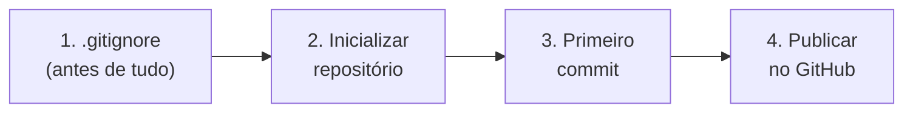
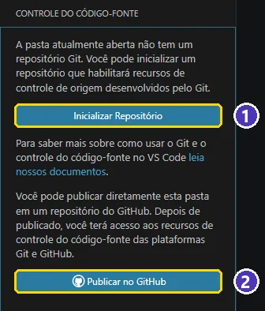
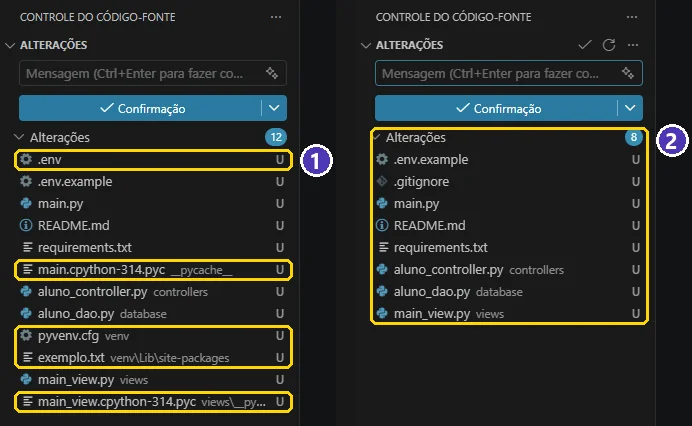
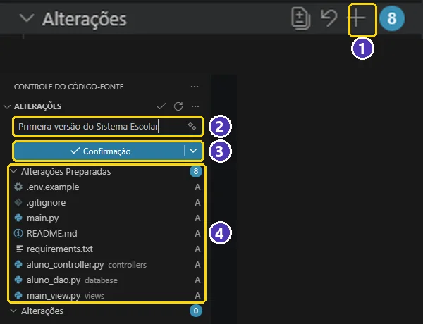
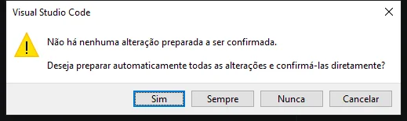
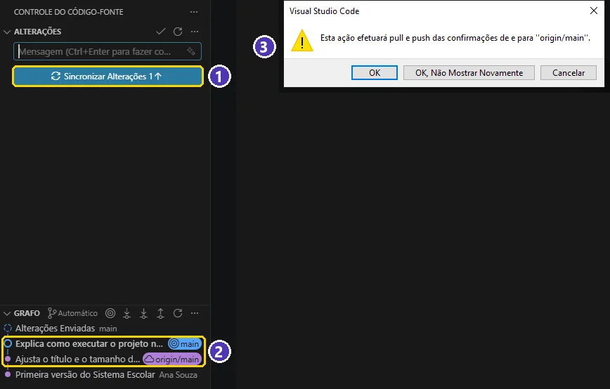

# 03 — Do VS Code para o GitHub: publicando um projeto que já existe

> **Curso:** Python para Desktop  
> **Módulo:** 06 — Git & GitHub (bônus)  
> **Tempo estimado:** 2 h  

---

## 🎯 Objetivos

Ao final desta aula, você será capaz de:

- Colocar no GitHub um projeto que **já existe** no seu computador (o Sistema Escolar, por exemplo), sem levar senhas nem o `venv`.
- Usar o painel **Controle do Código-Fonte** do VS Code: inicializar, preparar, fazer commit e comparar versões.
- **Publicar** o projeto no GitHub direto pelo VS Code e manter tudo sincronizado.
- Fazer o mesmo pelo **GitHub Desktop**, para quem prefere um programa visual.

## Pré-requisitos

- [Aula 02](02_primeiro_repositorio.md): as três áreas, `status`, `add`, `commit` e o `.gitignore`.
- Conta no GitHub com verificação em duas etapas ([aula 01](01_git_e_github_conceitos_e_instalacao.md)).
- Um projeto Python aberto no VS Code (*Arquivo ➔ Abrir Pasta*).

!!! info "Os botões fazem o que você já sabe"
    Cada botão desta aula roda um comando da aula 02: **Inicializar Repositório** = `git init`; o **+** = `git add`; **Confirmação** = `git commit`; **Sincronizar Alterações** = `git pull` + `git push`. Se algo der estranho, o `git status` no terminal continua sendo a sua lanterna.

---

## O cenário

Você tem a pasta do Sistema Escolar no computador, com o código, o `requirements.txt`, um `.env` com a `DATABASE_URL` do Neon, a pasta `venv` e algumas pastas `__pycache__`. Nunca usou Git nela. Quer o projeto no **seu** GitHub, para guardar uma cópia, mostrar ao professor e colocar no portfólio.

O caminho tem quatro etapas:



---

## Passo 1 — Antes de tudo: o `.gitignore`

Abra o painel **Controle do Código-Fonte** (o terceiro ícone da barra da esquerda, ou `Ctrl + Shift + G`). Numa pasta sem Git, ele mostra dois botões: **Inicializar Repositório** e **Publicar no GitHub**.

<figure markdown="span">
  { loading=lazy }
  <figcaption>(1) <strong>Inicializar Repositório</strong>: só cria o Git na pasta · (2) <strong>Publicar no GitHub</strong>: cria o Git, o repositório no GitHub e envia tudo de uma vez. Nesta aula vamos pelo caminho (1), passo a passo.</figcaption>
</figure>

**Não clique ainda.** Veja o que acontece se você inicializar sem `.gitignore`:

<figure markdown="span">
  { loading=lazy }
  <figcaption>(1) Sem <code>.gitignore</code>, o VS Code oferece o <code>.env</code> (com a senha do banco), o <code>venv</code> e o <code>__pycache__</code> · (2) com o <code>.gitignore</code> da aula 02, ficam só os arquivos do projeto. A letra <strong>U</strong> quer dizer <em>untracked</em>: o Git ainda não acompanha o arquivo.</figcaption>
</figure>

Crie o `.gitignore` na raiz do projeto (*Explorador ➔ Novo Arquivo* ➔ `.gitignore`) com o conteúdo da [aula 02](02_primeiro_repositorio.md#passo-5-gitignore-o-que-nao-vai-para-o-repositorio) e **confira a lista** antes de seguir. Se o `.env` ou o `venv` ainda aparecem, o `.gitignore` está com nome ou conteúdo errado.

!!! tip "E quem for baixar o projeto, como sabe o que vai no `.env`?"
    Deixe no projeto um **`.env.example`** com os nomes das variáveis e valores de mentira (`DATABASE_URL=cole-aqui-a-connection-string-do-neon`). Ele **entra** no repositório; o `.env` de verdade, não.

## Passo 2 — Inicializar, preparar e fazer o primeiro commit

1. **Inicializar Repositório**. A lista de *Alterações* aparece com os arquivos marcados com **U**.
2. Passe o mouse sobre **Alterações**: aparece um **+** (*Preparar Todas as Alterações*). Clique. Os arquivos vão para **Alterações Preparadas**, com a letra **A** (*added*).
3. Escreva a mensagem na caixa de cima (“Primeira versão do Sistema Escolar”).
4. Clique em **Confirmação** (ou `Ctrl + Enter`).

<figure markdown="span">
  { loading=lazy }
  <figcaption>(1) O <strong>+</strong> ao lado de <em>Alterações</em> prepara tudo (é o <code>git add .</code>) · (2) a mensagem do commit · (3) <strong>Confirmação</strong> grava o commit · (4) os arquivos preparados, com a letra <strong>A</strong>.</figcaption>
</figure>

!!! warning "“Não há nenhuma alteração preparada a ser confirmada”"
    Se você clicar em **Confirmação** sem preparar nada, o VS Code pergunta se pode **preparar automaticamente todas as alterações**. Responda **Sim** — vale só para esta vez. Evite **Sempre**: com ele, todo arquivo modificado entra nos commits sem você olhar a lista, e um `.env` mal ignorado escapa sem você perceber.

    { loading=lazy .sem-zoom }

### Comparar antes de confirmar

Mudou um arquivo? Ele aparece em *Alterações* com a letra **M** (*modified*). **Clique no nome do arquivo**: o VS Code abre a comparação lado a lado — à esquerda, como estava no último commit; à direita, como está agora.

<figure markdown="span">
  { loading=lazy }
  <figcaption>(1) O arquivo modificado (<strong>M</strong>) · (2) a versão do último commit, com o que saiu em vermelho · (3) a versão atual, com o que entrou em verde. É o <code>git diff</code> da aula 02, em forma visual.</figcaption>
</figure>

## Passo 3 — Publicar no GitHub

Depois do primeiro commit, o botão azul vira **Publicar Branch**. Clique nele.

1. Na primeira vez, o VS Code pede para entrar: *“A extensão 'GitHub' quer entrar usando GitHub”* ➔ **Permitir**.
2. O navegador abre a página do GitHub. Entre na sua conta (com a verificação em duas etapas) e **autorize o Visual Studio Code**. Se o navegador perguntar se pode abrir o VS Code, confirme.
3. De volta ao VS Code, escolha o nome do repositório (pode trocar o que vem preenchido) e o tipo: **privado** ou **público**.

<figure markdown="span">
  { loading=lazy }
  <figcaption>(1) <strong>Publicar Branch</strong> · (2) a permissão para entrar no GitHub (só na primeira vez) · (3) o nome do repositório · (4) privado ou público. Essas duas opções aparecem em inglês mesmo com o VS Code em português.</figcaption>
</figure>

| Privado ou público? | Quando |
|---|---|
| **Privado** (*private*) | Durante o desenvolvimento, ou quando o professor pedir. Só você e quem você convidar veem. |
| **Público** (*public*) | Para o portfólio. Qualquer pessoa vê o código — confira antes que não há senhas, dados de alunos ou dados pessoais. Dá para trocar depois em *Settings* do repositório. |

Em alguns segundos, o VS Code avisa: *“O repositório ... foi publicado com êxito no GitHub”*, com o botão **Abrir no GitHub**.

<figure markdown="span">
  { loading=lazy }
  <figcaption>O projeto no GitHub: (1) o histórico de commits · (2) os arquivos — repare que <strong>não</strong> estão lá o <code>.env</code>, o <code>venv</code> nem o <code>__pycache__</code> · (3) o <code>README.md</code> aparece como a página de apresentação do projeto.</figcaption>
</figure>

!!! danger "Publicou o `.env` sem querer?"
    Se a senha do banco foi para o GitHub, **troque a senha agora** (no Neon: *Reset password*) — apagar o arquivo depois não basta, porque ele continua no histórico. Depois: acrescente `.env` ao `.gitignore`, rode `git rm --cached .env`, faça um commit e sincronize.

## Passo 4 — O dia a dia: commit e sincronizar

Agora o ciclo é sempre o mesmo:

1. Trabalhe no código.
2. No painel, confira a lista e as diferenças, prepare e faça o **commit**.
3. Clique em **Sincronizar Alterações** — o número com a seta mostra quantos commits vão subir (↑) ou descer (↓).

<figure markdown="span">
  { loading=lazy }
  <figcaption>(1) <strong>Sincronizar Alterações 1↑</strong>: um commit para enviar · (2) no <em>Grafo</em>, a sua <em>main</em> está um commit à frente da <em>origin/main</em> (a cópia do GitHub) · (3) na primeira vez, o VS Code avisa que vai fazer <code>pull</code> e <code>push</code>.</figcaption>
</figure>

!!! tip "Sincronize no começo e no fim"
    Comece o dia sincronizando (para receber o que os colegas enviaram) e termine sincronizando (para enviar o seu trabalho). Em equipe, isso evita a maioria dos conflitos — o assunto da aula 05.

---

## E pelo GitHub Desktop?

O [GitHub Desktop](https://desktop.github.com) faz o mesmo, com uma janela própria. Ele só existe em inglês.

1. *File ➔ Add local repository* ➔ escolha a pasta do projeto ➔ **Add repository**. (Se a pasta ainda não tem Git, o Desktop oferece *create a repository* — e cria um `.gitignore` se você escolher o modelo **Python**.)
2. Na aba **Changes**, confira a lista, escreva o resumo (*Summary*) e clique em **Commit to main**.
3. Clique em **Publish repository**: dê o nome, uma descrição e decida a caixa **Keep this code private** (marcada = privado).
4. No dia a dia: **Commit to main** e depois **Push origin**; para receber, **Fetch origin** e **Pull origin**.

<figure markdown="span">
  { loading=lazy }
  <figcaption>(1) <em>Add local repository</em> · (2) <strong>Publish repository</strong>, na barra de cima e no centro · (3) nome, descrição e <strong>Keep this code private</strong>: desmarque para o repositório ser público.</figcaption>
</figure>

| No VS Code | No GitHub Desktop | Comando |
|---|---|---|
| Inicializar Repositório | *create a repository* | `git init` |
| **+** (Preparar) | caixas de seleção dos arquivos | `git add` |
| Confirmação | *Commit to main* | `git commit` |
| Publicar Branch | *Publish repository* | `git remote add` + `git push -u` |
| Sincronizar Alterações | *Push origin* / *Pull origin* | `git push` / `git pull` |

---

## ⚠️ Erros comuns

- **O `.env` aparece na lista de alterações** — o `.gitignore` não existe, está fora da raiz do projeto ou foi salvo como `.gitignore.txt`. Corrija **antes** de fazer o commit.
- **Fiz o commit com o `venv` dentro** — rode no terminal `git rm -r --cached venv`, confira que `venv/` está no `.gitignore`, faça um commit e sincronize.
- **O botão Publicar Branch não aparece** — falta o primeiro commit, ou o repositório já tem um remoto (aí o botão é *Sincronizar Alterações*).
- **O navegador não volta para o VS Code depois de autorizar** — confirme a pergunta do navegador para abrir o VS Code; se não aparecer, clique em *Publicar Branch* de novo.
- **“repository already exists”** — já existe um repositório com esse nome na sua conta. Escolha outro nome na caixa do VS Code.
- **Commits aparecem no GitHub com o nome ou a foto de outra pessoa** — o `user.email` do Git é um e-mail de outra conta (por exemplo, um `noreply` com número inventado). Veja a [aula 01](01_git_e_github_conceitos_e_instalacao.md#e-mail-privado-nos-commits).

---

## Exercícios

### Básico (fixação)

Com um projeto seu que ainda não usa Git (pode ser um exercício de qualquer módulo do curso):

1. Crie o `.gitignore` e confira, no painel, que nada de `venv`, `.env` ou `__pycache__` aparece.
2. Inicialize o repositório e faça o primeiro commit pelo VS Code.

<!-- gabarito -->
??? success "Gabarito — Básico"
    1. *Explorador ➔ Novo Arquivo* ➔ `.gitignore` com `venv/`, `.venv/`, `.env`, `__pycache__/` e `*.pyc` ➔ salvar.
    2. `Ctrl + Shift + G` ➔ **Inicializar Repositório** ➔ confira a lista (só arquivos do projeto, com **U**) ➔ **+** em *Alterações* ➔ mensagem “Primeira versão do projeto” ➔ **Confirmação**.

    **Confira:** o botão azul virou **Publicar Branch** e, no terminal, `git log --oneline` mostra o commit.

### Intermediário (aplicação)

1. Publique o projeto do exercício básico no seu GitHub como repositório **privado**.
2. Mude um arquivo, compare as versões no VS Code, faça o commit e sincronize.
3. Abra o repositório no GitHub e encontre o seu commit no histórico (*Commits*).

<!-- gabarito -->
??? success "Gabarito — Intermediário"
    1. **Publicar Branch** ➔ **Permitir** ➔ entrar e autorizar o VS Code no navegador ➔ nome do repositório ➔ **Publish to GitHub private repository**.
    2. Edite e salve ➔ no painel, clique no arquivo (letra **M**) para ver a comparação ➔ **+** ➔ mensagem ➔ **Confirmação** ➔ **Sincronizar Alterações 1↑** ➔ **OK**.
    3. Notificação **Abrir no GitHub** (ou `github.com/seu-usuario/nome-do-repositorio`) ➔ clique em **Commits** (o relógio com o número, acima da lista de arquivos).

### Avançado (desafio)

1. Faça o mesmo caminho com o **GitHub Desktop** num segundo projeto, até ver o botão **Publish repository** (publique, se quiser).
2. Simule o acidente: num projeto de teste **sem senha real**, faça um commit com um arquivo `.env` e depois tire-o do repositório **sem apagar o arquivo do seu computador**.
3. Explique por que, num caso real, tirar o `.env` do repositório **não** é suficiente.

<!-- gabarito -->
??? success "Gabarito — Avançado"
    1. GitHub Desktop ➔ *File ➔ Add local repository* ➔ pasta ➔ **Add repository** (ou *create a repository* se ainda não tem Git) ➔ **Commit to main** ➔ **Publish repository**.
    2. No terminal da pasta:
        ```powershell
        git rm --cached .env              # tira do Git, mantém o arquivo
        # acrescente .env ao .gitignore
        git add .gitignore
        git commit -m "Para de versionar o .env"
        ```
        O `.env` continua na pasta, mas some do painel e do próximo envio.
    3. O commit antigo com o `.env` **continua no histórico** — qualquer pessoa que olhe os commits anteriores vê a senha. Por isso, num vazamento real, a primeira providência é **trocar a senha** (no Neon, *Reset password*); só depois limpar o repositório.

---

## 💡 Resumo

- Projeto que já existe ➔ **`.gitignore` primeiro** ➔ Inicializar ➔ primeiro commit ➔ **Publicar Branch**.
- No painel: **U** = novo, **M** = modificado, **A** = preparado. O **+** prepara; **Confirmação** grava; clicar no arquivo mostra a comparação.
- A primeira publicação pede para **autorizar o VS Code** na sua conta; depois, é só **Sincronizar Alterações**.
- Privado durante o desenvolvimento; público para o portfólio, **conferindo antes** que não há senhas nem dados pessoais.
- O GitHub Desktop faz o mesmo: *Add local repository* ➔ *Commit to main* ➔ *Publish repository*.

## ➡️ Próximo passo

**[04 — Repositório remoto e equipe](04_repositorio_remoto_e_equipe.md)**: o repositório no site do GitHub, o terminal (`remote`, `push`, `pull`, `clone`) e os colaboradores.
