# 04 — Repositório remoto e equipe: push, pull, clone e colaboradores

> **Curso:** Python para Desktop  
> **Módulo:** 06 — Git & GitHub (bônus)  
> **Tempo estimado:** 2 h  

---

## 🎯 Objetivos

Ao final desta aula, você será capaz de:

- Criar um repositório **pelo site do GitHub** e escolher entre começar vazio ou com README, `.gitignore` e licença.
- Ligar o repositório do seu computador ao do GitHub com `git remote` e enviar os commits com `git push`.
- Entender como o Git entra na sua conta (sem senha no terminal).
- Ler e corrigir o **push recusado** (*rejected — fetch first*) com `git pull --rebase`.
- Baixar um projeto com `git clone` e receber as novidades com `git pull`.
- Convidar **colaboradores** e combinar o jeito de trabalhar em equipe.

## Pré-requisitos

- [Aula 02](02_primeiro_repositorio.md): o repositório `meu-primeiro-repo` com alguns commits (ou qualquer projeto com Git).
- [Aula 03](03_vscode_e_github_desktop.md): você já publicou um projeto pelo VS Code — agora vai ver o que os botões fazem por trás.
- Conta no GitHub com verificação em duas etapas ([aula 01](01_git_e_github_conceitos_e_instalacao.md)).

!!! info "Local × remoto"
    O repositório **local** é a pasta `.git` no seu computador. O **remoto** é a cópia no GitHub. Eles **não** se sincronizam sozinhos: `git push` **envia** os seus commits para o remoto; `git pull` **traz** os commits do remoto para você. Entre um e outro, os dois podem ficar diferentes — e é daí que vêm quase todas as dúvidas desta aula.

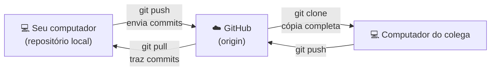

---

## Passo 1 — Criar o repositório no site

No GitHub, clique no **+** do alto da página ➔ **New repository**.

<figure markdown="span">
  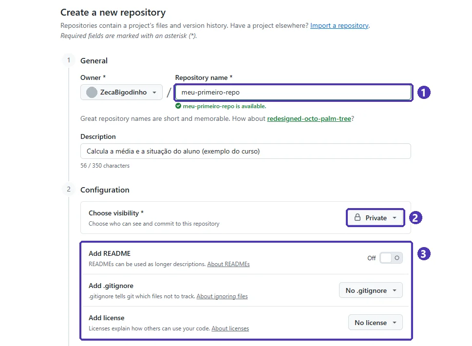{ loading=lazy }
  <figcaption>(1) O nome do repositório (o GitHub avisa se ele está livre) · (2) <strong>Private</strong> ou <strong>Public</strong> · (3) README, <code>.gitignore</code> e licença: <strong>desligados</strong> quando o projeto já existe no seu computador.</figcaption>
</figure>

1. **Repository name:** curto, minúsculo e com hífens (`meu-primeiro-repo`, `sistema-escolar`).
2. **Description:** uma frase dizendo o que o projeto faz (aparece na página do repositório).
3. **Visibility:** *Private* durante o desenvolvimento; *Public* para o portfólio (a [aula 03](03_vscode_e_github_desktop.md#passo-3-publicar-no-github) explica quando usar cada um).
4. **README, `.gitignore` e licença** — aqui está a decisão importante:

| O seu caso | O que marcar |
|---|---|
| O projeto **já existe** no computador e já tem commits (é o caso desta aula) | **Nada.** O repositório nasce vazio, e você envia o seu histórico para ele. |
| O projeto vai **começar do zero** | *Add README* ligado, *.gitignore* = **Python** e uma licença (por exemplo, **MIT**). Depois é só fazer o `git clone` (Passo 5). |

!!! warning "Por que vazio?"
    Se você marcar o README num repositório que vai receber um projeto existente, o GitHub cria um commit lá que o seu computador não tem. O primeiro `push` é **recusado** — exatamente o erro do Passo 4. Dá para resolver, mas é melhor não criar o problema.

Clique em **Create repository**.

## Passo 2 — Ligar o seu repositório ao GitHub (`git remote`)

O repositório vazio abre com o *Quick setup*: o endereço do repositório e os comandos prontos.

<figure markdown="span">
  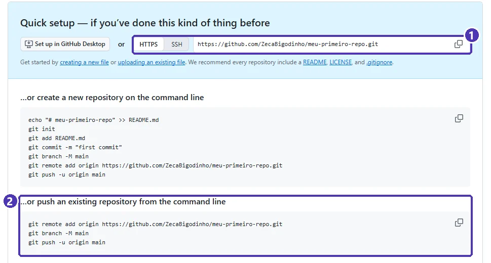{ loading=lazy }
  <figcaption>(1) O endereço do repositório: deixe em <strong>HTTPS</strong> e use o botão de copiar · (2) <em>push an existing repository</em>: os três comandos para o projeto que você já tem.</figcaption>
</figure>

No terminal do VS Code, **dentro da pasta do projeto**:

```powershell
git remote add origin https://github.com/seu-usuario/meu-primeiro-repo.git
git remote -v
```

- `git remote add origin <endereço>` dá um **apelido** ao endereço do GitHub. Por costume, o remoto principal se chama **`origin`**.
- `git remote -v` confere: mostra o endereço duas vezes, uma para buscar (*fetch*) e outra para enviar (*push*).

!!! tip "E o `git branch -M main`?"
    O terceiro comando do *Quick setup* renomeia a branch para `main`. Se você configurou `init.defaultBranch main` na [aula 01](01_git_e_github_conceitos_e_instalacao.md), ela já se chama `main` e o comando não muda nada — pode rodar ou pular.

## Passo 3 — O primeiro envio (`git push -u`)

```powershell
git push -u origin main
```

Lê-se: “envie a branch `main` para o `origin`”. O `-u` (*upstream*) grava essa ligação: daqui em diante, basta `git push` e `git pull`, sem repetir `origin main`.

<figure markdown="span">
  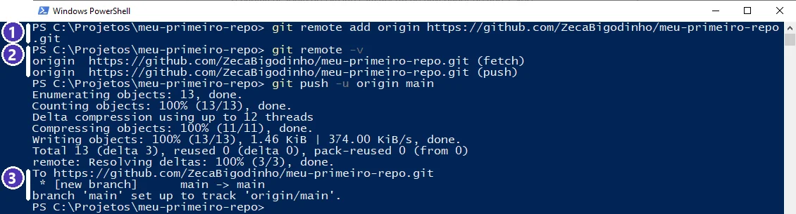{ loading=lazy }
  <figcaption>(1) O remoto <code>origin</code> é criado · (2) <code>git remote -v</code> confere o endereço · (3) o envio deu certo: <em>[new branch] main -> main</em>, e a <em>main</em> agora acompanha a <em>origin/main</em>.</figcaption>
</figure>

### Como o Git entra na sua conta

O GitHub **não aceita a senha da conta** no terminal. Na primeira vez que você faz `push` num computador, o **Gerenciador de Credenciais do Git** (instalado junto com o Git para Windows) abre uma janela *Connect to GitHub*:

1. Clique em **Sign in with your browser**.
2. O navegador abre o GitHub: entre na conta (com a verificação em duas etapas) e clique em **Authorize**.
3. Volte ao terminal: o `push` continua sozinho.

A permissão fica guardada no **Gerenciador de Credenciais do Windows**. Nos próximos `push`, nada é perguntado.

!!! danger "Computador da escola ou emprestado"
    A permissão fica salva **no computador**. Num computador que outras pessoas usam, ao terminar: *Painel de Controle* ➔ *Gerenciador de Credenciais* ➔ *Credenciais do Windows* ➔ apague a linha `git:https://github.com`. Se esquecer, revogue pelo site: *Settings* ➔ *Applications* ➔ *Authorized OAuth Apps* ➔ **Git Credential Manager** ➔ *Revoke*.

Recarregue a página do repositório no GitHub:

<figure markdown="span">
  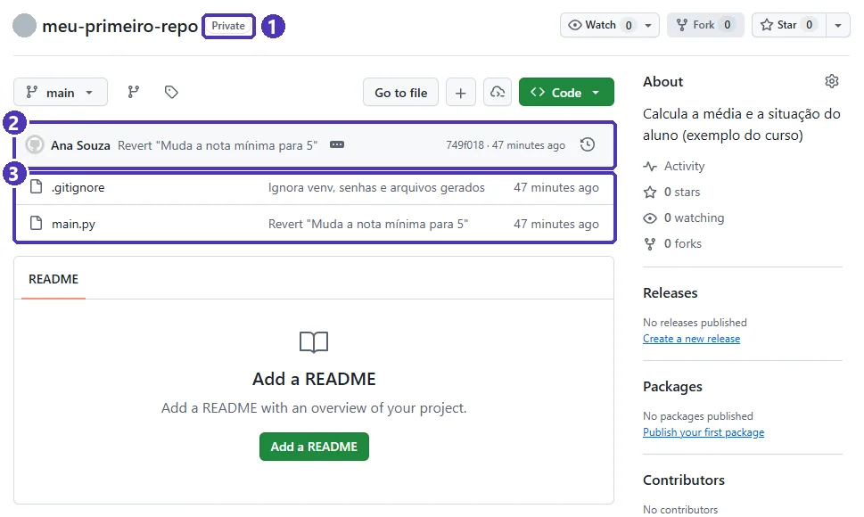{ loading=lazy }
  <figcaption>(1) <strong>Private</strong>: só você vê · (2) o último commit, com o autor e o código curto (clique no relógio para ver o histórico) · (3) os arquivos enviados — o <code>.gitignore</code> da aula 02 deixou de fora o <code>.env</code>, o <code>venv</code> e o <code>__pycache__</code>.</figcaption>
</figure>

## Passo 4 — Quando o push é recusado

Situação comum: alguém (um colega, ou você mesmo pelo site) mudou o repositório no GitHub, e você fez outro commit no computador sem antes buscar essa mudança.

Para ver acontecer, crie um README **pelo site**: na página do repositório, **Add a README** ➔ escreva o texto ➔ **Commit changes**.

<figure markdown="span">
  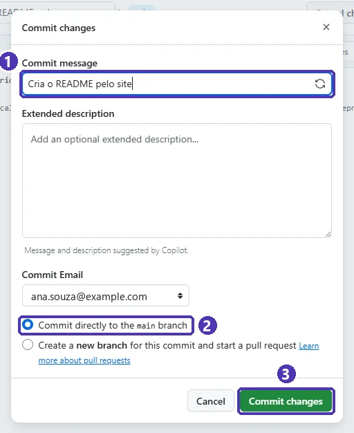{ loading=lazy }
  <figcaption>Commit pelo site: (1) a mensagem, como no <code>git commit -m</code> · (2) direto na <em>main</em> · (3) <strong>Commit changes</strong> grava o commit no GitHub — e só lá.</figcaption>
</figure>

Agora, **sem** fazer `pull`, mude um arquivo no computador, faça o commit e tente enviar:

```powershell
git commit -am "Corrige a quarta nota"
git push
```

<figure markdown="span">
  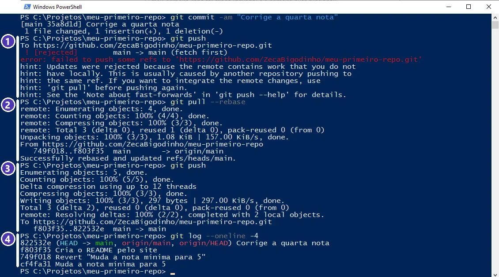{ loading=lazy }
  <figcaption>(1) <strong>Recusado</strong> (<em>rejected, fetch first</em>): o GitHub tem um commit que você não tem · (2) <code>git pull --rebase</code> traz o commit do site e coloca o seu por cima · (3) agora o <code>push</code> passa · (4) no histórico, os dois commits, um depois do outro.</figcaption>
</figure>

**Leia a mensagem:** *“Updates were rejected because the remote contains work that you do not have locally”* — o remoto tem trabalho que você não tem. O Git recusa para **não apagar** o commit do outro lado. A própria dica diz o caminho: *“use 'git pull' before pushing again”*.

```powershell
git pull --rebase    # traz o que falta e reaplica os seus commits por cima
git push             # agora vai
```

!!! info "Por que `--rebase`?"
    Sem ele, quando os dois lados têm commits novos, o Git pergunta como juntar (*“You have divergent branches and need to specify how to reconcile them”*) ou cria um commit extra de junção (*merge*). Com `--rebase`, o histórico fica em **linha reta**, como no `git log` da imagem. Para não precisar digitar sempre: `git config --global pull.rebase true`.

!!! danger "Nunca use `git push --force` para “resolver”"
    O `--force` substitui o histórico do GitHub pelo seu — e **apaga** os commits que só existiam lá (o README do site, o trabalho do colega). Push recusado se resolve com `pull`, não com força.

## Passo 5 — Baixar um repositório (`git clone`)

`git clone` copia o repositório **inteiro** — arquivos e todo o histórico — e já deixa o `origin` configurado. É o que um colega faz para começar a trabalhar no projeto, ou o que você faz num computador novo.

```powershell
cd C:\Projetos
git clone https://github.com/seu-usuario/meu-primeiro-repo.git copia-do-colega
cd copia-do-colega
```

O último nome (`copia-do-colega`) é opcional: sem ele, a pasta recebe o nome do repositório.

<figure markdown="span">
  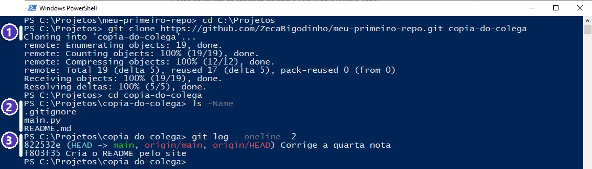{ loading=lazy }
  <figcaption>(1) O <code>clone</code> baixa tudo para uma pasta nova · (2) os arquivos do projeto — o <code>.env</code> e o <code>venv</code> não vêm, porque nunca foram para o GitHub · (3) o histórico completo veio junto.</figcaption>
</figure>

!!! tip "Depois do clone, recrie o que ficou de fora"
    O `.gitignore` funcionou: quem clona **não** recebe o `venv` nem o `.env`. Na pasta nova, crie o ambiente (`python -m venv venv`, ative e `pip install -r requirements.txt`) e copie o `.env.example` para `.env` com os valores certos ([aula 03](03_vscode_e_github_desktop.md#passo-1-antes-de-tudo-o-gitignore)).

## Passo 6 — Receber as novidades (`git pull`)

O colega mudou o README na cópia dele, fez o commit e o `push`. Do seu lado, para receber:

```powershell
git pull
```

<figure markdown="span">
  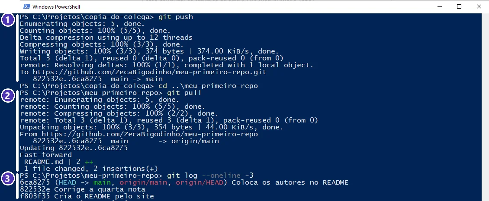{ loading=lazy }
  <figcaption>(1) Na cópia do colega: o <code>push</code> envia o commit · (2) na sua pasta: <code>git pull</code> traz o commit — <em>Fast-forward</em> quer dizer que você não tinha nada novo, então foi só avançar · (3) o commit do colega no topo do seu histórico.</figcaption>
</figure>

Esse é o ciclo do trabalho em equipe:

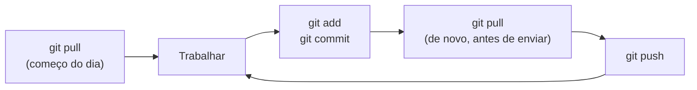

!!! tip "No VS Code é um botão só"
    **Sincronizar Alterações** ([aula 03](03_vscode_e_github_desktop.md#passo-4-o-dia-a-dia-commit-e-sincronizar)) faz `git pull` e depois `git push`. Se o VS Code mostrar que há commits para descer (↓), é o `pull` trazendo trabalho dos colegas.

## Passo 7 — Colaboradores

Para outras pessoas poderem fazer `push` no seu repositório, convide-as: no repositório, **Settings** ➔ **Collaborators** ➔ **Add people**.

<figure markdown="span">
  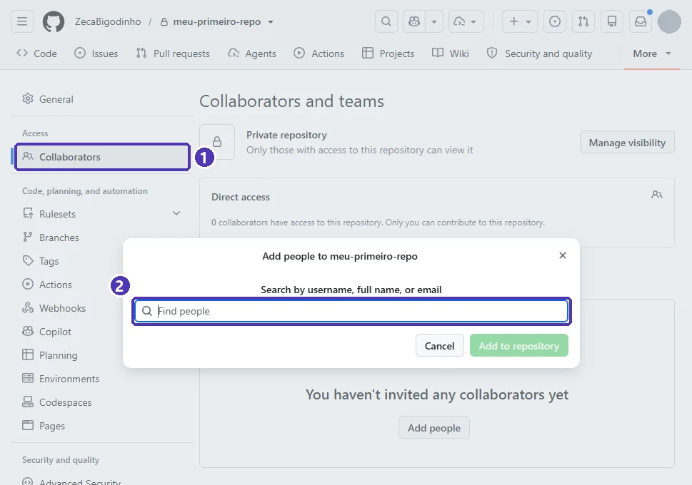{ loading=lazy }
  <figcaption>(1) <strong>Collaborators</strong>, no menu da esquerda das configurações · (2) busque o colega pelo <strong>nome de usuário</strong> do GitHub e clique em <em>Add to repository</em>.</figcaption>
</figure>

1. Peça a cada colega o **nome de usuário** do GitHub (é mais seguro que buscar pelo nome completo, que pode ter homônimos).
2. **Add people** ➔ digite o usuário ➔ escolha a pessoa certa (confira a foto e o nome) ➔ **Add to repository**.
3. O colega recebe o convite por e-mail e nas notificações do GitHub e precisa **aceitar** (*Accept invitation*). Enquanto não aceitar, o `push` dele é negado.
4. Depois de aceitar, ele faz o `git clone` (Passo 5) e trabalha normalmente.

!!! warning "Colaborador pode tudo no código"
    Num repositório pessoal, colaborador pode enviar commits, criar e apagar branches e mudar arquivos. Convide só quem faz parte da equipe e **remova** quem saiu (*Collaborators* ➔ *Remove*). O professor pode ser convidado para acompanhar o projeto privado.

### Combinados da equipe

| Combinado | Por quê |
|---|---|
| **`pull` antes de começar e antes de cada `push`** | Você trabalha sempre em cima da versão mais nova. |
| **Cada pessoa cuida de arquivos diferentes** (por exemplo: `views/`, `database/`, `controllers/`) | Duas pessoas mudando a mesma linha geram **conflito** — o assunto da aula 05. |
| **Commits pequenos, com mensagem clara** | Fica fácil entender e desfazer ([aula 02](02_primeiro_repositorio.md)). |
| **`.env` nunca no repositório** | Cada um tem o seu `.env`; no repositório vai só o `.env.example`. |

---

## ⚠️ Erros comuns

- **`fatal: not a git repository`** — o terminal não está na pasta do projeto. Use `cd` até a pasta que tem o `.git` (no VS Code: *Arquivo ➔ Abrir Pasta*, depois abra o terminal).
- **`error: remote origin already exists`** — o remoto já foi criado (talvez pelo VS Code). Confira com `git remote -v`. Para trocar o endereço: `git remote set-url origin <endereço-novo>`.
- **`! [rejected] main -> main (fetch first)`** — o GitHub tem commits que você não tem. `git pull --rebase` e depois `git push` (Passo 4).
- **`error: src refspec main does not match any`** — a branch não se chama `main` (veja com `git branch`) ou ainda não há nenhum commit. Faça o primeiro commit, ou envie com o nome certo: `git push -u origin master`.
- **`remote: Repository not found`** — o endereço está errado, o repositório é privado e você não tem acesso, ou o convite de colaborador ainda não foi aceito.
- **`Permission denied` / erro 403** — o computador está conectado com **outra** conta do GitHub. Apague a credencial `git:https://github.com` no Gerenciador de Credenciais do Windows e faça o `push` de novo para entrar com a conta certa.
- **Pediu usuário e senha no terminal e a senha não funciona** — o GitHub não aceita a senha da conta. Atualize o Git para Windows (o Gerenciador de Credenciais vem junto) e tente de novo.

---

## Exercícios

### Básico (fixação)

1. Crie no GitHub um repositório **privado e vazio** chamado `meu-primeiro-repo`.
2. Ligue o `meu-primeiro-repo` da aula 02 a ele e envie os commits.
3. Confira, na página do repositório, que o `.env` e o `venv` **não** foram enviados.

<!-- gabarito -->
??? success "Gabarito — Básico"
    1. **+** ➔ **New repository** ➔ nome `meu-primeiro-repo` ➔ **Private** ➔ README, `.gitignore` e licença **desligados** ➔ **Create repository**.
    2. No terminal, dentro da pasta do projeto:
        ```powershell
        git remote add origin https://github.com/seu-usuario/meu-primeiro-repo.git
        git push -u origin main
        ```
        Na primeira vez, entre pela janela *Connect to GitHub* ➔ **Sign in with your browser**.
    3. Na página do repositório devem aparecer só os arquivos do projeto (`main.py`, `.gitignore`...). Se o `.env` aparecer, siga o quadro **“Publicou o `.env` sem querer?”** da [aula 03](03_vscode_e_github_desktop.md#passo-3-publicar-no-github).

### Intermediário (aplicação)

1. Pelo site, crie um `README.md` no seu repositório.
2. No computador, **sem** fazer `pull`, mude o `main.py`, faça o commit e tente o `push`. Anote a mensagem de erro.
3. Resolva e confira que o histórico tem os dois commits.

<!-- gabarito -->
??? success "Gabarito — Intermediário"
    1. **Add a README** ➔ texto ➔ **Commit changes** ➔ **Commit directly to the main branch** ➔ **Commit changes**.
    2. `git commit -am "Muda o main.py"` e `git push` ➔ `! [rejected] main -> main (fetch first)`: o GitHub tem um commit (o do README) que o seu computador não tem.
    3. ```powershell
        git pull --rebase
        git push
        git log --oneline -3
        ```
        No `log`, o seu commit aparece **em cima** do commit do README — e o `README.md` agora também está na sua pasta.

### Avançado (desafio)

1. Clone o seu repositório numa **segunda pasta** (como se fosse o computador de um colega).
2. Na segunda pasta, mude um arquivo, faça o commit e o `push`.
3. Volte à primeira pasta e traga a mudança. Explique o que quer dizer *Fast-forward* na saída.
4. Por que o `venv` não veio no clone, e o que o colega precisa fazer antes de rodar o programa?

<!-- gabarito -->
??? success "Gabarito — Avançado"
    1. ```powershell
        cd C:\Projetos
        git clone https://github.com/seu-usuario/meu-primeiro-repo.git copia-do-colega
        ```
    2. Na pasta `copia-do-colega`: edite, `git commit -am "Mensagem"` e `git push`. (O clone já vem com o `origin` e o `-u` configurados: não precisa de `remote add`.)
    3. Na primeira pasta: `git pull`. *Fast-forward* (avanço rápido) quer dizer que a sua pasta não tinha commits novos: o Git só **avançou** a sua `main` até o último commit do GitHub, sem precisar juntar nada.
    4. O `venv` está no `.gitignore`, então nunca foi para o GitHub — e nem deveria: ele é grande e só funciona no computador onde foi criado. O colega cria o dele: `python -m venv venv`, ativa e roda `pip install -r requirements.txt`. O mesmo vale para o `.env` (a partir do `.env.example`).

---

## 🏆 Missão da Equipe

**Tarefa:** montar o repositório oficial do Projeto Final da equipe.

- [ ] Um integrante cria o repositório (privado) e envia o código atual do projeto, com o `.gitignore` e o `.env.example`.
- [ ] Todos os integrantes (e o professor, se ele pedir) são convidados como **colaboradores** e aceitam o convite.
- [ ] Cada integrante faz o `git clone`, cria o próprio `venv` e `.env` e roda o programa.
- [ ] Cada integrante faz **pelo menos um commit** numa parte diferente do projeto e envia.
- [ ] Cada integrante faz `git pull` e vê, no `git log`, os commits dos colegas.

!!! note "Para o professor"
    Na aba **Commits** do repositório devem aparecer commits de todos os integrantes, com nomes reconhecíveis. Commit com nome ou foto de outra pessoa indica `user.email` errado ([aula 01](01_git_e_github_conceitos_e_instalacao.md#e-mail-privado-nos-commits)).

---

## 💡 Resumo

- Repositório para um projeto que **já existe**: crie **vazio** no site. Projeto **novo**: crie com README, `.gitignore` Python e licença, e faça o `clone`.
- `git remote add origin <endereço>` liga as duas pontas; `git push -u origin main` faz o primeiro envio; depois, só `git push`.
- O terminal entra na sua conta pelo **Gerenciador de Credenciais** (janela do navegador), nunca pela senha.
- **Push recusado** (*fetch first*) = o GitHub tem commits que você não tem ➔ `git pull --rebase` e `git push`. **Nunca** `--force`.
- `git clone` = cópia completa com histórico; `git pull` = receber as novidades.
- Equipe: colaboradores convidados pelo **usuário**, `pull` antes de começar e antes de enviar, cada um nos seus arquivos.

## ➡️ Próximo passo

**05 — Branches e Pull Requests** *(em preparação)*: cada integrante trabalha numa branch, abre um Pull Request para revisão e aprende a resolver **conflitos**.
