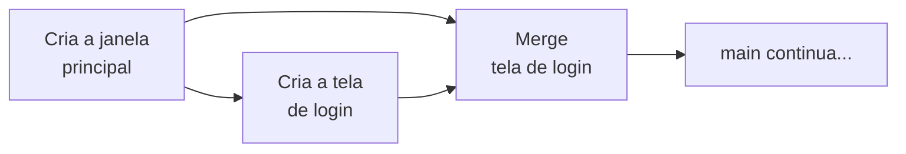
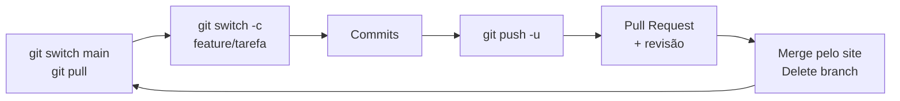

# 05 — Branches, Pull Requests, conflitos e Issues

> **Curso:** Python para Desktop  
> **Módulo:** 06 — Git & GitHub (bônus)  
> **Tempo estimado:** 2 h 30 min  

---

## 🎯 Objetivos

Ao final desta aula, você será capaz de:

- Explicar o que é uma **branch** e por que a equipe não trabalha direto na `main`.
- Criar, listar, trocar e apagar branches com `git switch` e `git branch`.
- Enviar uma branch para o GitHub e abrir um **Pull Request** (PR) com título e descrição.
- **Revisar** o PR de um colega e fazer o *merge* pelo site.
- Ler e resolver um **conflito** de merge no terminal e no VS Code.
- Organizar as tarefas da equipe com **Issues** e fechá-las automaticamente pelo PR.

## Pré-requisitos

- [Aula 04](04_repositorio_remoto_e_equipe.md): repositório no GitHub, `push`, `pull`, `clone` e colaboradores.
- O repositório da equipe (ou o `meu-primeiro-repo`) clonado no seu computador.

!!! info "O problema que a branch resolve"
    Na aula 04, todo mundo fazia commit direto na `main`. Funciona com uma ou duas pessoas, mas logo aparecem problemas: o código de alguém quebra o programa dos outros, ninguém confere o que entrou e uma tarefa pela metade vai parar no projeto. Com **branches**, cada tarefa ganha uma linha de trabalho separada. A `main` só recebe o que está **pronto e revisado**.

---

## Passo 1 — O que é uma branch

Uma **branch** (ramo) é uma linha do histórico com nome próprio. A `main` é a branch principal: a versão que funciona. Para cada tarefa, você cria uma branch a partir da `main`, trabalha nela com quantos commits quiser e, no fim, **junta** (*merge*) o resultado de volta.



Enquanto a branch existe, a `main` não muda. Se a tarefa der errado, basta abandonar a branch: nada do que estava funcionando foi estragado.

!!! tip "Nomes de branch"
    Use nomes curtos, minúsculos, com hífens e um prefixo que diga o tipo da tarefa: `feature/tela-login` (algo novo), `fix/calculo-media` (correção), `docs/readme` (documentação). O nome aparece no GitHub e no PR, então ele precisa explicar a tarefa.

## Passo 2 — Criar e trocar de branch

Sempre comece a partir da `main` atualizada:

```powershell
git switch main
git pull
git switch -c feature/tela-login
```

- `git switch -c <nome>` **cria** a branch e já entra nela (o `-c` vem de *create*).
- `git switch <nome>` **troca** para uma branch que já existe.
- `git branch` **lista** as branches; o `*` marca a branch em que você está.

```text
$ git switch -c feature/tela-login
Switched to a new branch 'feature/tela-login'

$ git branch
* feature/tela-login
  main
```

Agora trabalhe normalmente: crie os arquivos, teste e faça os commits.

```text
$ git add .
$ git commit -m "Cria a tela de login"
[feature/tela-login 8d684ac] Cria a tela de login
 1 file changed, 5 insertions(+)
 create mode 100644 views/login.py
```

Repare que o próprio commit mostra a branch: `[feature/tela-login ...]`.

!!! example "Teste: a `main` não mudou"
    Troque para a `main` e liste os arquivos:

    ```text
    $ git switch main
    Your branch is up to date with 'origin/main'.
    Switched to branch 'main'

    $ ls
    main.py
    ```

    A pasta `views/` sumiu! Ela não foi apagada: está guardada na branch `feature/tela-login`. Volte com `git switch feature/tela-login` e ela reaparece. O Git troca os arquivos da pasta conforme a branch.

!!! tip "No VS Code"
    O nome da branch atual aparece no **canto inferior esquerdo** da janela. Clique nele para trocar de branch ou escolher **Criar nova branch...**. É o mesmo `git switch`, só que com botões.

!!! warning "Antes de trocar de branch, faça o commit"
    Se você mudou arquivos e não fez o commit, o Git pode recusar a troca:

    ```text
    error: Your local changes to the following files would be overwritten by checkout:
            views/login.py
    Please commit your changes or stash them before you switch branches.
    ```

    Faça o commit do que está pronto e depois troque de branch.

## Passo 3 — Enviar a branch e abrir o Pull Request

Na primeira vez, envie a branch com `-u` (como na aula 04):

```powershell
git push -u origin feature/tela-login
```

Na saída, o próprio GitHub mostra o link para abrir o PR:

```text
remote:
remote: Create a pull request for 'feature/tela-login' on GitHub by visiting:
remote:      https://github.com/seu-usuario/sistema-escolar/pull/new/feature/tela-login
remote:
To https://github.com/seu-usuario/sistema-escolar.git
 * [new branch]      feature/tela-login -> feature/tela-login
branch 'feature/tela-login' set up to track 'origin/feature/tela-login'.
```

Um **Pull Request** é um pedido: *"revisem o que eu fiz na minha branch e juntem na `main`"*. Para abrir:

1. Abra o link da saída. Outra opção é ir à página do repositório e clicar em **Compare & pull request**, no aviso amarelo que aparece depois do `push`.
2. Confira as duas branches no alto: **base: `main`** ← **compare: `feature/tela-login`**. Lê-se: "levar a `feature/tela-login` para dentro da `main`".
3. **Título:** o que o PR faz, como uma mensagem de commit ("Cria a tela de login").
4. **Descrição:** o que mudou, como testar e, se houver, a Issue que ele resolve (Passo 7). Um modelo simples:

    ```markdown
    ## O que muda
    - Nova tela de login em `views/login.py`.

    ## Como testar
    1. Rode `python main.py`.
    2. A tela de login aparece antes da janela principal.

    Closes #3
    ```

5. Clique em **Create pull request**.

!!! info "O PR acompanha a branch"
    Depois de aberto, todo novo `push` na mesma branch entra **no mesmo PR**. Se o revisor pedir uma mudança, você corrige, faz o commit e o `git push`, sem abrir outro PR.

## Passo 4 — Revisar o PR de um colega

A revisão é feita por **outra pessoa da equipe**. Na página do PR:

| Aba | Para que serve |
|---|---|
| **Conversation** | A descrição, os comentários e o botão de merge. |
| **Commits** | Os commits da branch, um por um. |
| **Files changed** | O que mudou em cada arquivo: verde = linha nova, vermelho = linha removida. |

Para revisar:

1. Abra **Files changed** e leia as mudanças.
2. Para comentar uma linha, passe o mouse sobre ela e clique no **+** azul. Escreva a sugestão ("Esse nome de variável ficou confuso", "Falta tratar a senha vazia").
3. Termine com o botão **Review changes** (em algumas versões do site, *Submit review*) e escolha:
    - **Comment**: só comentários, sem decidir.
    - **Approve**: está bom, pode juntar.
    - **Request changes**: precisa mudar antes de juntar.

!!! tip "Revisão boa é gentil e concreta"
    Comente o **código**, não a pessoa. Diga o que mudar e por quê: "Sugiro `validar_senha()` em vez de `vs()`: o nome explica o que a função faz". E elogie o que ficou bom, porque isso também ensina.

!!! note "Para o professor"
    Com o professor como colaborador, ele pode revisar os PRs da equipe e acompanhar quem fez o quê pela aba **Pull requests** do repositório.

## Passo 5 — Fazer o merge e limpar

Com o PR aprovado, na aba **Conversation**:

1. Confira o aviso verde *This branch has no conflicts with the base branch* (não há conflito).
2. Clique em **Merge pull request** ➔ **Confirm merge**.
3. Clique em **Delete branch**. A branch já cumpriu o papel dela, e o histórico continua guardado na `main`.

Agora a `main` do GitHub tem o trabalho novo, mas o seu computador ainda não. Atualize e apague a branch local:

```powershell
git switch main
git pull
git branch -d feature/tela-login
```

```text
$ git branch -d feature/tela-login
Deleted branch feature/tela-login (was 8d684ac).
```

O histórico mostra a branch saindo e voltando para a `main`:

```text
$ git log --oneline --graph
*   fb027da Merge pull request #1 from ana-souza/feature/tela-login
|\
| * 8d684ac Cria a tela de login
|/
* d78a963 Cria a janela principal
```

!!! info "`-d` pequeno é seguro"
    `git branch -d` só apaga a branch que **já foi juntada**. Se ainda houver trabalho que não está em lugar nenhum, o Git recusa:

    ```text
    error: the branch 'feature/tamanho-janela' is not fully merged
    ```

    O `-D` maiúsculo apaga mesmo assim e **descarta** esses commits. Use só quando tiver certeza de que quer jogar o trabalho fora.

Esse é o ciclo de cada tarefa:



## Passo 6 — Conflitos

Um **conflito** acontece quando duas branches mudam **as mesmas linhas** de um arquivo. O Git não sabe qual versão vale e pede para uma pessoa decidir. Não é erro, e nada se perdeu: é uma pergunta do Git.

**A situação:** a Ana criou a branch `feature/tamanho-janela` e mudou o título e o tamanho da janela no `main.py`. Enquanto isso, o PR do Bruno, que muda **o mesmo título**, foi juntado na `main`. O PR da Ana mostra o aviso *This branch has conflicts that must be resolved*.

O jeito mais seguro de resolver é **no seu computador**: traga a `main` para dentro da sua branch.

```powershell
git switch main
git pull
git switch feature/tamanho-janela
git merge main
```

```text
Auto-merging main.py
CONFLICT (content): Merge conflict in main.py
Automatic merge failed; fix conflicts and then commit the result.
```

O `git status` aponta o arquivo em conflito (*both modified*, ou seja, modificado pelos dois lados):

```text
$ git status
On branch feature/tamanho-janela
You have unmerged paths.
  (fix conflicts and run "git commit")
  (use "git merge --abort" to abort the merge)

Unmerged paths:
  (use "git add <file>..." to mark resolution)
        both modified:   main.py
```

Abra o `main.py`. O Git marcou o trecho com as duas versões:

```text
import customtkinter as ctk

janela = ctk.CTk()
<<<<<<< HEAD
janela.title("Sistema Escolar 2026")
janela.geometry("1024x700")
=======
janela.title("Sistema Escolar — IF")
janela.geometry("800x600")
>>>>>>> main
janela.mainloop()
```

| Marca | Significado |
|---|---|
| `<<<<<<< HEAD` | Começo da **sua** versão (a branch em que você está). |
| `=======` | Divisão entre as duas versões. |
| `>>>>>>> main` | Fim da versão que **chegou** da `main`. |

**Resolver é editar o arquivo** até ele ficar do jeito certo **e sem as marcas**. Aqui, a equipe combinou manter o nome da escola (do Bruno) e a janela maior (da Ana):

```python
import customtkinter as ctk

janela = ctk.CTk()
janela.title("Sistema Escolar — IF")
janela.geometry("1024x700")
janela.mainloop()
```

Teste o programa e termine o merge:

```powershell
git add main.py
git commit --no-edit
git push
```

O `git add` avisa ao Git que o conflito daquele arquivo está resolvido. O `git commit --no-edit` grava o commit de merge com a mensagem padrão (*Merge branch 'main' into feature/tamanho-janela*). Depois do `push`, o PR da Ana fica verde de novo e pode ser revisado e juntado.

!!! tip "No VS Code: botões sobre o conflito"
    O VS Code pinta as duas versões (a atual e a recebida) e mostra links logo acima do trecho: **Aceitar Alteração Atual** (a sua), **Aceitar Alteração Recebida** (a da `main`), **Aceitar Ambas as Alterações** e **Comparar Alterações**. No exemplo, nenhum botão resolve sozinho, porque a resposta certa mistura as duas. Aceite uma versão e ajuste a linha à mão. Arquivos com conflito aparecem com um **C** na aba *Controle do Código-Fonte*.

!!! warning "Desistir também é uma opção"
    Se o conflito ficou confuso, `git merge --abort` desfaz a tentativa e devolve a branch ao estado de antes do `git merge`. Converse com o colega que mexeu nas mesmas linhas e tente de novo.

!!! info "E o botão *Resolve conflicts* do site?"
    Para conflitos pequenos, o GitHub oferece um editor no próprio PR com as mesmas marcas `<<<<<<<`, `=======` e `>>>>>>>`. Funciona, mas lá você **não consegue testar** o programa. No computador, você resolve, roda o programa e só depois envia.

### Como evitar conflitos

| Combinado | Por quê |
|---|---|
| **Branches pequenas e curtas** (uma tarefa, poucos dias) | Quanto mais tempo a branch fica separada, mais a `main` muda e maior a chance de conflito. |
| **`git merge main` na sua branch com frequência** | Os conflitos aparecem pequenos, um de cada vez. |
| **Cada pessoa nos seus arquivos** (`views/`, `database/`, `controllers/`) | Conflito só acontece quando duas pessoas mudam as mesmas linhas. |
| **Avisar a equipe** antes de mexer num arquivo de todos (`main.py`, `requirements.txt`) | Quem sabe antes espera ou combina. |

## Passo 7 — Issues: a lista de tarefas da equipe

Uma **Issue** é um cartão de tarefa ou de problema dentro do repositório: "Criar a tela de login", "O cálculo da média arredonda errado". Ela fica na aba **Issues** e recebe um número (`#3`).

Para criar: **Issues** ➔ **New issue** ➔ preencha:

- **Title:** a tarefa em uma frase ("Criar a tela de login").
- **Description:** o que precisa ser feito e como saber que terminou. Para um problema, inclua os passos para repetir o erro.
- **Assignees:** quem vai fazer a tarefa.
- **Labels:** o tipo, por exemplo `bug` (erro) ou `enhancement` (melhoria).

Clique em **Create** (em algumas versões do site, *Submit new issue*).

**Ligando a Issue ao PR:** escreva `Closes #3` na descrição do PR (como no modelo do Passo 3). Quando o PR for juntado na `main`, o GitHub **fecha a Issue #3 sozinho** e deixa o link entre os dois. `Fixes #3` e `Resolves #3` funcionam do mesmo jeito.

!!! tip "Um fluxo completo de equipe"
    1. A equipe divide o projeto em **Issues**, cada uma com um responsável.
    2. Cada pessoa cria uma **branch** para a sua Issue.
    3. Quando termina, abre um **PR** com `Closes #número`.
    4. Um colega **revisa**; o autor ajusta, se for preciso.
    5. **Merge** ➔ a Issue fecha sozinha ➔ todos fazem `git pull` na `main`.

---

## ⚠️ Erros comuns

- **Fiz os commits na `main` sem querer** e ainda não enviei: crie a branch ali mesmo (`git switch -c feature/tarefa`). Os commits vão junto. Envie a branch e abra o PR. Peça ajuda ao professor antes de "consertar" a `main` local.
- **`fatal: a branch named 'main' already exists`**: você usou `git switch -c` com um nome que já existe. Para só trocar, use `git switch` sem o `-c`.
- **`fatal: invalid reference: <nome>`**: a branch não existe com esse nome. Confira com `git branch -a` (o `-a` mostra também as branches do GitHub). Se o colega acabou de criar a branch, rode antes `git fetch`.
- **`error: Your local changes ... would be overwritten by checkout`**: há mudanças sem commit. Faça o commit e depois troque de branch (Passo 2).
- **`error: the branch '...' is not fully merged`**: a branch tem commits que não estão na `main`. Confira se o PR foi mesmo juntado e se você fez o `git pull` na `main` (Passo 5).
- **Fiz o commit com as marcas `<<<<<<<` no arquivo**: o programa nem abre (erro de sintaxe). Apague as marcas, deixe o código certo, teste e faça um novo commit.
- **O PR mostra commits de outras pessoas**: a branch foi criada a partir de outra branch, e não da `main`. Para a próxima tarefa, comece sempre com `git switch main` e `git pull`.

---

## Exercícios

### Básico (fixação)

1. No seu repositório, crie a branch `docs/readme`, acrescente uma seção "Como rodar" ao `README.md` e faça o commit.
2. Troque para a `main` e confira que a seção nova **não** está lá. Volte para a branch.
3. Envie a branch para o GitHub e abra um PR para a `main`.

<!-- gabarito -->
??? success "Gabarito — Básico"
    1. ```powershell
        git switch main
        git pull
        git switch -c docs/readme
        # edite o README.md
        git add README.md
        git commit -m "Acrescenta a seção Como rodar ao README"
        ```
    2. `git switch main` e abra o `README.md`: a seção não está lá, porque o commit está só na branch. `git switch docs/readme` traz a seção de volta.
    3. `git push -u origin docs/readme` ➔ abra o link da saída (ou **Compare & pull request**) ➔ confira **base: `main`** ← **compare: `docs/readme`** ➔ título e descrição ➔ **Create pull request**.

### Intermediário (aplicação)

1. Em dupla: cada pessoa abre um PR no repositório da equipe, cada um num arquivo diferente.
2. Revise o PR do colega: deixe pelo menos **um comentário numa linha** e termine com **Approve**.
3. Faça o merge do seu PR, apague a branch no site e atualize o seu computador.

<!-- gabarito -->
??? success "Gabarito — Intermediário"
    1. Cada um: `git switch main`, `git pull`, `git switch -c feature/<tarefa>`, commits, `git push -u origin feature/<tarefa>` e **Create pull request**.
    2. No PR do colega: **Files changed** ➔ **+** azul na linha ➔ escreva o comentário ➔ **Review changes** ➔ **Approve** ➔ envie.
    3. No seu PR: **Merge pull request** ➔ **Confirm merge** ➔ **Delete branch**. No computador:
        ```powershell
        git switch main
        git pull
        git branch -d feature/<tarefa>
        ```
        Se o `-d` recusar com *not fully merged*, falta o `git pull` na `main`.

### Avançado (desafio)

1. Provoque um conflito de propósito: crie a branch `teste/conflito-a`, mude o título da janela no `main.py` e faça o commit. Volte para a `main`, crie a `teste/conflito-b` e mude **a mesma linha** de outro jeito.
2. Dentro da `teste/conflito-b`, rode `git merge teste/conflito-a`. Leia o arquivo e explique cada marca.
3. Resolva mantendo um título que junte as duas ideias, teste e termine o merge.
4. Apague as duas branches de teste. Por que uma delas precisa de `-D`?

<!-- gabarito -->
??? success "Gabarito — Avançado"
    1. ```powershell
        git switch main
        git switch -c teste/conflito-a
        # mude a linha janela.title(...) e salve
        git commit -am "Título A"
        git switch main
        git switch -c teste/conflito-b
        # mude a MESMA linha de outro jeito
        git commit -am "Título B"
        ```
    2. `git merge teste/conflito-a` ➔ `CONFLICT (content): Merge conflict in main.py`. Entre `<<<<<<< HEAD` e `=======` está a versão da branch atual (`teste/conflito-b`); entre `=======` e `>>>>>>> teste/conflito-a`, a versão que chegou.
    3. Edite a linha, apague as três marcas, rode `python main.py` e:
        ```powershell
        git add main.py
        git commit --no-edit
        ```
    4. ```powershell
        git switch main
        git branch -d teste/conflito-b
        git branch -d teste/conflito-a
        ```
        As duas recusam com *not fully merged*: nenhuma delas foi juntada na `main`. Como são só testes, apague com `git branch -D` (o maiúsculo descarta os commits). Em trabalho de verdade, o `-d` recusando é um aviso para conferir antes.

---

## 🏆 Missão da Equipe

**Tarefa:** fazer uma rodada completa de trabalho com Issues, branches e Pull Requests no repositório do Projeto Final.

- [ ] A equipe cria **uma Issue por integrante**, cada uma com uma parte diferente do projeto, um responsável (*Assignees*) e um rótulo (*Labels*).
- [ ] Cada integrante cria uma **branch** para a sua Issue e faz pelo menos dois commits.
- [ ] Cada integrante abre um **PR** com `Closes #número` na descrição.
- [ ] Cada PR recebe **uma revisão** de outro integrante, com pelo menos um comentário.
- [ ] Os PRs são juntados e as Issues fecham sozinhas.
- [ ] Pelo menos um conflito é resolvido **no computador** (se nenhum aparecer naturalmente, provoquem um no `README.md`).

!!! note "Para o professor"
    Confira em **Pull requests** ➔ **Closed**: cada PR deve ter autor, revisor, comentário e a Issue ligada. Em **Insights** ➔ **Network**, o desenho das branches mostra se a equipe trabalhou em paralelo.

---

## 💡 Resumo

- **Branch** = uma linha de trabalho separada. A `main` só recebe o que está pronto e revisado.
- `git switch -c <nome>` cria e entra na branch; `git switch <nome>` troca; `git branch` lista; `git branch -d` apaga a que já foi juntada.
- **Pull Request** = pedido para juntar uma branch na `main`, com revisão (*Comment*, *Approve*, *Request changes*) antes do **merge**.
- Depois do merge: **Delete branch** no site, `git switch main`, `git pull` e `git branch -d` no computador.
- **Conflito** = duas branches mudaram as mesmas linhas. Edite o arquivo, apague as marcas `<<<<<<<`, `=======` e `>>>>>>>`, teste, `git add` e `git commit`. Para desistir: `git merge --abort`.
- **Issues** organizam as tarefas; `Closes #3` no PR fecha a Issue no merge.

## ➡️ Próximo passo

**[06 — Publicando o Projeto Final](06_publicando_projeto_final.md)**: README completo, release `v1.0.0` e o repositório pronto para o portfólio.
