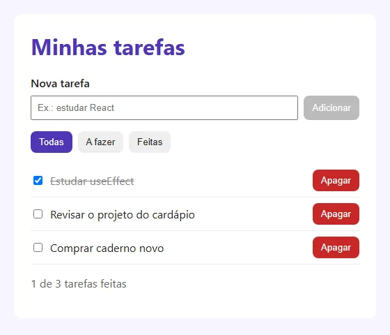

# 05 — Projeto do módulo: lista de tarefas

> **Curso:** React
> **Módulo:** 02 — Listas, formulários e efeitos
> **Tempo estimado:** 2 h

---

## Objetivos

Ao final deste projeto, você terá:

- A **lista de tarefas** em React, com formulário controlado, filtros e botões de marcar e apagar.
- Os dados guardados no `localStorage` com `useEffect` e carregados com inicialização preguiçosa.
- O app dividido em **componentes** com props tipadas.

## Pré-requisitos

- Aulas [01](01_formularios_controlados.md) a [04](04_buscar_dados.md) deste módulo.

---

## Três versões do mesmo app

| Versão | Como a tela muda |
|---|---|
| [JavaScript](../../desenvolvimento_web/modulo_03_javascript/05_projeto_lista_de_tarefas.md) | Você apaga e recria a lista com `createElement` |
| [TypeScript](../../typescript/modulo_03_navegador/04_projeto_lista_de_tarefas.md) | O mesmo, com tipos e módulos |
| **React (esta)** | Você só muda o **estado**; o React atualiza a tela |

Compare: nesta versão não existe nenhuma função `desenhar()`.

---

## Estrutura

```text
src/
├── App.tsx                 ← estado (tarefas e filtro) e as funções que o mudam
├── tipos.ts
├── armazenamento.ts        ← carregar e salvar no localStorage, com validação
├── index.css
└── components/
    ├── FormTarefa.tsx      ← formulário controlado
    ├── Filtros.tsx         ← Todas / A fazer / Feitas
    └── ItemTarefa.tsx      ← uma tarefa
```

Crie o projeto (`npm create vite@latest tarefas -- --template react-ts`), apague `src/App.css` e escreva os arquivos.

### `src/tipos.ts`

```ts
export type Tarefa = {
  id: number;
  texto: string;
  feita: boolean;
};

export type Filtro = "todas" | "afazer" | "feitas";
```

### `src/armazenamento.ts`

```ts
import type { Tarefa } from "./tipos";

const CHAVE = "tarefas-react";

function ehTarefa(valor: unknown): valor is Tarefa {
  if (typeof valor !== "object" || valor === null) return false;
  const v = valor as Record<string, unknown>;
  return typeof v.id === "number" && typeof v.texto === "string" && typeof v.feita === "boolean";
}

export function carregarTarefas(): Tarefa[] {
  try {
    const dados: unknown = JSON.parse(localStorage.getItem(CHAVE) ?? "[]");
    return Array.isArray(dados) ? dados.filter(ehTarefa) : [];
  } catch {
    return [];
  }
}

export function salvarTarefas(tarefas: Tarefa[]): void {
  localStorage.setItem(CHAVE, JSON.stringify(tarefas));
}
```

### `src/components/FormTarefa.tsx`

```tsx
import { useState } from "react";
import type { FormEvent } from "react";

type Props = { aoAdicionar: (texto: string) => void };

export default function FormTarefa({ aoAdicionar }: Props) {
  const [texto, setTexto] = useState("");

  function enviar(evento: FormEvent<HTMLFormElement>) {
    evento.preventDefault();
    const limpo = texto.trim();
    if (limpo === "") return;
    aoAdicionar(limpo);
    setTexto("");
  }

  return (
    <form onSubmit={enviar} className="form-tarefa">
      <label htmlFor="nova">Nova tarefa</label>
      <input
        id="nova"
        value={texto}
        onChange={(e) => setTexto(e.target.value)}
        maxLength={80}
        placeholder="Ex.: estudar React"
      />
      <button type="submit" disabled={texto.trim() === ""}>
        Adicionar
      </button>
    </form>
  );
}
```

### `src/components/ItemTarefa.tsx`

```tsx
import type { Tarefa } from "../tipos";

type Props = {
  tarefa: Tarefa;
  aoAlternar: (id: number) => void;
  aoApagar: (id: number) => void;
};

export default function ItemTarefa({ tarefa, aoAlternar, aoApagar }: Props) {
  return (
    <li className={tarefa.feita ? "feita" : undefined}>
      <input
        type="checkbox"
        checked={tarefa.feita}
        onChange={() => aoAlternar(tarefa.id)}
        aria-label={`Marcar "${tarefa.texto}" como feita`}
      />
      <span>{tarefa.texto}</span>
      <button type="button" className="apagar" onClick={() => aoApagar(tarefa.id)}>
        Apagar
      </button>
    </li>
  );
}
```

### `src/components/Filtros.tsx`

```tsx
import type { Filtro } from "../tipos";

const OPCOES: { valor: Filtro; rotulo: string }[] = [
  { valor: "todas", rotulo: "Todas" },
  { valor: "afazer", rotulo: "A fazer" },
  { valor: "feitas", rotulo: "Feitas" },
];

type Props = { atual: Filtro; aoMudar: (filtro: Filtro) => void };

export default function Filtros({ atual, aoMudar }: Props) {
  return (
    <div className="filtros" role="group" aria-label="Filtrar tarefas">
      {OPCOES.map((op) => (
        <button
          key={op.valor}
          type="button"
          aria-pressed={atual === op.valor}
          onClick={() => aoMudar(op.valor)}
        >
          {op.rotulo}
        </button>
      ))}
    </div>
  );
}
```

### `src/App.tsx`

```tsx
import { useEffect, useState } from "react";
import type { Filtro, Tarefa } from "./tipos";
import { carregarTarefas, salvarTarefas } from "./armazenamento";
import FormTarefa from "./components/FormTarefa";
import ItemTarefa from "./components/ItemTarefa";
import Filtros from "./components/Filtros";

export default function App() {
  const [tarefas, setTarefas] = useState<Tarefa[]>(carregarTarefas);
  const [filtro, setFiltro] = useState<Filtro>("todas");

  useEffect(() => {
    salvarTarefas(tarefas);
  }, [tarefas]);

  function adicionar(texto: string) {
    setTarefas((atual) => [...atual, { id: Date.now(), texto, feita: false }]);
  }

  function alternar(id: number) {
    setTarefas((atual) => atual.map((t) => (t.id === id ? { ...t, feita: !t.feita } : t)));
  }

  function apagar(id: number) {
    setTarefas((atual) => atual.filter((t) => t.id !== id));
  }

  const visiveis = tarefas.filter((t) =>
    filtro === "todas" ? true : filtro === "feitas" ? t.feita : !t.feita,
  );
  const feitas = tarefas.filter((t) => t.feita).length;

  return (
    <main className="app">
      <h1>Minhas tarefas</h1>
      <FormTarefa aoAdicionar={adicionar} />
      <Filtros atual={filtro} aoMudar={setFiltro} />
      {visiveis.length === 0 ? (
        <p className="vazio">Nenhuma tarefa aqui.</p>
      ) : (
        <ul className="lista">
          {visiveis.map((t) => (
            <ItemTarefa key={t.id} tarefa={t} aoAlternar={alternar} aoApagar={apagar} />
          ))}
        </ul>
      )}
      <p className="resumo">
        {feitas} de {tarefas.length} tarefas feitas
      </p>
    </main>
  );
}
```

### `src/index.css`

```css
*, *::before, *::after { box-sizing: border-box; }
body { margin: 0; font-family: "Segoe UI", Arial, sans-serif; background: #f7f5ff; color: #222; }
.app { max-width: 520px; margin: 40px auto; padding: 24px; background: white; border-radius: 12px; }
h1 { color: #4f35b5; margin-top: 0; }
.form-tarefa { display: flex; flex-wrap: wrap; gap: 8px; }
.form-tarefa label { width: 100%; font-weight: 600; }
.form-tarefa input { flex: 1; padding: 8px; }
button { padding: 8px 12px; border: 0; border-radius: 8px; background: #4f35b5; color: white; cursor: pointer; }
button:disabled { background: #bbb; cursor: default; }
.filtros { display: flex; gap: 8px; margin: 16px 0; }
.filtros button { background: #eee; color: #222; }
.filtros button[aria-pressed="true"] { background: #4f35b5; color: white; }
.lista { list-style: none; padding: 0; }
.lista li { display: flex; align-items: center; gap: 8px; padding: 8px 0; border-bottom: 1px solid #eee; }
.lista li span { flex: 1; }
.lista li.feita span { text-decoration: line-through; color: #888; }
.apagar { background: #c62828; }
.vazio, .resumo { color: #666; }
```

| Detalhe | Por quê |
|---|---|
| `useState<Tarefa[]>(carregarTarefas)` | Lê o `localStorage` só na primeira renderização |
| `useEffect(() => salvarTarefas(tarefas), [tarefas])` | Salva sozinho a cada mudança |
| O texto do campo fica no `FormTarefa` | Só ele usa esse dado; o `App` recebe a tarefa pronta por `aoAdicionar` |
| `visiveis` calculado | O filtro não altera a lista guardada |
| `aria-pressed` nos filtros | O leitor de tela anuncia qual filtro está ligado; o CSS usa o mesmo atributo para destacar |

---

## O resultado

<figure markdown="span">
  { loading=lazy }
  <figcaption>Três tarefas adicionadas pelo formulário e uma marcada como feita. Com o <code>useEffect</code> salvando no <code>localStorage</code>, elas continuam lá ao recarregar a página.</figcaption>
</figure>

## Entrega

1. A pasta `src/` compactada (sem `node_modules/`).
2. Prints da lista com os três filtros e a saída do `npm run build` sem erros.
3. Teste: recarregue a página. A lista e as marcações continuam?

### Critérios de avaliação

| Critério | O que se espera |
|---|---|
| Componentes | `FormTarefa`, `Filtros` e `ItemTarefa`, com props tipadas |
| Estado | Atualizado com a forma funcional e cópias novas; filtro calculado |
| Persistência | `useEffect` salvando; inicialização preguiçosa carregando com validação |
| Build | `npm run build` sem erros |

---

## Exercícios extras

### Básico (fixação)

Acrescente o botão **Limpar feitas**, desabilitado quando não houver tarefas feitas.

<!-- gabarito -->
??? success "Gabarito — Básico"
    ```tsx
    <button type="button" disabled={feitas === 0} onClick={() => setTarefas((a) => a.filter((t) => !t.feita))}>
      Limpar feitas
    </button>
    ```
    O `useEffect` salva a mudança sozinho.

### Intermediário (aplicação)

Impeça tarefas repetidas (sem diferenciar maiúsculas) e avise abaixo do formulário.

<!-- gabarito -->
??? success "Gabarito — Intermediário"
    Em `adicionar`, antes do `setTarefas`:
    ```tsx
    if (tarefas.some((t) => t.texto.toLowerCase() === texto.toLowerCase())) {
      setAviso("Essa tarefa já está na lista.");
      return;
    }
    setAviso("");
    ```
    Com `const [aviso, setAviso] = useState("");` no `App` e `{aviso && <p role="alert">{aviso}</p>}` no JSX.

### Avançado (desafio)

Permita **editar** o texto de uma tarefa com dois cliques no texto, salvando com `Enter` e cancelando com `Esc`.

<!-- gabarito -->
??? success "Gabarito — Avançado"
    No `ItemTarefa`, um estado local `editando` e um `rascunho`; o `<span>` ganha `onDoubleClick={() => { setEditando(true); setRascunho(tarefa.texto); }}`. Em modo de edição, mostre um `<input>` controlado com:
    ```tsx
    onKeyDown={(e) => {
      if (e.key === "Enter") { aoRenomear(tarefa.id, rascunho); setEditando(false); }
      if (e.key === "Escape") setEditando(false);
    }}
    ```
    No `App`, `renomear(id, texto)` usa `map` como o `alternar`. O texto em edição é estado **do item**; a lista oficial só muda ao confirmar.

---

## 💡 Resumo

- Estado no `App`, componentes que recebem dados e avisam por funções.
- Formulário controlado, filtro calculado, `key` pelo `id`.
- `localStorage`: carregar com `useState(funcao)`, salvar com `useEffect([estado])`.

## ➡️ Próximo passo

Você terminou o **Módulo 02**. Volte ao [índice do módulo](index.md) e confira o checklist. Depois, siga para o **[Módulo 03 — Aplicação completa](../modulo_03_aplicacao/index.md)**.
