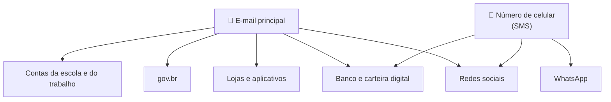

# 01 — Por que as contas são o alvo

> **Curso:** Segurança digital e cidadania online  
> **Módulo:** 01 — Senhas e contas  
> **Tempo estimado:** 45 min  

---

## 🎯 Objetivos

Ao final desta aula, você será capaz de:

- Explicar o que um golpista consegue fazer com uma conta invadida.
- Entender por que o **e-mail** e o **número de celular** são as contas mais importantes.
- Reconhecer as três formas mais comuns de alguém descobrir uma senha.
- Montar o **mapa das suas contas**, separando as que precisam de mais proteção.

## Pré-requisitos

- Usar celular ou computador e ter pelo menos um e-mail.

---

## O que vale uma conta invadida

Pouca gente rouba uma conta para "ler as suas mensagens". Ela vale **dinheiro**, e de vários jeitos:

| Conta invadida | O que o golpista faz |
|---|---|
| **WhatsApp** | Pede dinheiro emprestado aos seus contatos, fingindo ser você. |
| **Instagram ou Facebook** | Anuncia vendas falsas para os seus seguidores, que confiam em você. |
| **E-mail** | Usa o "esqueci minha senha" para entrar nas **outras** contas. |
| **Banco ou carteira digital** | Faz Pix e compras. |
| **gov.br** | Tenta acessar documentos, benefícios e dados pessoais. |
| **Conta da escola ou do trabalho** | Manda links falsos para colegas, que acreditam porque vem de você. |

Repare: na maioria dos casos, a vítima final **não é você**, e sim quem confia em você. Proteger a sua conta também protege a sua família e os seus amigos.

## O e-mail é a chave-mestra

Quase todo site tem um botão **"Esqueci minha senha"**. Ele manda um link ou um código para o seu **e-mail** (ou por SMS para o seu **celular**). Quem controla o e-mail consegue trocar a senha de quase tudo.

!!! danger "As duas contas que você não pode perder"
    O **e-mail principal** e o **número de celular** abrem as portas de todo o resto. É por eles que este módulo começa. Se só der tempo de proteger duas coisas hoje, proteja essas duas.

## Como as senhas são descobertas

Golpistas raramente "adivinham" uma senha na sorte. Os três caminhos mais comuns:

**1. A pessoa entrega sem perceber (*phishing*).** Chega uma mensagem com um link para uma página **igual** à do banco, do e-mail ou da rede social. A pessoa digita a senha ali e ela vai direto para o golpista. O Módulo 02 é todo sobre esses golpes.

**2. A senha vazou de outro site.** Sites são invadidos o tempo todo, e listas com milhões de e-mails e senhas circulam na internet. Se você usa **a mesma senha** em vários lugares, o vazamento de um site pequeno (uma loja, um fórum) abre também o seu e-mail.

**3. A senha é fácil demais.** Programas testam bilhões de combinações por segundo, começando pelas mais comuns: `123456`, `senha123`, nome + ano de nascimento, nome do time, nome do animal de estimação. A aula 02 mostra quanto tempo cada tipo de senha aguenta.

!!! info "O que dá para fazer contra cada caminho"
    | Caminho | Proteção | Aula |
    |---|---|---|
    | Senha fácil | Senha **longa** (frase-senha) | 02 |
    | Senha repetida que vazou | **Uma senha diferente para cada conta**, com gerenciador | 03 |
    | Senha entregue num site falso | **Verificação em duas etapas**: a senha sozinha não basta | 04 |

## Mapa das suas contas

Antes de proteger, é preciso saber **o que** proteger. Faça uma lista das contas que você usa e marque o nível de importância.

| Nível | Quais são | O que fazer |
|---|---|---|
| 🔴 **Críticas** | E-mail principal, número de celular (operadora), WhatsApp, banco e carteiras digitais, gov.br | Senha única e forte **e** verificação em duas etapas. Conferir dados de recuperação. |
| 🟠 **Importantes** | Redes sociais, contas da escola e do trabalho, lojas com cartão salvo | Senha única e verificação em duas etapas sempre que o site oferecer. |
| 🟢 **Comuns** | Jogos, fóruns, cadastros de promoção | Senha única (o gerenciador cria e guarda). Apague as que você não usa mais. |

!!! tip "Dica: descubra contas esquecidas"
    Procure no seu e-mail por palavras como **"bem-vindo"**, **"confirme seu cadastro"** e **"welcome"**. Cada resultado é um site onde você tem conta. Contas abandonadas com senha antiga são uma porta aberta: entre e apague as que não usa mais.

!!! warning "O mapa é seu"
    A lista é para **você**. Não anote senhas nela e não entregue para ninguém, nem para o professor. O que a turma compartilha, no máximo, é quantas contas cada um encontrou.

---

## ⚠️ Erros comuns

- **"Ninguém vai querer a minha conta, eu não sou famoso."** Golpistas não escolhem pessoas; eles testam milhões de contas de uma vez e usam qualquer uma que abrir.
- **"Minha conta foi invadida, mas eu não perdi nada."** Quem perde normalmente é quem recebe as mensagens falsas em seu nome.
- **Proteger o banco e esquecer o e-mail.** Pelo e-mail, o golpista pode trocar a senha do resto.
- **Achar que o celular "é só um aparelho".** O **número** recebe os códigos por SMS. Perder o controle do número (golpe do chip, por exemplo) é tão grave quanto perder o e-mail.

---

## Exercícios

### Básico (fixação)

1. Cite três coisas que um golpista pode fazer com um WhatsApp invadido ou com uma rede social invadida.
2. Por que o e-mail é chamado de "chave-mestra" nesta aula?

<!-- gabarito -->
??? success "Gabarito — Básico"
    1. Pedir dinheiro aos contatos fingindo ser a vítima; anunciar vendas falsas para os seguidores; mandar links falsos para amigos e colegas; usar a conta para aplicar o mesmo golpe em outras pessoas.
    2. Porque o "esqueci minha senha" de quase todos os sites manda o link ou o código para o e-mail. Quem controla o e-mail consegue trocar a senha das outras contas.

### Intermediário (aplicação)

1. Monte o **mapa das suas contas** (só para você): liste pelo menos 10 contas e classifique em 🔴 críticas, 🟠 importantes e 🟢 comuns.
2. Use a busca do seu e-mail ("bem-vindo", "confirme seu cadastro", "welcome") e encontre pelo menos **uma conta esquecida**.

<!-- gabarito -->
??? success "Gabarito — Intermediário"
    1. Resposta pessoal. Confira se o **e-mail principal**, o **WhatsApp**, o **banco** e o **gov.br** (se você tiver) estão entre as 🔴 críticas. Se a operadora do celular tiver aplicativo ou site com login, ela também é crítica.
    2. Resposta pessoal. Para cada conta esquecida: se ainda usa, troque a senha; se não usa, procure no site a opção **Excluir conta** (em geral em *Configurações* ➔ *Conta* ou *Privacidade*).

### Avançado (desafio)

1. A Ana usa a senha `Ana2008!` no e-mail, no Instagram e numa loja de roupas. A loja foi invadida e a lista de clientes vazou. Descreva, passo a passo, como um golpista chegaria ao Instagram e ao e-mail dela.
2. Diga **duas** mudanças que teriam impedido cada passo.

<!-- gabarito -->
??? success "Gabarito — Avançado"
    1. O golpista pega o e-mail e a senha `Ana2008!` na lista vazada da loja ➔ testa a mesma senha no e-mail da Ana e entra ➔ testa no Instagram e também entra (ou usa o "esqueci minha senha" do Instagram, que chega no e-mail que ele já controla) ➔ usa o Instagram para pedir dinheiro aos seguidores.
    2. **Senha diferente em cada site** (o vazamento da loja não abriria o e-mail) e **verificação em duas etapas** no e-mail e no Instagram (mesmo com a senha certa, o golpista precisaria do código do celular da Ana). Uma senha mais longa que `Ana2008!` também ajuda, mas não resolve sozinha: a senha vazou inteira.

---

## 💡 Resumo

- Conta invadida vale dinheiro, e quem costuma perder são as pessoas que confiam em você.
- O **e-mail** e o **número de celular** são as contas mais importantes: por eles se recupera todo o resto.
- Senhas são descobertas por **site falso**, por **vazamento** de outro site ou por serem **fáceis demais**.
- O mapa das contas mostra onde começar: primeiro as 🔴 críticas.

## ➡️ Próximo passo

**[02 — Senha forte e frase-senha](02_senha_forte_e_frase_senha.md)**: por que o tamanho importa mais que o símbolo e como criar uma senha forte que você consegue lembrar.
