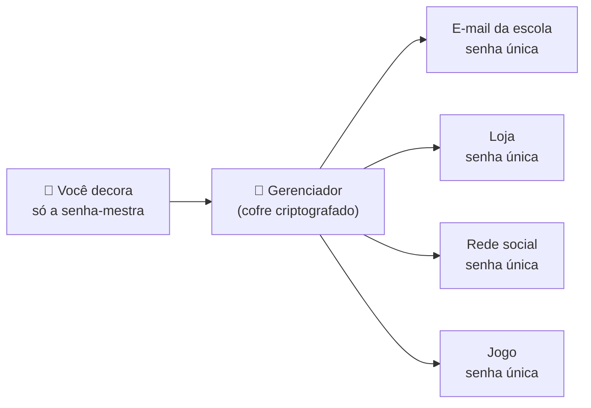

# 03 — Gerenciador de senhas

> **Curso:** Segurança digital e cidadania online  
> **Módulo:** 01 — Senhas e contas  
> **Tempo estimado:** 50 min  

---

## 🎯 Objetivos

Ao final desta aula, você será capaz de:

- Explicar o que é um **gerenciador de senhas** e por que ele é mais seguro que decorar ou anotar.
- Escolher entre as opções **gratuitas**: a do Google, a da Apple ou um aplicativo independente.
- Criar uma senha forte e diferente para cada conta com o gerador.
- Proteger o próprio gerenciador com uma **senha-mestra** e saber o que acontece se esquecê-la.
- Usar senhas com cuidado em computadores que não são seus.

## Pré-requisitos

- [Aula 02](02_senha_forte_e_frase_senha.md): saber criar uma frase-senha.

---

## O que é um gerenciador de senhas

É um **cofre digital** para as suas senhas. Você decora **uma** senha, a **senha-mestra**, e o gerenciador:

- **cria** senhas longas e sorteadas para cada site (você nem precisa ver);
- **guarda** tudo de forma criptografada (embaralhada, só abre com a senha-mestra);
- **preenche** a senha no site certo, no celular e no computador;
- **avisa** quando uma senha é repetida, fraca ou apareceu em vazamento (na maioria deles).

!!! tip "Ele também protege contra site falso"
    O gerenciador guarda a senha junto com o **endereço** do site. Num site falso (`banco-seguro-login.com` em vez do endereço verdadeiro), ele **não oferece** a senha. Se o preenchimento automático não aparecer num site em que você sempre entra, desconfie e confira o endereço.

!!! question "Não é perigoso guardar tudo num lugar só?"
    É um risco, mas muito menor que os outros. Sem gerenciador, quase todo mundo acaba **repetindo** senhas, e aí um vazamento qualquer abre várias contas. Com gerenciador, cada conta tem a sua senha, e o cofre é protegido pela senha-mestra **e** pela verificação em duas etapas ([aula 04](04_verificacao_em_duas_etapas.md)).

## Opções gratuitas

| Opção | Onde funciona | Bom para |
|---|---|---|
| **Gerenciador de Senhas do Google** | Android, Chrome (em qualquer computador) e o site `passwords.google.com` | Quem usa Android e Chrome. Já vem instalado: é só usar a conta Google. |
| **Senhas da Apple** (app *Senhas*, antes *Chaves do iCloud*) | iPhone, iPad e Mac | Quem usa só aparelhos Apple. |
| **Bitwarden** (plano gratuito) | Android, iPhone, Windows, Mac, Linux e extensão para todos os navegadores | Quem mistura aparelhos (por exemplo, iPhone + computador com Windows) ou prefere um aplicativo separado da conta Google ou Apple. |

Qualquer uma das três é muito melhor que decorar senhas repetidas. Escolha **uma** e use em tudo.

!!! warning "Se for usar o do Google ou o da Apple"
    O cofre fica protegido pela **conta Google** ou pelo **Apple ID**. Então essa conta precisa de frase-senha forte **e** verificação em duas etapas. Caso contrário, quem invadir a conta leva todas as senhas junto.

## A senha-mestra

A senha-mestra é a frase-senha mais importante que você vai ter.

1. Use **5 palavras ou mais**, sorteadas ([aula 02](02_senha_forte_e_frase_senha.md)).
2. **Nunca** use essa frase em outro lugar.
3. Nos primeiros dias, digite a senha-mestra várias vezes para fixar na memória.

!!! danger "Esqueceu a senha-mestra de um app independente? Perdeu o cofre."
    Em aplicativos como o Bitwarden, nem a empresa consegue abrir o seu cofre: é isso que o torna seguro. Por isso, se você esquecer a senha-mestra, **não há como recuperar** as senhas guardadas. Escreva a senha-mestra num papel, guarde em casa num lugar seguro (junto com documentos, por exemplo) e **não** tire foto dela.

## Usando no dia a dia

**Ao criar uma conta nova:** no campo de senha, o gerenciador oferece **"Sugerir senha forte"** ou **"Gerar senha"**. Aceite. Ele cria e guarda a senha na hora.

**Ao entrar num site:** toque no campo de senha e escolha a conta que o gerenciador sugerir.

**Para trocar as senhas antigas aos poucos:** comece pelas contas 🔴 críticas e 🟠 importantes do seu mapa (aula 01). Em cada uma: *Configurações* ➔ *Segurança* ➔ *Alterar senha* ➔ deixe o gerenciador gerar a nova. Não precisa fazer tudo num dia: troque cada senha antiga **na próxima vez** que entrar no site.

!!! tip "Quais senhas você ainda digita"
    Algumas senhas não dá para preencher pelo gerenciador, como a do próprio gerenciador, a do celular e a do computador. Essas três são frases-senha **decoradas**. Todas as outras podem ser sorteadas e longas, porque você nunca vai digitá-las.

## Computador da escola ou emprestado

- **Não** salve senhas no navegador de um computador que outras pessoas usam. Quando o navegador perguntar "Salvar senha?", clique em **Nunca** ou **Agora não**.
- Prefira uma **janela anônima** (Ctrl+Shift+N no Chrome e no Edge): ao fechar, ela apaga cookies e histórico daquela sessão.
- **Saia da conta** (*Sair* / *Logout*) antes de fechar o navegador.
- Se precisar de uma senha guardada, abra o gerenciador **no seu celular** e digite olhando para ele, em vez de entrar no cofre pelo computador da escola.

---

## ⚠️ Erros comuns

- **Senha-mestra fraca ou repetida:** ela abre todas as outras. Precisa ser a melhor frase-senha que você tem.
- **Usar dois ou três gerenciadores ao mesmo tempo:** você esquece onde está cada senha. Escolha um.
- **Recusar a senha sugerida e digitar a de sempre:** perde-se toda a vantagem.
- **Gerenciador do Google sem verificação em duas etapas na conta Google:** quem entrar na conta leva o cofre.
- **Tirar print do cofre** ou mandar a senha por WhatsApp "para não esquecer": a imagem fica no celular, na nuvem e na conversa.

---

## Exercícios

### Básico (fixação)

1. Cite três coisas que um gerenciador de senhas faz por você.
2. Por que o preenchimento automático ajuda a perceber um site falso?

<!-- gabarito -->
??? success "Gabarito — Básico"
    1. Cria senhas fortes e diferentes, guarda tudo criptografado, preenche nos sites certos e avisa sobre senhas repetidas, fracas ou vazadas.
    2. O gerenciador guarda cada senha junto com o endereço do site. Num endereço falso, ele não oferece a senha: se o preenchimento não aparecer onde sempre aparece, é sinal para conferir o endereço.

### Intermediário (aplicação)

1. Escolha um gerenciador (Google, Apple ou Bitwarden) e explique por que ele combina com os aparelhos que você usa.
2. No seu gerenciador, procure a área de **verificação de senhas** (no Google, `passwords.google.com` ➔ *Verificação de senha*; nos outros, *Segurança* ou *Relatórios*). Quantas senhas repetidas ou fracas apareceram? **Não** mostre quais são.
3. Troque a senha de **uma** conta 🟠 importante usando a senha gerada.

<!-- gabarito -->
??? success "Gabarito — Intermediário"
    1. Exemplos: Android + Chrome ➔ Google; só aparelhos Apple ➔ Senhas da Apple; iPhone + computador Windows, ou quem não quer depender da conta Google/Apple ➔ Bitwarden.
    2. Resposta pessoal. Anote só o **número**. As repetidas são as primeiras a trocar, começando pelas contas críticas.
    3. *Configurações* da conta ➔ *Segurança* ➔ *Alterar senha* ➔ no campo da senha nova, escolha **Sugerir senha forte**/**Gerar senha** ➔ salve. Saia da conta e entre de novo pelo preenchimento automático para conferir.

### Avançado (desafio)

1. O Bruno guarda as senhas no Gerenciador do Google, mas a conta Google dele tem a senha `bruno123` e não tem verificação em duas etapas. Qual é o risco? O que ele deve fazer primeiro?
2. A Ana usa o Bitwarden e anotou a senha-mestra num arquivo `senhas.txt` na área de trabalho do computador da escola. Liste os problemas e proponha a forma correta.

<!-- gabarito -->
??? success "Gabarito — Avançado"
    1. Quem descobrir `bruno123` (uma senha que cai em segundos) entra na conta Google **e** leva todas as senhas guardadas, além do e-mail e das fotos. Primeiro: trocar a senha da conta Google por uma frase-senha longa e ligar a verificação em duas etapas. Só depois disso continuar guardando senhas lá.
    2. Problemas: o arquivo está num computador que outras pessoas usam; qualquer um pode abrir; não tem proteção nenhuma; e ainda pode ser copiado. O certo: decorar a senha-mestra, guardar uma cópia **em papel** num lugar seguro de casa, apagar o arquivo e ligar a verificação em duas etapas no Bitwarden.

---

## 💡 Resumo

- O gerenciador de senhas é um **cofre**: você decora só a **senha-mestra**, e ele cria, guarda e preenche uma senha diferente para cada conta.
- Opções gratuitas: **Google**, **Apple** ou **Bitwarden**. Escolha uma e use em tudo.
- A senha-mestra é a melhor frase-senha que você tem; se for um app independente, esquecê-la significa perder o cofre (guarde uma cópia em papel em casa).
- Se o cofre é o do Google ou o da Apple, a conta Google ou o Apple ID precisam de frase-senha forte **e** verificação em duas etapas.
- Em computador de outras pessoas: não salve senhas, use janela anônima e saia da conta.

## ➡️ Próximo passo

**[04 — Verificação em duas etapas e chaves de acesso](04_verificacao_em_duas_etapas.md)**: a proteção que segura a conta mesmo quando a senha vaza.
