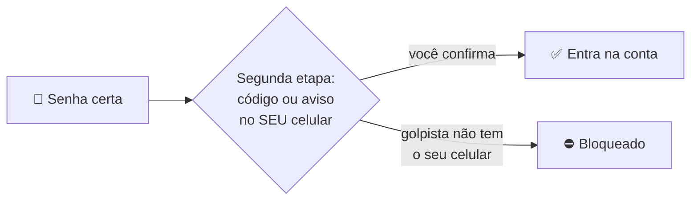

# 04 — Verificação em duas etapas e chaves de acesso

> **Curso:** Segurança digital e cidadania online  
> **Módulo:** 01 — Senhas e contas  
> **Tempo estimado:** 1 h  

---

## 🎯 Objetivos

Ao final desta aula, você será capaz de:

- Explicar como a **verificação em duas etapas** protege a conta mesmo quando a senha vaza.
- Comparar os tipos de segunda etapa: **SMS**, **aplicativo autenticador**, **aviso no celular** e **chave de acesso**.
- Ligar a verificação em duas etapas no **e-mail** e no **WhatsApp**.
- Guardar os **códigos de recuperação** para não ficar trancado fora da própria conta.
- Reconhecer o golpe mais comum contra essa proteção: pedir o código.

## Pré-requisitos

- [Aula 03](03_gerenciador_de_senhas.md): senha forte e gerenciador de senhas.

---

## Duas etapas: algo que você sabe + algo que você tem

Com a verificação em duas etapas (também chamada de **2FA** ou **autenticação de dois fatores**), entrar na conta pede **duas provas**:

1. Algo que você **sabe**: a senha.
2. Algo que você **tem**: o seu celular (ou uma chave de segurança).

Se a sua senha vazar ou for digitada num site falso, o golpista ainda precisa do **seu celular**. Na grande maioria dos casos, ele para aí.

## Os tipos de segunda etapa

| Tipo | Como funciona | Segurança |
|---|---|---|
| **Código por SMS** | O site manda um código de 6 dígitos por mensagem de texto. | ⭐⭐ Melhor que nada. O risco é o golpe da **troca de chip** (alguém consegue um chip com o seu número) e códigos lidos por quem pega o celular desbloqueado. |
| **Aplicativo autenticador** (Google Authenticator, Microsoft Authenticator, Bitwarden Authenticator...) | Um app no seu celular mostra um código que muda a cada 30 segundos. | ⭐⭐⭐ Não depende do chip nem de sinal de celular. |
| **Aviso no celular** ("É você tentando entrar?") | O celular em que você já está conectado mostra um aviso para tocar em **Sim** ou **Não**. | ⭐⭐⭐ Prático. Cuidado: **nunca** toque em *Sim* num aviso que você não pediu. |
| **Chave de acesso** (*passkey*) ou chave de segurança física | Em vez de senha + código, você confirma com a digital, o rosto ou o PIN do aparelho. | ⭐⭐⭐⭐ A mais segura: **não funciona em site falso**, porque a chave está presa ao endereço verdadeiro. |

**Regra prática:** ligue a segunda etapa que o site oferecer. Se puder escolher, prefira **aplicativo**, **aviso no celular** ou **chave de acesso**; deixe o **SMS** como reserva.

!!! info "Chaves de acesso (*passkeys*)"
    Google, Apple, Microsoft, WhatsApp e muitos outros sites já oferecem as **chaves de acesso**: você entra com a digital, o rosto ou o PIN do celular, sem digitar senha. A chave fica guardada no aparelho (ou no gerenciador de senhas) e só funciona no site verdadeiro. Se a conta oferecer *Criar chave de acesso* nas configurações de segurança, vale ativar.

## Ligando no e-mail

O caminho muda um pouco em cada serviço, mas é sempre parecido:

1. Entre na conta pelo **site oficial** ou pelo aplicativo (nunca por link recebido em mensagem).
2. Procure **Segurança** (ou *Segurança e login*, *Login e segurança*).
3. Ative **Verificação em duas etapas** (pode aparecer como *autenticação de dois fatores* ou *2FA*).
4. Siga as telas: confirme o seu número de celular, escolha o aviso no celular ou o aplicativo autenticador.

!!! example "Na conta Google (Gmail)"
    No navegador, abra `myaccount.google.com` ➔ **Segurança** ➔ **Verificação em duas etapas** ➔ **Ativar**. Na mesma página aparecem **Chaves de acesso**, **Códigos alternativos** e **App autenticador**.

    Na conta Microsoft (Outlook/Hotmail), o caminho é parecido: `account.microsoft.com` ➔ **Segurança** ➔ opções de segurança avançadas.

## Ligando no WhatsApp

No WhatsApp, a segunda etapa é um **PIN de 6 dígitos** que você cria. Mesmo que alguém receba o código de SMS para instalar o seu WhatsApp em outro celular, **sem o PIN não entra**.

1. Abra o WhatsApp ➔ **Configurações** ➔ **Conta** ➔ **Confirmação em duas etapas** ➔ **Ativar**.
2. Crie um PIN de 6 dígitos que **não** seja data de nascimento, `123456` nem o final do seu telefone.
3. Cadastre um **e-mail** para recuperar o PIN, se esquecer.

!!! danger "O golpe do código"
    "Oi, mandei um código por engano para o seu número, pode me passar?" "Sou da loja, confirme o código para receber o prêmio." Esse código é o que **instala o seu WhatsApp em outro celular**. **Nunca passe um código recebido por SMS para ninguém**, nem para quem parece ser um parente, uma empresa ou o "suporte". O Módulo 02 mostra esse golpe em detalhes.

## Códigos de recuperação: o plano B

E se você perder o celular? Para não ficar trancado fora da própria conta, os serviços oferecem **códigos de recuperação** (ou *códigos alternativos*, *códigos de backup*): uma lista de códigos de uso único, para entrar quando o celular não estiver à mão.

- Gere os códigos logo depois de ligar a verificação em duas etapas.
- **Imprima** ou **anote em papel** e guarde junto com documentos importantes, em casa. Outra opção é guardar no gerenciador de senhas, desde que ele **não** seja o mesmo celular que você pode perder sem ter outro acesso.
- Cada código funciona **uma vez**. Usou um, risque.
- Confira também o **e-mail** e o **telefone de recuperação** da conta: precisam ser seus e estar atualizados.

!!! warning "Antes de trocar de celular"
    Se você usa um aplicativo autenticador, transfira as contas para o celular novo **antes** de apagar o antigo (os aplicativos têm a opção de exportar ou sincronizar). Trocar de número? Atualize o telefone em cada conta crítica **antes** de cancelar o chip antigo.

---

## ⚠️ Erros comuns

- **Passar o código de SMS para alguém.** Nenhum banco, loja, escola ou parente de verdade pede esse código.
- **Tocar em *Sim* num aviso de login que você não pediu**, só para ele sumir. Se apareceu sem você estar entrando, é alguém com a sua senha: toque em **Não** e troque a senha.
- **Não guardar os códigos de recuperação** e perder o celular.
- **E-mail ou telefone de recuperação desatualizados** (um número antigo, um e-mail que você não acessa mais).
- **PIN do WhatsApp óbvio** (`123456`, ano de nascimento).

---

## Exercícios

### Básico (fixação)

1. Explique, com as suas palavras, por que a verificação em duas etapas protege a conta mesmo se a senha vazar.
2. Ordene do menos seguro para o mais seguro: aplicativo autenticador, SMS, chave de acesso.

<!-- gabarito -->
??? success "Gabarito — Básico"
    1. Porque, além da senha, é preciso uma segunda prova que está **com você** (o celular ou a chave). Quem tem só a senha não consegue terminar o login.
    2. SMS ➔ aplicativo autenticador ➔ chave de acesso.

### Intermediário (aplicação)

1. Ligue a **verificação em duas etapas** no seu e-mail principal e gere os **códigos de recuperação**. Guarde-os em papel, em casa.
2. Ligue a **confirmação em duas etapas** no WhatsApp, com e-mail de recuperação.
3. Confira o **e-mail** e o **telefone de recuperação** do seu e-mail principal.

<!-- gabarito -->
??? success "Gabarito — Intermediário"
    1. Conta Google: `myaccount.google.com` ➔ **Segurança** ➔ **Verificação em duas etapas** ➔ **Ativar**; depois, na mesma página, **Códigos alternativos** ➔ gerar e anotar. Em outros serviços, procure *Segurança* ➔ *verificação em duas etapas* / *2FA*.
    2. **Configurações** ➔ **Conta** ➔ **Confirmação em duas etapas** ➔ **Ativar** ➔ PIN de 6 dígitos que não seja óbvio ➔ e-mail de recuperação.
    3. Na área de segurança da conta, em *formas de verificar sua identidade* / *informações de recuperação*: o número e o e-mail precisam ser seus e estar ativos. Corrija o que estiver desatualizado.

### Avançado (desafio)

1. Às 2h da manhã, o celular da Ana mostra: *"Você está tentando fazer login? Dispositivo: Windows, São Paulo"*. Ela está dormindo e só viu de manhã. O que isso significa e o que ela deve fazer?
2. O Bruno usa só SMS como segunda etapa e vai trocar de operadora e de número. Liste, em ordem, o que ele deve fazer para não perder o acesso às contas.

<!-- gabarito -->
??? success "Gabarito — Avançado"
    1. Alguém tem a **senha** dela (a primeira etapa passou) e foi barrado pela segunda. A verificação funcionou, mas a senha precisa mudar. Ela deve: responder **Não, não fui eu** (se o aviso ainda estiver lá); trocar a senha da conta por uma frase-senha nova e única; ver a lista de **dispositivos conectados** e sair dos que não reconhece; trocar a mesma senha em qualquer outro lugar em que ela tenha sido repetida.
    2. Antes de cancelar o número antigo: cadastrar o número **novo** como telefone de recuperação e de segunda etapa em cada conta crítica (e-mail, banco, gov.br, redes); de preferência, ligar também um **aplicativo autenticador** ou **chave de acesso**, que não dependem do número; gerar e guardar os **códigos de recuperação**; no WhatsApp, usar **Mudar número** (em *Configurações* ➔ *Conta*). Só então cancelar o chip antigo.

---

## 💡 Resumo

- Verificação em duas etapas = **senha** (algo que você sabe) + **celular ou chave** (algo que você tem). Senha vazada sozinha não abre a conta.
- Do mais fraco ao mais forte: **SMS** ➔ **aplicativo autenticador** / **aviso no celular** ➔ **chave de acesso**. Qualquer um é muito melhor que nenhum.
- WhatsApp: **Confirmação em duas etapas** com PIN de 6 dígitos e e-mail de recuperação.
- Guarde os **códigos de recuperação** em papel e mantenha e-mail e telefone de recuperação atualizados.
- **Nunca** passe um código recebido por SMS e **nunca** aprove um aviso de login que você não pediu.

## ➡️ Próximo passo

**[05 — Projeto do módulo: plano de proteção das minhas contas](05_projeto_plano_de_protecao.md)**: juntar tudo num plano e colocá-lo em prática.
