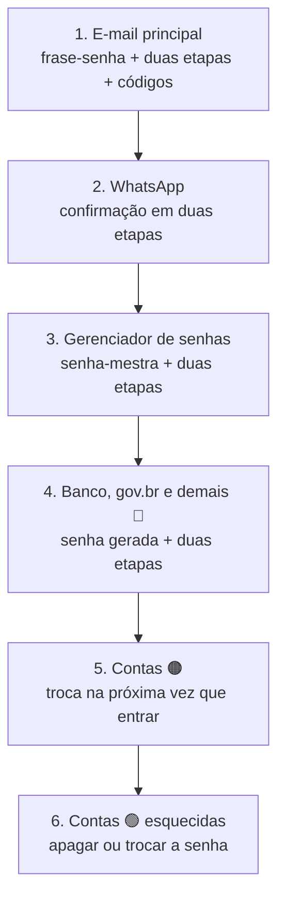

# 05 — Projeto do módulo: plano de proteção das minhas contas

> **Curso:** Segurança digital e cidadania online  
> **Módulo:** 01 — Senhas e contas  
> **Tempo estimado:** 1 h (mais o tempo de aplicar o plano em casa)  

---

## 🎯 Objetivos

Ao final desta aula, você terá:

- Conferido se o seu e-mail apareceu em **vazamentos de dados**.
- Montado o seu **plano de proteção**, conta por conta, começando pelas críticas.
- Aplicado o plano nas contas 🔴 críticas.
- Um roteiro do que fazer se uma conta for **invadida**.
- Entregue ao professor o **checklist** do projeto, sem expor nenhuma senha ou dado pessoal.

## Pré-requisitos

- Aulas [01](01_por_que_as_contas_sao_o_alvo.md), [02](02_senha_forte_e_frase_senha.md), [03](03_gerenciador_de_senhas.md) e [04](04_verificacao_em_duas_etapas.md).
- O **mapa das suas contas** da aula 01.

---

## Passo 1 — O meu e-mail vazou?

O site **Have I Been Pwned** (`haveibeenpwned.com`) junta as listas de vazamentos conhecidos e mostra em quais o seu e-mail aparece. É gratuito e não pede senha, **só o e-mail**.

1. Digite o endereço **direto** na barra do navegador: `haveibeenpwned.com` (não clique em links de mensagens).
2. Escreva o seu e-mail e clique em **Check**.
3. Leia o resultado:
    - *Good news — no pwnage found!*: o e-mail não aparece nas listas conhecidas.
    - *Oh no — pwned!*: o e-mail aparece em um ou mais vazamentos. Logo abaixo, a lista mostra **quais sites** vazaram, **quando** e **que tipo de dado** saiu (e-mail, senha, telefone, endereço...).

!!! warning "Apareceu num vazamento? Não entre em pânico, aja"
    Aparecer na lista quer dizer que **um site em que você tinha conta** foi invadido. Não quer dizer que o seu e-mail foi invadido. O que fazer:

    1. Se a senha daquele site também é usada em **outro** lugar, troque em todos esses lugares, começando pelo e-mail.
    2. Troque a senha do site que vazou (ou apague a conta, se não usa mais).
    3. Ligue a verificação em duas etapas onde ainda não estiver ligada.
    4. Fique mais atento a mensagens que usem os dados vazados (nome, telefone, endereço) para parecerem verdadeiras.

!!! info "O próprio gerenciador também avisa"
    O Gerenciador de Senhas do Google (*Verificação de senha*), as Senhas da Apple (*Segurança*/*Recomendações*) e outros gerenciadores mostram quais das **suas senhas guardadas** já apareceram em vazamentos. Use as duas verificações.

## Passo 2 — Montar o plano

Copie a tabela num caderno ou num documento **só seu** e preencha uma linha para cada conta 🔴 crítica e 🟠 importante do seu mapa. **Não escreva senhas na tabela.**

| Conta | Nível | Senha única e forte? | Duas etapas? | Recuperação conferida? | Data |
|---|---|---|---|---|---|
| E-mail principal | 🔴 | ☐ | ☐ | ☐ | |
| WhatsApp | 🔴 | — (não usa senha) | ☐ PIN | ☐ e-mail do PIN | |
| Banco / carteira digital | 🔴 | ☐ | ☐ | ☐ | |
| gov.br (se tiver) | 🔴 | ☐ | ☐ | ☐ | |
| Gerenciador de senhas | 🔴 | ☐ senha-mestra | ☐ | ☐ cópia em papel | |
| Rede social 1 | 🟠 | ☐ | ☐ | ☐ | |
| Conta da escola | 🟠 | ☐ | ☐ | ☐ | |

**Ordem de execução:**

## Passo 3 — Se uma conta for invadida

Sinais: e-mail avisando de troca de senha que você não fez, amigos recebendo mensagens estranhas suas, login que não funciona mais, aviso de acesso de outro aparelho.

1. **Tente entrar e troque a senha** imediatamente, por uma frase-senha nova.
2. **Saia de todos os aparelhos**: na área de segurança, procure *Dispositivos* / *Onde você está conectado* e encerre as sessões que não reconhece.
3. **Ligue ou confira a verificação em duas etapas** e os dados de recuperação: o golpista pode ter trocado o e-mail ou o telefone de recuperação pelos dele.
4. **Não conseguiu entrar?** Use a opção oficial de recuperação do serviço (*Esqueci minha senha* ➔ *Preciso de ajuda* / *Recuperar conta*), sempre pelo **site ou app oficial**.
5. **Avise os seus contatos** por outro canal: "minha conta foi invadida, não façam Pix nem cliquem em links que eu mandar".
6. Se houve prejuízo em dinheiro, procure o banco **na hora** e registre um **boletim de ocorrência**. O Módulo 02 detalha o caso do Pix.

!!! danger "Cuidado com o \"suporte\" que aparece para ajudar"
    Depois de uma invasão, é comum aparecer alguém nos comentários ou por mensagem oferecendo "recuperar sua conta" por um valor. É **outro golpe**. Recuperação de conta se faz só pelo site ou aplicativo oficial, e é gratuita.

## Passo 4 — Entrega

Entregue ao professor **só o checklist abaixo** (marcado), sem nomes de conta, senhas, prints ou códigos.

- [ ] Fiz o mapa das minhas contas e sei quais são as 🔴 críticas.
- [ ] Conferi o meu e-mail no Have I Been Pwned (e agi, se apareceu algum vazamento).
- [ ] O e-mail principal tem frase-senha única, verificação em duas etapas e códigos de recuperação guardados.
- [ ] O WhatsApp tem confirmação em duas etapas com e-mail de recuperação.
- [ ] Escolhi um gerenciador de senhas e troquei pelo menos 3 senhas repetidas por senhas geradas.
- [ ] Conferi o e-mail e o telefone de recuperação das contas críticas.
- [ ] Sei o que fazer, passo a passo, se uma conta for invadida.

!!! note "Para o professor"
    Avalie pelo checklist e por uma conversa rápida (por exemplo: "o que você faria se aparecesse um aviso de login às 2h da manhã?"). **Não** peça prints das telas de segurança: elas mostram e-mails, telefones e aparelhos dos alunos. Para quem não tem e-mail próprio ou celular, aceite o plano escrito e a aplicação numa conta de estudo da escola.

---

## ⚠️ Erros comuns

- **Escrever senhas na tabela do plano.** A tabela é de marcações, não de senhas.
- **Clicar num link de "seu e-mail vazou" recebido por mensagem.** Para verificar, digite o endereço do Have I Been Pwned (ou do seu gerenciador) você mesmo.
- **Trocar todas as senhas num dia e esquecer metade.** Use o gerenciador e siga a ordem do plano.
- **Recuperar a conta por um "especialista" das redes sociais.** É golpe; use só o caminho oficial.

---

## Exercícios

### Básico (fixação)

1. O Have I Been Pwned mostrou que o e-mail da Ana apareceu no vazamento de uma loja on-line de 2021. Isso quer dizer que o e-mail dela foi invadido? O que ela deve fazer?
2. Qual é a primeira conta do plano de proteção e por quê?

<!-- gabarito -->
??? success "Gabarito — Básico"
    1. Não: quer dizer que a **loja** foi invadida e os dados dela vazaram. Ela deve trocar a senha da loja (ou apagar a conta) e, se usou a mesma senha em outros lugares, trocar em todos, começando pelo e-mail. E ligar a verificação em duas etapas.
    2. O **e-mail principal**: por ele se recupera quase todas as outras contas (aula 01).

### Intermediário (aplicação)

1. Faça o Passo 1 com o seu e-mail principal e anote **só** quantos vazamentos apareceram.
2. Preencha a tabela do Passo 2 com as suas contas críticas e importantes.
3. Aplique o plano no **e-mail principal** e no **WhatsApp** ainda hoje.

<!-- gabarito -->
??? success "Gabarito — Intermediário"
    1. Resposta pessoal. Para cada site da lista, siga o quadro "Apareceu num vazamento?".
    2. Confira se estão na tabela: e-mail, WhatsApp, banco/carteira, gov.br (se tiver) e o gerenciador de senhas. Nenhuma senha escrita.
    3. E-mail: frase-senha nova ([aula 02](02_senha_forte_e_frase_senha.md)), verificação em duas etapas e códigos de recuperação ([aula 04](04_verificacao_em_duas_etapas.md)). WhatsApp: *Configurações* ➔ *Conta* ➔ *Confirmação em duas etapas*.

### Avançado (desafio)

1. O Instagram do Bruno foi invadido: o golpista trocou a senha e o e-mail de recuperação e está anunciando celulares baratos para os seguidores. Escreva o roteiro, em ordem, do que o Bruno deve fazer nas próximas horas.
2. Escreva a mensagem curta que o Bruno vai mandar para os contatos, por outro canal, avisando da invasão.

<!-- gabarito -->
??? success "Gabarito — Avançado"
    1. (a) Usar a recuperação **oficial** do Instagram pelo aplicativo (*Esqueceu a senha?* / *Precisa de mais ajuda?*), que permite confirmar a identidade mesmo com o e-mail trocado; (b) avisar os contatos por outro canal; (c) pedir a amigos que **denunciem** o perfil enquanto ele estiver com o golpista; (d) ao recuperar: frase-senha nova, verificação em duas etapas, conferir e-mail e telefone de recuperação, encerrar sessões desconhecidas e apagar os anúncios falsos; (e) se a senha do Instagram era usada em outro lugar, trocar lá também; (f) se alguém pagou ao golpista, orientar a pessoa a procurar o banco e registrar boletim de ocorrência. Ignorar "especialistas" que oferecem recuperação paga.
    2. Exemplo: *"Pessoal, meu Instagram foi invadido. Os anúncios de celular que estão aparecendo lá são golpe: não façam Pix e não cliquem em links. Se puderem, denunciem o perfil. Aviso quando recuperar. — Bruno"*

---

## 💡 Resumo

- O **Have I Been Pwned** mostra em quais vazamentos o seu e-mail aparece; o gerenciador mostra quais senhas guardadas vazaram.
- O **plano de proteção** segue a ordem: e-mail ➔ WhatsApp ➔ gerenciador ➔ demais críticas ➔ importantes ➔ esquecidas.
- Conta invadida: trocar a senha, sair dos aparelhos, conferir duas etapas e recuperação, usar só a **recuperação oficial**, avisar os contatos.
- A entrega é um **checklist**: nada de senhas, prints ou códigos.

## ➡️ Próximo passo

**[Módulo 02 — Golpes mais comuns](../modulo_02_golpes/index.md)**: falso parente no WhatsApp, golpe do código, Pix e o MED, links falsos, lojas e boletos falsos.
