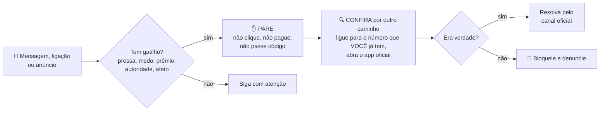

# 01 — Engenharia social: como o golpe engana

> **Curso:** Segurança digital e cidadania online  
> **Módulo:** 02 — Golpes mais comuns  
> **Tempo estimado:** 45 min  

---

## 🎯 Objetivos

Ao final desta aula, você será capaz de:

- Explicar o que é **engenharia social** e por que ela funciona com qualquer pessoa.
- Reconhecer os **gatilhos** que os golpes usam: urgência, medo, prêmio, autoridade e afeto.
- Aplicar a regra **Pare ➔ Desconfie ➔ Confira por outro caminho** antes de agir.
- Identificar golpes de "emprego fácil" e de "tarefas pagas".

## Pré-requisitos

- [Módulo 01](../modulo_01_senhas_e_contas/index.md): contas protegidas com senha forte e verificação em duas etapas.

---

## O golpe não ataca o celular, ataca a pessoa

No Módulo 01, você trancou as contas. Por isso, a maioria dos golpes de hoje nem tenta "invadir" nada: eles convencem a **própria vítima** a abrir a porta. Fazer um Pix, passar um código, clicar num link, digitar a senha numa página falsa.

Esse jeito de enganar se chama **engenharia social**: usar a conversa, a pressa e os sentimentos para levar alguém a fazer o que o golpista quer.

!!! info "Não é falta de inteligência"
    Pessoas estudadas, desconfiadas e acostumadas com tecnologia caem em golpes todos os dias. O golpe funciona porque chega no **momento errado**: no meio do trabalho, de madrugada, com a pessoa cansada, preocupada ou animada. Por isso a defesa é um **hábito** (a regra desta aula), e não "ser esperto".

## Os gatilhos

Quase todo golpe usa um ou mais destes gatilhos. Quando perceber um deles, **acenda o alerta**.

| Gatilho | O que o golpe diz | Exemplo |
|---|---|---|
| ⏰ **Urgência** | "Tem que ser agora." | "Seu cadastro será bloqueado em 2 horas." |
| 😨 **Medo** | "Algo ruim vai acontecer." | "Detectamos uma compra de R$ 3.000 no seu cartão." |
| 🎁 **Prêmio ou oportunidade** | "Você ganhou / foi escolhido." | "Parabéns, você ganhou um vale de R$ 500." |
| 👮 **Autoridade** | "Somos do banco / da polícia / do governo." | "Aqui é da central de segurança do seu banco." |
| ❤️ **Afeto** | "Sou alguém que você ama e preciso de ajuda." | "Mãe, troquei de número, me ajuda com um Pix?" |
| 🤫 **Segredo** | "Não conte para ninguém." | "Não comenta com o pai, depois eu explico." |

Repare que o **segredo** e a **urgência** existem para uma coisa só: **impedir que você confira**.

## A regra: Pare ➔ Desconfie ➔ Confira por outro caminho

**Outro caminho** quer dizer: **não use nada que veio na mensagem**. Nem o link, nem o número de telefone, nem o QR code.

- O "banco" ligou? Desligue e ligue **você** para o número que está **atrás do seu cartão** ou no aplicativo.
- O "filho" mandou mensagem de um número novo? Ligue para o número **antigo** dele, ou faça uma pergunta que só ele sabe.
- A "loja" mandou um link de promoção? Abra o aplicativo ou digite o endereço da loja você mesmo.

!!! tip "Combine uma palavra-código com a família"
    Escolham uma palavra ou pergunta que só a família conhece (não pode estar nas redes sociais). Se alguém pedir dinheiro "em nome" de um parente, peça a palavra-código. Golpista não sabe.

## Golpes de "dinheiro fácil"

Um tipo de golpe cresce muito entre jovens: a **oferta de trabalho fácil**.

**Tarefas pagas (curtir vídeos, avaliar produtos, seguir perfis):** a pessoa é chamada no WhatsApp ou Telegram para "ganhar R$ 50 por dia curtindo vídeos". As primeiras tarefas **pagam de verdade** (pouco dinheiro), para criar confiança. Depois vem uma "tarefa especial" ou um "nível VIP" que exige **depositar** dinheiro para liberar ganhos maiores. O dinheiro depositado não volta.

**Vaga de emprego com taxa:** "Você foi aprovado! Para começar, pague o curso obrigatório / o uniforme / o exame." Empresa séria **não cobra** para contratar.

!!! danger "Regra simples"
    **Se você precisa pagar para ganhar, é golpe.** Trabalho de verdade paga você, não o contrário.

## Ligações e a voz "parecida"

Golpistas também ligam. Fingem ser do banco, de uma loja, do "sequestro" de um parente. Hoje, com inteligência artificial, dá para **imitar a voz** de uma pessoa a partir de áudios publicados (o curso de [Introdução à IA](../../introducao_a_ia/modulo_04_etica_e_privacidade/index.md) fala desses riscos). Por isso, nem uma voz conhecida dispensa a conferência por outro caminho.

---

## ⚠️ Erros comuns

- **Responder à mensagem para "tirar a dúvida".** Quem responde confirma que o número está ativo e entra na conversa do golpista. Confira por **outro** caminho.
- **Ligar para o número que veio na mensagem.** Ele leva direto ao golpista.
- **Achar que um detalhe verdadeiro prova que é real.** O golpista pode saber o seu nome, CPF e endereço por causa de vazamentos (aula 05 do Módulo 01). Saber os seus dados não faz dele o banco.
- **Ter vergonha de contar que caiu.** Quanto mais rápido você avisa o banco e a família, mais chance de recuperar o dinheiro e de evitar que outros caiam.

---

## Exercícios

### Básico (fixação)

1. O que é engenharia social?
2. Identifique os gatilhos: *"URGENTE: seu CPF será cancelado hoje. Regularize pelo link para não perder o benefício."*

<!-- gabarito -->
??? success "Gabarito — Básico"
    1. É enganar a pessoa (e não o aparelho) usando conversa, pressa e sentimentos, para que ela mesma faça o que o golpista quer: pagar, clicar, passar um código ou uma senha.
    2. **Urgência** ("URGENTE", "hoje"), **medo** ("cancelado", "perder o benefício") e **autoridade** (fala como se fosse o governo). E traz um **link**: é exatamente o que não se deve usar.

### Intermediário (aplicação)

1. Para cada situação, diga qual seria o **outro caminho** para conferir: (a) mensagem do "banco" com um link para "desbloquear o cartão"; (b) ligação da "central de segurança" dizendo que houve uma compra suspeita; (c) mensagem da "tia" de um número novo pedindo Pix.
2. Combine com a sua família uma **palavra-código**. (Não conte para a turma qual é.)

<!-- gabarito -->
??? success "Gabarito — Intermediário"
    1. (a) Abrir o **aplicativo do banco** (ou ligar para o número atrás do cartão), sem usar o link. (b) Desligar e ligar **você** para o número oficial do banco, de preferência de outro telefone ou depois de alguns minutos. (c) Ligar para o número **antigo** da tia ou para outro parente que fale com ela; fazer uma pergunta que só ela sabe.
    2. Resposta pessoal. A palavra não pode aparecer em redes sociais nem ser fácil de adivinhar (nome do cachorro, time).

### Avançado (desafio)

1. O primo da Ana entrou num grupo de "tarefas pagas": recebeu R$ 15 e R$ 30 em dois dias e agora pediram R$ 200 para "subir de nível" e ganhar R$ 800. Explique por que o dinheiro dos primeiros dias **não** prova que é verdade.
2. Escreva uma mensagem curta e gentil para convencer o primo a sair do grupo.

<!-- gabarito -->
??? success "Gabarito — Avançado"
    1. Os primeiros pagamentos são a **isca**: custam pouco para o golpista e criam confiança. O golpe está justamente no pedido de depósito ("subir de nível"). A regra vale: se é preciso pagar para ganhar, é golpe. Quem deposita costuma receber novos pedidos ("taxa de saque", "imposto") até desistir.
    2. Exemplo: *"Primo, esse esquema de tarefas é um golpe conhecido: eles pagam pouco no começo para você confiar e depois pedem depósito. Ninguém consegue sacar os R$ 800. Não manda os R$ 200, sai do grupo e bloqueia. Se quiser, te ajudo a procurar um bico de verdade."*

---

## 💡 Resumo

- **Engenharia social** engana a pessoa, não o aparelho. Funciona com qualquer um, no momento errado.
- Gatilhos: **urgência, medo, prêmio, autoridade, afeto e segredo**.
- Regra: **Pare ➔ Desconfie ➔ Confira por outro caminho**, sem usar link, número ou QR code que veio na mensagem.
- **Se precisa pagar para ganhar, é golpe.**
- Palavra-código com a família ajuda contra o golpe do parente e da voz imitada.

## ➡️ Próximo passo

**[02 — Golpes no WhatsApp](02_golpes_no_whatsapp.md)**: falso parente, golpe do código e conta clonada.
