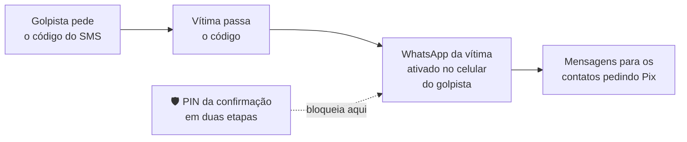

# 02 — Golpes no WhatsApp

> **Curso:** Segurança digital e cidadania online  
> **Módulo:** 02 — Golpes mais comuns  
> **Tempo estimado:** 50 min  

---

## 🎯 Objetivos

Ao final desta aula, você será capaz de:

- Reconhecer o golpe do **falso parente** ("troquei de número").
- Entender como funciona o **golpe do código** e por que ele leva à **conta clonada**.
- Identificar perfis falsos de empresas e de "atendentes".
- Saber o que fazer se o seu WhatsApp (ou o de alguém da família) for clonado.

## Pré-requisitos

- [Aula 01](01_engenharia_social.md): os gatilhos e a regra "confira por outro caminho".
- Confirmação em duas etapas do WhatsApp ligada ([Módulo 01, aula 04](../modulo_01_senhas_e_contas/04_verificacao_em_duas_etapas.md)).

!!! note "As conversas desta aula são simuladas"
    Nomes, números e valores são inventados. Os golpes, infelizmente, são reais e muito comuns.

---

## Golpe 1 — O falso parente

+55 11 9●●●●-●●●● · não está nos seus contatos

Oi mãe, tudo bem? Esse é meu número novo, pode salvar 😊

Oi filha! Que houve com o outro?

Caiu na água, tô usando esse por enquanto. Mãe, preciso de um favor urgente

Tenho um boleto pra pagar hoje e meu app do banco não abre nesse celular. Faz um Pix de R$ 1.280 pra essa conta que amanhã te devolvo? Não comenta com o pai que ele vai brigar

**Como funciona:** o golpista pega a **foto** e o **nome** da pessoa nas redes sociais, descobre quem são os parentes (comentários, marcações, seguidores) e escreve de um número novo. Depois de algumas mensagens normais, vem o pedido de dinheiro, com **urgência** e **segredo**.

!!! warning "Sinais de alerta"
    - Número novo + pedido de dinheiro na mesma conversa.
    - A conta do Pix está no nome de **outra pessoa** ("é do meu amigo", "é da loja").
    - Desculpa para não fazer ligação ou chamada de vídeo ("tô sem microfone", "tô no trabalho").
    - "Não conta para ninguém."

**O que fazer:**

1. **Não faça o Pix** e não continue a conversa.
2. **Ligue para o número antigo** da pessoa, ou para alguém que esteja com ela. Use a **palavra-código** da família ([aula 01](01_engenharia_social.md#a-regra-pare-desconfie-confira-por-outro-caminho)).
3. Confirmado o golpe: **denuncie e bloqueie** o número (na conversa, toque no nome ➔ **Denunciar** e **Bloquear**).
4. Avise a pessoa de verdade: os golpistas costumam mandar a mesma mensagem para **vários** contatos dela.

!!! tip "Dificulte para o golpista"
    Deixe a foto de perfil e o "recado" do WhatsApp visíveis só para **Meus contatos**: *Configurações* ➔ *Privacidade* ➔ *Foto do perfil* / *Recado*. Nas redes sociais, evite deixar pública a lista de parentes.

## Golpe 2 — O código de verificação

Para ativar o WhatsApp num celular, o app manda um **código de 6 dígitos por SMS** para o número. Quem tiver esse código consegue instalar **o seu WhatsApp** em outro aparelho.

Loja Super Ofertas ✅ (perfil falso)

Olá! Você foi sorteado(a) no nosso aniversário de 10 anos e ganhou um vale de R$ 300 🎉

Para validar o prêmio, enviamos um código de 6 dígitos por SMS. Por favor, nos informe o código recebido.

O "sorteio" pode ser de loja, de pesquisa de satisfação, de "atualização de cadastro" do posto de saúde, de vaga de emprego ou até de alguém dizendo que **mandou o código por engano**. Em todos os casos, o pedido é o mesmo: **o código**.

!!! danger "O código do SMS é a chave do seu WhatsApp"
    O próprio SMS do WhatsApp avisa para não compartilhar. **Nunca passe esse código para ninguém**, por nenhum motivo. Empresas, sorteios e o "suporte" do WhatsApp **não** pedem esse código.

**Por que a confirmação em duas etapas salva:** mesmo com o código do SMS, o golpista esbarra no **PIN de 6 dígitos** que você criou no [Módulo 01](../modulo_01_senhas_e_contas/04_verificacao_em_duas_etapas.md#ligando-no-whatsapp). Sem o PIN, ele não entra.

## Golpe 3 — A conta clonada

Quando o golpista consegue entrar, ele usa o **seu** WhatsApp, com o seu nome e a sua foto, para pedir dinheiro aos **seus** contatos. É o golpe do falso parente, só que do número verdadeiro: muito mais convincente.

**Se o seu WhatsApp for clonado:**

1. **Reinstale e ative o WhatsApp** no seu celular, com o seu número. Você vai receber um novo código por SMS: ao ativar, o aparelho do golpista é **desconectado**.
2. Se aparecer o pedido de um **PIN que você não criou**, o golpista ligou a confirmação em duas etapas. Siga as instruções do app; em geral, é preciso **esperar alguns dias** para redefinir. Enquanto isso, peça ajuda pelo **suporte oficial** (*Configurações* ➔ *Ajuda* ➔ *Fale conosco*, num aparelho em que você ainda tenha acesso, ou pela página de ajuda do WhatsApp).
3. **Avise os contatos por outro canal** (outra rede, ligação, o WhatsApp de um familiar): "meu WhatsApp foi clonado, não façam Pix".
4. Depois de recuperar: ligue a **confirmação em duas etapas** com um PIN novo e confira em *Configurações* ➔ *Dispositivos conectados* se há algum aparelho que você não conhece.
5. Se alguém fez Pix para o golpista, oriente a pessoa a procurar o banco **imediatamente** ([aula 03](03_golpes_com_pix.md)) e a registrar boletim de ocorrência.

## Golpe 4 — O falso atendente

Você reclama de uma empresa nas redes sociais e, minutos depois, chega uma mensagem de "atendimento" com a logo da empresa, oferecendo resolver o problema. Ou você procura "telefone da loja X" e cai num número falso. O "atendente" pede dados do cartão, uma "taxa de reembolso" ou que você instale um aplicativo.

!!! warning "Como conferir uma empresa no WhatsApp"
    - Procure o número **no site oficial** ou no aplicativo da empresa, e não em resultados patrocinados, comentários ou mensagens.
    - Empresas grandes costumam ter **selo de verificação** no perfil; mas um perfil sem selo não é prova de golpe, e um nome bonito não é prova de nada.
    - Nenhum atendimento sério pede **senha**, **código de SMS**, **foto do cartão** ou **"taxa para liberar reembolso"**.

---

## ⚠️ Erros comuns

- **Fazer "só um Pix pequeno" para testar** se é o parente mesmo. O golpista agradece e pede mais.
- **Confiar porque a foto é do parente.** A foto foi copiada das redes sociais.
- **Passar o código "porque a pessoa disse que mandou por engano".** Ninguém manda código por engano para você: o código é **do seu número**.
- **Não avisar os contatos depois de uma clonagem.** É deles que o golpista vai tirar o dinheiro.

---

## Exercícios

### Básico (fixação)

1. Para que serve o código de 6 dígitos que o WhatsApp manda por SMS? Por que ninguém pode pedir esse código?
2. Cite três sinais de alerta do golpe do falso parente.

<!-- gabarito -->
??? success "Gabarito — Básico"
    1. Para ativar o WhatsApp **do seu número** num celular. Quem tem o código pode instalar a sua conta no aparelho dele. Nenhuma empresa, sorteio ou suporte precisa desse código.
    2. Número novo pedindo dinheiro; conta do Pix no nome de outra pessoa; recusa em ligar ou fazer chamada de vídeo; urgência; pedido de segredo.

### Intermediário (aplicação)

1. Deixe a **foto do perfil** e o **recado** do seu WhatsApp visíveis só para *Meus contatos*.
2. Confira se a **confirmação em duas etapas** está ligada e se há algum aparelho estranho em **Dispositivos conectados**.
3. Ensine a regra do código para **uma pessoa da família** (de preferência quem usa menos tecnologia) e anote como foi.

<!-- gabarito -->
??? success "Gabarito — Intermediário"
    1. *Configurações* ➔ *Privacidade* ➔ *Foto do perfil* ➔ **Meus contatos**; o mesmo em *Recado*.
    2. *Configurações* ➔ *Conta* ➔ *Confirmação em duas etapas* (deve aparecer como ativada). *Configurações* ➔ *Dispositivos conectados*: se houver um aparelho que você não reconhece, toque nele e escolha **Desconectar**.
    3. Resposta pessoal. Uma frase simples ajuda: *"Código que chega por SMS é como a chave de casa: não se entrega para ninguém."*

### Avançado (desafio)

1. O WhatsApp do Bruno foi clonado às 10h. Às 10h20, a avó dele recebeu do número verdadeiro do Bruno um pedido de Pix de R$ 900 e pagou. Liste, em ordem, o que o Bruno e a avó devem fazer.
2. Por que o golpe com o número verdadeiro é mais perigoso que o do "número novo"?

<!-- gabarito -->
??? success "Gabarito — Avançado"
    1. **Avó:** procurar o banco **na hora** (aplicativo ou central oficial) e pedir a devolução pelo **MED** ([aula 03](03_golpes_com_pix.md)); registrar boletim de ocorrência. **Bruno:** reinstalar e ativar o WhatsApp no próprio celular (desconecta o golpista); avisar todos os contatos por outro canal; ligar a confirmação em duas etapas com PIN novo; conferir os dispositivos conectados; descobrir como o código vazou (para não acontecer de novo) e ajudar a avó com o boletim.
    2. Porque tudo parece verdadeiro: o número, o nome, a foto e até as conversas antigas. A única defesa é a conferência por **outro caminho** (ligar, palavra-código), mesmo quando a mensagem vem do número de sempre.

---

## 💡 Resumo

- **Falso parente:** número novo, urgência, segredo e conta de outra pessoa. Ligue para o número antigo e use a palavra-código.
- **Golpe do código:** o código do SMS ativa o seu WhatsApp em outro celular. **Nunca** passe esse código.
- **Conta clonada:** reative o WhatsApp no seu celular, avise os contatos por outro canal e ligue a confirmação em duas etapas.
- **Falso atendente:** pegue o contato da empresa no site ou app oficial.

## ➡️ Próximo passo

**[03 — Golpes com Pix e o MED](03_golpes_com_pix.md)**: falsa central, QR code trocado, comprovante falso e como pedir o dinheiro de volta.
