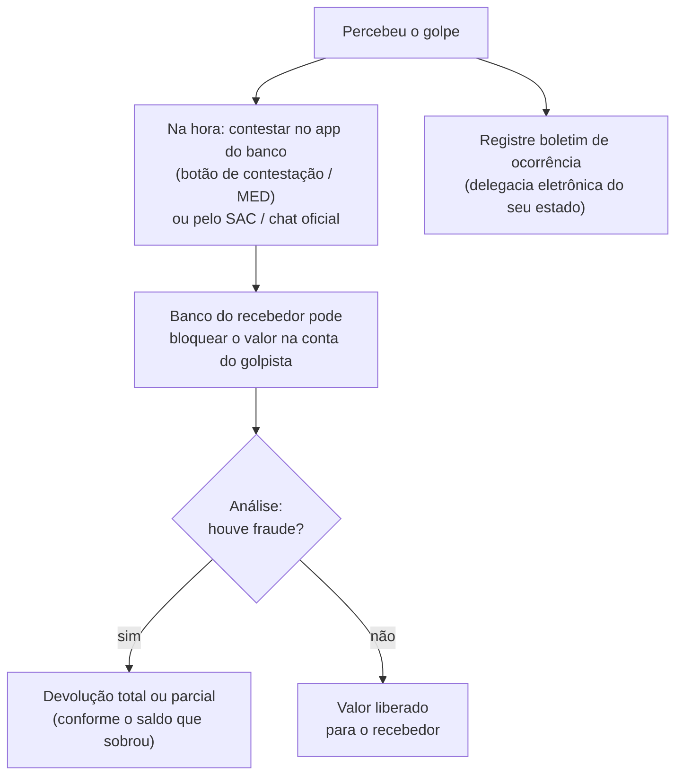

# 03 — Golpes com Pix e o MED

> **Curso:** Segurança digital e cidadania online  
> **Módulo:** 02 — Golpes mais comuns  
> **Tempo estimado:** 1 h  

---

## 🎯 Objetivos

Ao final desta aula, você será capaz de:

- Reconhecer os golpes mais comuns com Pix: **falsa central**, **QR code ou boleto trocado**, **comprovante falso** e **"Pix por engano"**.
- Conferir **para quem** vai o dinheiro antes de confirmar um Pix.
- Usar o **limite noturno** e os limites do aplicativo a seu favor.
- Pedir a devolução pelo **MED** (Mecanismo Especial de Devolução) quando cair num golpe.

## Pré-requisitos

- [Aula 01](01_engenharia_social.md) e [aula 02](02_golpes_no_whatsapp.md) deste módulo.

!!! info "Por que o Pix é o alvo"
    O Pix é rápido, funciona 24 horas e cai na hora. Isso é ótimo para você, e também para o golpista: em minutos o dinheiro passa por várias contas (as "contas laranja"). Por isso, **conferir antes** vale muito mais do que tentar desfazer depois.

---

## Antes de qualquer Pix: a tela de confirmação

Todo aplicativo mostra, antes de concluir, **o nome de quem vai receber** e o **banco**. É a sua última chance.

!!! tip "Pare e leia a tela de confirmação"
    - O **nome** é de quem você queria pagar? Ou é de uma pessoa desconhecida, de "outra empresa", de alguém que "é amigo do meu filho"?
    - O **valor** está certo?
    - Você está pagando porque **você** decidiu, ou porque alguém está com pressa do outro lado?

    Se algo não bater, **cancele**. Cancelar não custa nada.

## Golpe 1 — A falsa central do banco

Toca o telefone. Do outro lado, alguém que sabe o seu nome e o seu CPF: *"Aqui é da central de segurança do seu banco. Identificamos uma compra suspeita de R$ 2.400. Para proteger o seu dinheiro, vamos transferir o saldo para uma **conta segura**."* Às vezes o número que aparece na tela até parece o do banco.

Variações: pedem para você **instalar um aplicativo** "de proteção" (que, na verdade, dá acesso remoto ao seu celular), **digitar a senha** no teclado do telefone, **entregar o cartão** a um "motoboy do banco" ou fazer um Pix de "teste".

!!! danger "O banco nunca..."
    - pede para transferir dinheiro para uma "conta segura";
    - pede a sua **senha**, o **código** do SMS ou a **senha do cartão**;
    - pede para **instalar** um aplicativo durante a ligação;
    - manda alguém **buscar o cartão** na sua casa.

    **Desligue.** Espere alguns minutos (ou use outro telefone) e ligue **você** para o número que está **atrás do seu cartão** ou no aplicativo do banco.

## Golpe 2 — QR code e boleto trocados

**QR code trocado:** num site de compras falso, numa mensagem ou até colado por cima do QR code de uma loja, o código leva o pagamento para a conta do golpista.

**Boleto adulterado:** o boleto chega por e-mail ou WhatsApp com aparência perfeita, mas o código de barras foi trocado e o dinheiro vai para outra conta.

**Como se proteger:**

- Depois de ler o QR code ou o código do boleto, confira na tela de confirmação o **nome do beneficiário**. Pagando a loja "Calçados Bom Passo", o recebedor não pode ser "J. Silva Comércio" nem uma pessoa física desconhecida.
- Boletos de contas da casa (luz, água, escola, internet): **baixe pelo site ou aplicativo oficial** da empresa, em vez de usar o boleto que chegou por mensagem.
- Na dúvida, ligue para a empresa pelo número **oficial** e pergunte qual é o beneficiário correto.

## Golpe 3 — O comprovante falso

Para quem vende (na loja, na feira, no Instagram): o "cliente" manda um **print** de comprovante de Pix e pede para liberar a mercadoria. O comprovante foi montado num editor de imagem, ou é de um Pix **agendado** que vai ser cancelado.

!!! warning "Quem vende: confira no extrato"
    Só entregue o produto depois de ver o dinheiro **no seu aplicativo**, no **extrato** ou na notificação do **seu** banco. Print de comprovante não é dinheiro. Desconfie de "Pix agendado" e de pressa ("o motoboy já está aí").

## Golpe 4 — O "Pix por engano"

Você recebe um Pix de alguém que não conhece. Logo depois chega uma mensagem: *"Moça, mandei um Pix errado pra você, pode devolver nessa outra chave?"* Se você devolver para a outra chave, o golpista pode usar o MED para pedir de volta o Pix **original**, e você paga **duas vezes**.

!!! tip "Para devolver um Pix recebido por engano"
    Use **só** a função **Devolver** do seu aplicativo, dentro da própria transação recebida. Assim o dinheiro volta para a **mesma conta** que enviou. Nunca devolva para outra chave, outra conta ou "o nome do meu pai".

## Limites: menos dinheiro exposto

O Banco Central definiu regras que ajudam a reduzir o prejuízo:

- **Limite noturno:** entre **20h e 6h**, transferências Pix entre pessoas físicas ficam limitadas, por padrão, a **R$ 1.000**. Você pode escolher que o período noturno comece às **22h**.
- **Aumentar o limite demora:** um pedido de **aumento** feito pelo aplicativo só passa a valer depois de pelo menos **24 horas**. Assim, quem estiver sob pressão de um golpista não consegue aumentar o limite na hora.
- **Diminuir o limite é imediato.**

!!! example "Ajuste os seus limites"
    No aplicativo do banco, procure **Pix** ➔ **Meus limites** (o nome muda de banco para banco). Coloque limites **do tamanho do seu uso** normal. Se um dia precisar de mais, você aumenta com antecedência. Isso protege você também em caso de roubo do celular desbloqueado.

## Caí num golpe com Pix: o MED

O **MED (Mecanismo Especial de Devolução)** é o caminho oficial do Pix para pedir de volta o dinheiro enviado por causa de **golpe ou fraude**.

**Passo a passo:**

1. **Aja imediatamente.** Quanto antes, maior a chance de o dinheiro ainda estar na conta do golpista.
2. No **aplicativo do seu banco**, abra o Pix enviado e procure a opção de **contestar** (desde outubro de 2025, todo aplicativo com Pix precisa ter esse autoatendimento do MED). Se não encontrar, use o **SAC** ou o **chat oficial** e peça, com estas palavras: *"devolução de Pix por fraude, pelo MED"*.
3. Informe o que aconteceu, a data, o valor e os dados do recebedor. **Anote o número do protocolo.**
4. Registre um **boletim de ocorrência** (a maioria dos estados tem delegacia eletrônica pela internet). Alguns bancos pedem o B.O.
5. Acompanhe pelo aplicativo ou pelo protocolo.

!!! warning "O que o MED não garante"
    - **Prazo:** o pedido pode ser feito em até **80 dias** depois do Pix, mas, na prática, as chances caem muito depois das primeiras horas.
    - **Não cobre erro seu:** chave digitada errada ou pagamento a pessoa errada sem golpe não entram no MED. Nesses casos, o caminho é pedir a devolução ao recebedor.
    - **Depende do saldo:** se o golpista já tirou o dinheiro da conta, a devolução pode ser **parcial** ou não acontecer.

!!! danger "Cuidado com quem promete recuperar o seu dinheiro"
    Depois do golpe, aparecem "advogados", "hackers" e "empresas de recuperação" cobrando para devolver o dinheiro. É o **segundo golpe**. O MED é feito pelo **seu banco**, de graça.

---

## ⚠️ Erros comuns

- **Não ler o nome do recebedor** na tela de confirmação.
- **Fazer o que a "central" pede durante a ligação.** Desligue e ligue você.
- **Pagar boleto que chegou por mensagem** sem conferir o beneficiário.
- **Entregar a mercadoria pelo print do comprovante.**
- **Devolver "Pix por engano" para outra chave.** Use o botão **Devolver**.
- **Esperar para ver se resolve sozinho** antes de contestar. Cada hora conta.

---

## Exercícios

### Básico (fixação)

1. Cite três coisas que o banco **nunca** pede.
2. O que é o MED e onde ele é pedido?

<!-- gabarito -->
??? success "Gabarito — Básico"
    1. Transferir para "conta segura"; senha, código do SMS ou senha do cartão; instalar aplicativo durante a ligação; entregar o cartão a um "motoboy".
    2. É o Mecanismo Especial de Devolução do Pix, para pedir de volta o dinheiro enviado por golpe ou fraude. Pede-se no **próprio banco**: pelo aplicativo (contestação/autoatendimento do MED), pelo SAC ou pelo chat oficial.

### Intermediário (aplicação)

1. No aplicativo do seu banco, encontre onde ficam os **limites do Pix** e o **limite noturno**. Ajuste para o seu uso normal (se a conta for de um responsável, faça junto com ele).
2. Encontre no aplicativo onde fica a opção de **contestar** um Pix (sem contestar nada!). Anote o caminho.

<!-- gabarito -->
??? success "Gabarito — Intermediário"
    1. Em geral: **Pix** ➔ **Meus limites** / **Configurar limites**. Lembre: diminuir vale na hora; aumentar leva pelo menos 24 horas.
    2. Costuma ficar no **comprovante** ou **detalhe** do Pix enviado (*Contestar*, *Reportar problema*, *Fui vítima de golpe*) ou na área de **Ajuda**. Anotar o caminho antes economiza minutos preciosos se um dia for preciso.

### Avançado (desafio)

1. A Ana vende bolos pelo Instagram. Um cliente manda o print de um Pix de R$ 180 agendado para "daqui a pouco" e diz que o entregador já está na porta. O que ela deve fazer?
2. O Bruno recebeu R$ 350 de um desconhecido e uma mensagem pedindo para devolver "na chave do meu irmão, porque minha conta está bloqueada". Explique o golpe e a forma certa de agir.

<!-- gabarito -->
??? success "Gabarito — Avançado"
    1. Não entregar enquanto o dinheiro não aparecer **no extrato** do aplicativo dela. Pix agendado pode ser cancelado, e o print pode ser montado. A pressa ("o entregador já está aí") é gatilho de urgência. Ela pode explicar com educação: *"Assim que o Pix cair na minha conta, libero o bolo."*
    2. Se o Bruno devolver para a chave do "irmão", o golpista pode depois pedir pelo MED a devolução do Pix original (dizendo que foi fraude), e o Bruno perde R$ 350 duas vezes. O certo: não usar a chave indicada; devolver **só** pelo botão **Devolver** da transação recebida (volta para a conta de origem) ou procurar o próprio banco e explicar o caso.

---

## 💡 Resumo

- Antes de confirmar qualquer Pix, leia o **nome do recebedor** na tela de confirmação.
- **Falsa central:** banco não pede transferência para "conta segura", senha, código, aplicativo nem cartão. Desligue e ligue você.
- **QR code e boleto trocados:** confira o beneficiário; baixe boletos no site ou app oficial.
- **Comprovante falso:** quem vende confere no extrato. **Pix por engano:** devolva só pelo botão **Devolver**.
- **Limites:** noturno de R$ 1.000 (20h às 6h) por padrão; aumento só depois de 24 horas; diminuir é imediato.
- **MED:** contestar no app do banco **na hora** (até 80 dias), protocolo e boletim de ocorrência. Recuperação não é garantida.

## ➡️ Próximo passo

**[04 — Links falsos, lojas e boletos falsos](04_links_lojas_e_boletos_falsos.md)**: como ler um endereço, reconhecer uma loja falsa e não cair no SMS da "taxa de entrega".

---

*Regras do Pix conferidas em 08/11/2026 em fontes do Banco Central e de órgãos de defesa do consumidor. As regras mudam: em caso de dúvida, consulte o seu banco e a página do Pix no site do Banco Central.*
