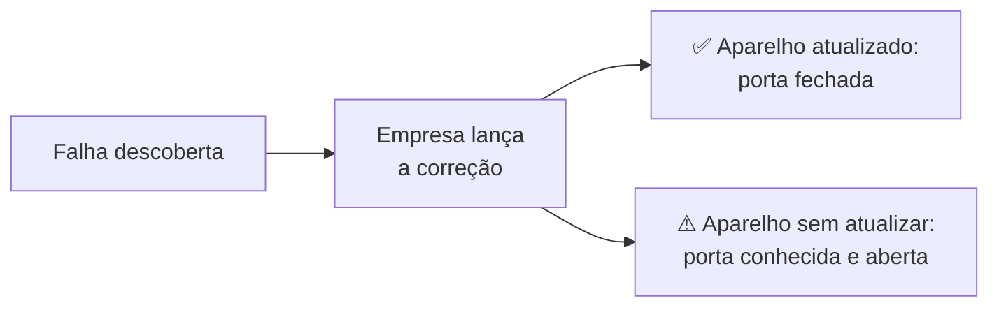

# 01 — Atualizações e apps oficiais

> **Curso:** Segurança digital e cidadania online  
> **Módulo:** 03 — Celular e computador seguros  
> **Tempo estimado:** 45 min  

---

## 🎯 Objetivos

Ao final desta aula, você será capaz de:

- Explicar por que **atualizar** o celular e o computador é uma proteção, e não só "novidade".
- Ligar as **atualizações automáticas** do sistema e dos aplicativos.
- Saber quando um celular **deixou de receber atualizações** e o que isso significa.
- Instalar aplicativos **só das lojas oficiais** e reconhecer o golpe do "APK" e do aplicativo de acesso remoto.

## Pré-requisitos

- [Módulo 02](../modulo_02_golpes/index.md): os golpes mais comuns.

---

## Atualização é conserto de segurança

Todo sistema (Android, iOS, Windows) e todo aplicativo têm falhas. Quando alguém descobre uma falha, a empresa lança uma **atualização** que fecha a porta. A partir desse momento, a falha fica **pública**, e os golpistas passam a procurar aparelhos que **ainda não atualizaram**.

Por isso, a regra é simples: **atualize assim que puder**, de preferência no automático.

## Ligando as atualizações automáticas

| Onde | Caminho (pode variar um pouco de aparelho para aparelho) |
|---|---|
| **Android: sistema** | *Configurações* ➔ *Sistema* (ou *Sobre o telefone*) ➔ *Atualização do sistema* / *Atualização de software*. |
| **Android: segurança do Google** | *Configurações* ➔ *Segurança e privacidade* ➔ *Atualizações* (atualização de segurança e do Google Play). |
| **Android: aplicativos** | *Play Store* ➔ sua foto ➔ *Configurações* ➔ *Preferências de rede* ➔ *Atualizar apps automaticamente*. |
| **iPhone: sistema** | *Ajustes* ➔ *Geral* ➔ *Atualização de Software* ➔ *Atualizações Automáticas*. |
| **iPhone: aplicativos** | *Ajustes* ➔ *App Store* ➔ *Atualizações de Apps*. |
| **Windows** | *Configurações* ➔ *Windows Update* (deixe ligado e reinicie quando ele pedir). |
| **Navegador** (Chrome, Edge, Firefox) | Atualiza sozinho; quando aparecer o aviso de **Atualizar** ou **Reiniciar**, aceite. |

!!! tip "Reinicie de vez em quando"
    Muitas correções só passam a valer depois de **reiniciar** o aparelho. Desligar e ligar o celular uma vez por semana ajuda (e ainda deixa ele mais rápido).

## Celular sem atualização: hora de se preparar

Os fabricantes atualizam cada modelo por **alguns anos** e depois param. Para descobrir, veja a **data da última atualização de segurança**:

- **Android:** *Configurações* ➔ *Sobre o telefone* ➔ *Versão do Android* ➔ **Nível do patch de segurança do Android** (aparece uma data).
- **iPhone:** *Ajustes* ➔ *Geral* ➔ *Sobre* ➔ **Versão do iOS**; compare com a versão mais nova no site da Apple.

Se a data tiver **mais de um ano**, o aparelho provavelmente não recebe mais correções.

!!! warning "Celular antigo não precisa ir para o lixo, mas precisa de cuidado"
    Num celular sem atualizações: evite usar o **aplicativo do banco** nele, mantenha os **apps atualizados** (eles continuam recebendo correções por um tempo), não instale nada fora da loja e, na próxima troca, pesquise **por quantos anos** o modelo novo vai receber atualizações. Essa informação aparece no site do fabricante.

## Apps só das lojas oficiais

Instale aplicativos **só** pela **Google Play Store** (Android) ou pela **App Store** (iPhone). As lojas não são perfeitas, mas analisam os aplicativos e retiram os perigosos.

**Antes de instalar, confira:**

- **Quem publicou:** o nome do desenvolvedor é o da empresa de verdade? (O app do banco tem que ser publicado pelo **banco**.)
- **Downloads e avaliações:** um app "do banco" com 500 downloads é falso.
- **Permissões pedidas:** uma lanterna não precisa ler as suas mensagens ([aula 02](02_permissoes_e_privacidade.md)).

!!! info "Google Play Protect"
    No Android, o **Play Protect** verifica os aplicativos instalados e avisa sobre os perigosos. Confira se ele está ligado: *Play Store* ➔ sua foto ➔ *Play Protect* ➔ engrenagem ➔ *Verificar apps com o Play Protect*.

## Os dois golpes de instalação

**1. O APK por link.** No Android, um aplicativo também pode ser instalado por um arquivo `.apk` baixado de um link. Golpistas mandam esse link no WhatsApp ou por SMS: "app do benefício", "rastreio da encomenda", "versão premium grátis", "comprovante". Para instalar, o celular pede para **permitir fontes desconhecidas**: esse aviso é o freio. **Não permita.**

**2. O aplicativo de acesso remoto.** Na falsa central do banco ([Módulo 02](../modulo_02_golpes/03_golpes_com_pix.md#golpe-1-a-falsa-central-do-banco)), o golpista pede para você instalar um app "de segurança" ou "de suporte". Muitas vezes é um app **legítimo** de acesso remoto (usado por técnicos de verdade), que deixa o golpista **ver e controlar** a sua tela, inclusive enquanto você abre o banco.

!!! danger "Nunca instale um aplicativo a pedido de quem ligou ou mandou mensagem"
    Banco, loja, operadora ou "suporte" de verdade **não pedem** para você instalar aplicativo durante uma ligação. Se alguém pedir, é golpe: desligue.

## Pirataria: o "grátis" que sai caro

Programas, jogos, filmes e "apps premium" piratas, além de ilegais, são um dos jeitos mais comuns de **instalar vírus**: quem distribui o arquivo crackeado pode colocar junto o que quiser. Prefira as versões **gratuitas oficiais** (este curso e os outros cursos da plataforma só usam programas gratuitos) ou alternativas livres.

---

## ⚠️ Erros comuns

- **Adiar a atualização para sempre** ("depois eu faço").
- **Desligar as atualizações automáticas** para economizar internet. Deixe atualizar pelo Wi-Fi.
- **Permitir "fontes desconhecidas"** para instalar o app que chegou por mensagem.
- **Instalar app pelo link de um anúncio** em vez de procurar na loja oficial.
- **Usar o app do banco num celular que não recebe atualização há anos.**

---

## Exercícios

### Básico (fixação)

1. Por que uma atualização é uma proteção?
2. O que significa um celular pedir para "permitir instalação de fontes desconhecidas"?

<!-- gabarito -->
??? success "Gabarito — Básico"
    1. Porque ela corrige falhas que já são conhecidas. Depois que a correção sai, a falha fica pública, e quem não atualizou fica com uma "porta" que os golpistas sabem abrir.
    2. Que você está instalando um aplicativo **fora da loja oficial** (um arquivo `.apk`). É o freio do sistema: na dúvida, não permita.

### Intermediário (aplicação)

1. Confira e ligue as atualizações automáticas do sistema e dos aplicativos no seu celular.
2. Descubra a data do **último patch de segurança** (Android) ou a **versão do iOS** (iPhone) do seu celular.
3. Abra a lista de aplicativos instalados e **desinstale** pelo menos um que você não usa mais.

<!-- gabarito -->
??? success "Gabarito — Intermediário"
    1. Use os caminhos da tabela "Ligando as atualizações automáticas".
    2. Android: *Configurações* ➔ *Sobre o telefone* ➔ *Versão do Android* ➔ *Nível do patch de segurança*. iPhone: *Ajustes* ➔ *Geral* ➔ *Sobre*. Se a data passar de um ano, siga o quadro "Celular antigo...".
    3. Menos aplicativos = menos coisas para atualizar e menos permissões espalhadas. Apps esquecidos são os que ficam desatualizados.

### Avançado (desafio)

1. O avô do Bruno recebeu no WhatsApp: *"Baixe o novo app do INSS para receber o 14º salário: link"*. O link baixa um arquivo `.apk`. Liste todos os sinais de golpe e o que o Bruno deve explicar ao avô.
2. Durante uma ligação, a "central do banco" pede para a Ana instalar um aplicativo "de proteção" da Play Store. Como o app está na loja oficial, a Ana acha que é seguro. Explique o erro.

<!-- gabarito -->
??? success "Gabarito — Avançado"
    1. Sinais: **prêmio** (dinheiro extra), mensagem com **link**, app que não vem da **loja oficial** (arquivo `.apk`, pedindo "fontes desconhecidas"), e órgão público "mandando" app pelo WhatsApp. O Bruno deve explicar que aplicativos oficiais do governo ficam na **loja oficial**, publicados pelo próprio órgão, e que benefícios se consultam no app ou site oficial (terminado em `.gov.br`), nunca por link de mensagem.
    2. O app pode até ser legítimo (muitos aplicativos de acesso remoto são), mas **quem pediu a instalação** é o golpista. Com ele, o golpista vê e controla a tela da Ana. O problema não é a loja, é o pedido: banco não pede para instalar nada durante uma ligação.

---

## 💡 Resumo

- **Atualizar** fecha portas conhecidas: deixe sistema, apps e navegador no **automático** e reinicie de vez em quando.
- Celular **sem atualização** há mais de um ano: nada de banco nele, e planeje a troca.
- Apps **só das lojas oficiais**, conferindo quem publicou. **Não** permita "fontes desconhecidas".
- **Nunca** instale um aplicativo a pedido de quem ligou ou mandou mensagem.
- Pirataria é porta de entrada de vírus.

## ➡️ Próximo passo

**[02 — Permissões e privacidade no celular](02_permissoes_e_privacidade.md)**: quem pode ver a sua localização, câmera, microfone e contatos.
