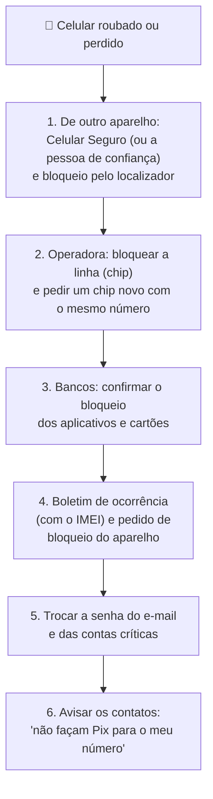

# 03 — Bloqueio de tela, roubo e backup

> **Curso:** Segurança digital e cidadania online  
> **Módulo:** 03 — Celular e computador seguros  
> **Tempo estimado:** 1 h  

---

## 🎯 Objetivos

Ao final desta aula, você será capaz de:

- Escolher um **bloqueio de tela** seguro e ajustar o bloqueio automático.
- Ligar as **proteções contra roubo** do Android ou do iPhone e o **localizador** do aparelho.
- Cadastrar-se no **Celular Seguro** e anotar o **IMEI** do celular.
- Seguir um **roteiro** do que fazer, em ordem, se o celular for roubado ou perdido.
- Manter **backup** das fotos, contatos e conversas.

## Pré-requisitos

- [Módulo 01](../modulo_01_senhas_e_contas/index.md): contas com verificação em duas etapas e códigos de recuperação.

!!! info "Tudo o que funciona depois do roubo precisa ser feito ANTES"
    Localizador, bloqueio remoto, Celular Seguro, IMEI anotado, backup: se não estiverem prontos antes, não ajudam depois. Esta aula é para fazer **hoje**.

---

## Bloqueio de tela

O bloqueio de tela é a porta da frente. Do mais fraco ao mais forte:

| Tipo | Avaliação |
|---|---|
| Nenhum / deslizar | ⛔ Qualquer um entra. |
| **Padrão** (desenho) | ⚠️ Fraco: o desenho fica marcado na tela (gordura do dedo) e é fácil de ver por cima do ombro. |
| **PIN de 4 dígitos** | ⚠️ Pouco: datas e `1234` são adivinhados. |
| **PIN de 6 dígitos ou mais** (sem data) | ✅ Bom para o dia a dia. |
| **Senha** com letras | ✅✅ O mais forte. |

Use também a **biometria** (digital ou rosto) para desbloquear rápido no dia a dia: ela não substitui o PIN, que continua sendo pedido de vez em quando.

!!! tip "Ajustes rápidos"
    - **Bloqueio automático** em 30 segundos ou 1 minuto (*Tela* ➔ *Tempo limite da tela*; no iPhone, *Tela e Brilho* ➔ *Bloqueio Automático*).
    - Digite o PIN **cobrindo a tela** em lugares cheios. Ladrões observam o PIN antes de pegar o celular.
    - Nunca use como PIN a sua data de nascimento ou o final do seu telefone.

## Proteções contra roubo do próprio celular

**Android** (versão 10 ou mais nova): *Configurações* ➔ *Google* ➔ *Todos os serviços* ➔ **Proteção contra roubo**. Ligue:

- **Bloqueio por detecção de roubo:** a tela trava sozinha se o celular for arrancado da mão e levado correndo.
- **Bloqueio de dispositivo off-line:** a tela trava se o ladrão desligar a internet por muito tempo.
- **Bloqueio remoto:** permite travar a tela pelo seu **número de telefone**, de outro aparelho.

**iPhone** (iOS 17.3 ou mais novo): *Ajustes* ➔ *Face ID e Código* (ou *Touch ID e Código*) ➔ **Proteção de Dispositivo Roubado**. Com ela, longe de casa ou do trabalho, mudar senhas e configurações importantes exige o **rosto ou a digital** e, em alguns casos, uma **espera de uma hora**, mesmo para quem sabe o código.

## O localizador do aparelho

| | Android | iPhone |
|---|---|---|
| Nome | **Encontre Meu Dispositivo** (Google) | **Buscar** (Apple) |
| Onde ligar | *Configurações* ➔ *Google* ➔ *Todos os serviços* ➔ *Encontre Meu Dispositivo* | *Ajustes* ➔ seu nome ➔ *Buscar* ➔ *Buscar iPhone* (ligue também *Rede do app Buscar*) |
| Para usar de outro aparelho | `android.com/find`, entrando com a conta Google | `icloud.com/find` ou o app Buscar de outro aparelho Apple |
| O que faz | Mostrar no mapa, tocar, bloquear com mensagem, **apagar tudo** | O mesmo |

!!! warning "Vai precisar da senha de cor"
    Para usar o localizador depois de um roubo, você vai entrar na conta Google ou no Apple ID **em outro aparelho**. Por isso a frase-senha dessa conta precisa estar **decorada** e os **códigos de recuperação** guardados em casa ([Módulo 01](../modulo_01_senhas_e_contas/04_verificacao_em_duas_etapas.md#codigos-de-recuperacao-o-plano-b)).

## Celular Seguro (governo federal)

O **Celular Seguro** é um aplicativo **gratuito** do Ministério da Justiça e Segurança Pública, feito com a Anatel e a Febraban. Funciona como um **botão de emergência**: depois de um roubo, um único registro avisa ao mesmo tempo os **bancos** e as **operadoras** participantes, que bloqueiam a linha, o aparelho e o acesso aos aplicativos bancários.

1. Instale o **Celular Seguro** pela loja oficial (publicado pelo governo) e entre com a sua conta **gov.br**.
2. Cadastre o seu aparelho e o seu número.
3. Cadastre uma **pessoa de confiança**: ela poderá registrar o roubo pelo celular **dela**, quando você estiver sem o seu.

O registro também pode ser feito pelo site do programa, em qualquer computador, com a sua conta gov.br.

## Anote o IMEI

O **IMEI** é o número de identidade do aparelho. Com ele, a operadora pode **bloquear o celular** para que não funcione em nenhuma operadora no Brasil (depois do boletim de ocorrência).

- Digite `*#06#` no teclado de ligação: o IMEI aparece na tela (celulares com dois chips têm dois).
- Anote num papel, guarde com os documentos e deixe também com alguém de confiança. Ele costuma estar também na **caixa** e na **nota fiscal** do aparelho.

## Fui roubado(a): o roteiro

!!! tip "Apagar ou não apagar o celular?"
    Se houver chance de recuperar (perdeu em casa, no ônibus, esqueceu na escola), primeiro **bloqueie** com uma mensagem e um telefone de contato. Se foi roubo e você não vai recuperar, use **apagar o dispositivo** pelo localizador: seus dados deixam de estar no aparelho. Com o backup em dia, você recupera tudo no celular novo.

## Backup: o que você não quer perder

Celular quebra, cai na água, é roubado. O **backup** (cópia de segurança) garante que as suas fotos, contatos e conversas continuem existindo.

| O quê | Android | iPhone |
|---|---|---|
| Fotos e vídeos | **Google Fotos** (backup ligado) | **Fotos do iCloud** |
| Contatos, agenda, configurações | Conta Google (*Configurações* ➔ *Google* ➔ *Backup*) | **Backup do iCloud** |
| Conversas do WhatsApp | *Configurações* ➔ *Conversas* ➔ *Backup de conversas* (Google Drive) | *Configurações* ➔ *Conversas* ➔ *Backup de conversas* (iCloud) |

!!! info "Espaço grátis é limitado"
    O Google e a Apple dão um espaço gratuito pequeno. Se não couber tudo, priorize: **contatos** e **conversas** importantes, e copie as **fotos** que você não quer perder para um computador ou um HD externo de vez em quando. O que importa de verdade deve estar em **dois lugares**.

---

## ⚠️ Erros comuns

- **Padrão de desenho ou PIN com data de nascimento.**
- **Deixar o localizador desligado** "para economizar bateria".
- **Não decorar a senha** da conta Google ou do Apple ID: sem ela, não dá para usar o localizador depois do roubo.
- **Só cadastrar no Celular Seguro depois do roubo.** O cadastro tem que ser antes.
- **Backup do WhatsApp desligado** e conversas importantes perdidas.
- **Demorar para avisar a operadora e os bancos.** A ordem do roteiro existe para fechar as portas o mais rápido possível.

---

## Exercícios

### Básico (fixação)

1. Ordene do mais fraco para o mais forte: padrão de desenho, PIN de 6 dígitos, senha com letras, PIN de 4 dígitos.
2. Para que serve o IMEI e como descobri-lo?

<!-- gabarito -->
??? success "Gabarito — Básico"
    1. Padrão de desenho e PIN de 4 dígitos (os dois são fracos) ➔ PIN de 6 dígitos ➔ senha com letras.
    2. É o número de identidade do aparelho: com ele, a operadora bloqueia o celular roubado para que não funcione no Brasil. Para ver: digite `*#06#` no teclado de ligação (ou olhe na caixa e na nota fiscal).

### Intermediário (aplicação)

1. Ligue as **proteções contra roubo** do seu celular (Android: *Proteção contra roubo*; iPhone: *Proteção de Dispositivo Roubado*).
2. Confira se o **localizador** está ligado e teste entrando em `android.com/find` ou `icloud.com/find` **de outro aparelho** (por exemplo, o computador da escola), fazendo o celular **tocar**. Ao terminar, **saia da conta** nesse aparelho.
3. Anote o **IMEI** em papel e guarde com os seus documentos.
4. Confira se o backup das **fotos** e do **WhatsApp** está ligado.

<!-- gabarito -->
??? success "Gabarito — Intermediário"
    1. Use os caminhos da seção "Proteções contra roubo do próprio celular". Se a opção não aparecer no iPhone, configure antes o Face ID ou o Touch ID.
    2. Se o celular tocou, o localizador está pronto. Lembre de **sair da conta** e fechar a janela (de preferência use uma **janela anônima**, como no [Módulo 01](../modulo_01_senhas_e_contas/03_gerenciador_de_senhas.md#computador-da-escola-ou-emprestado)).
    3. `*#06#` ➔ anote os números (um ou dois IMEIs).
    4. Google Fotos ou Fotos do iCloud com o backup **ligado**; WhatsApp: *Configurações* ➔ *Conversas* ➔ *Backup de conversas*, com data recente.

### Avançado (desafio)

1. Na saída da escola, o celular da Ana foi arrancado da mão dela. Ela está com uma amiga, que tem celular. Escreva o que a Ana deve fazer nos próximos 30 minutos, em ordem, e o que ela vai precisar saber de cor.
2. Por que o golpe do WhatsApp (Módulo 02) costuma vir **logo depois** de um roubo de celular? Como o roteiro protege os contatos da Ana?

<!-- gabarito -->
??? success "Gabarito — Avançado"
    1. Pelo celular da amiga: (1) registrar o roubo no **Celular Seguro** (a amiga pode ser a pessoa de confiança, ou a Ana entra pelo site com o gov.br) e **bloquear** o aparelho pelo localizador; (2) ligar para a **operadora** e bloquear o chip; (3) confirmar com os **bancos** o bloqueio dos apps e cartões; (4) **avisar a família** por outro canal; depois, (5) boletim de ocorrência com o IMEI e (6) trocar as senhas do e-mail e das contas críticas. De cor, ela precisa saber a **frase-senha** da conta Google/Apple ID e a do **gov.br** (e ter os códigos de recuperação em casa).
    2. Porque o ladrão tem o aparelho (e às vezes o chip) e tenta usar o WhatsApp para pedir dinheiro aos contatos, ou vende o acesso a golpistas. O bloqueio rápido da linha e do aparelho, a confirmação em duas etapas do WhatsApp e o **aviso aos contatos** cortam esse caminho.

---

## 💡 Resumo

- Bloqueio de tela com **PIN de 6+ dígitos ou senha**, biometria para o dia a dia e bloqueio automático curto.
- Ligue a **Proteção contra roubo** (Android) ou a **Proteção de Dispositivo Roubado** (iPhone) e o **localizador**.
- Cadastre-se **antes** no **Celular Seguro**, com uma pessoa de confiança, e anote o **IMEI** (`*#06#`).
- Roubo: Celular Seguro e localizador ➔ operadora ➔ bancos ➔ boletim de ocorrência ➔ senhas ➔ avisar contatos.
- **Backup** de fotos, contatos e WhatsApp: o que importa fica em dois lugares.

## ➡️ Próximo passo

**[04 — Computador, Wi-Fi e o computador da escola](04_computador_e_wifi.md)**: Windows Update, antivírus, Wi-Fi público e roteador de casa.

---

*Recursos do Android, do iPhone e do Celular Seguro conferidos em 08/11/2026 nas páginas de suporte do Google e da Apple e em notícias sobre o programa. Os caminhos de menu mudam com as versões dos sistemas.*
