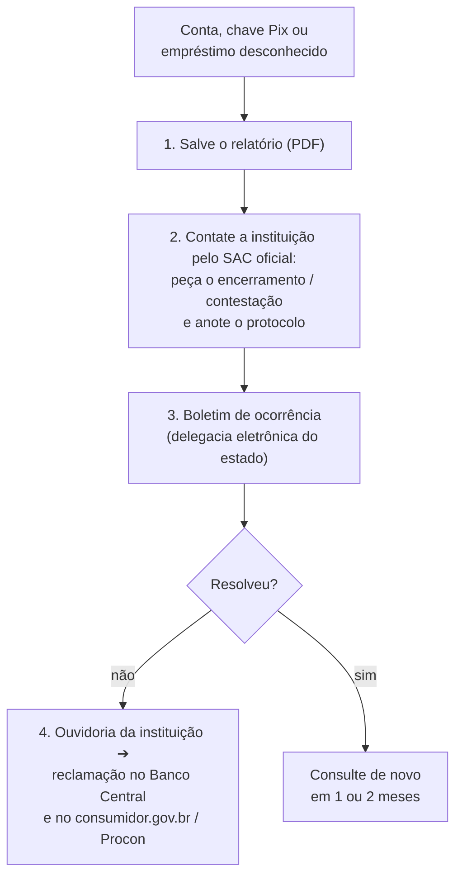

# 02 — Registrato: o que existe no seu CPF

> **Curso:** Segurança digital e cidadania online  
> **Módulo:** 04 — Cidadania e direitos  
> **Tempo estimado:** 45 min  

---

## 🎯 Objetivos

Ao final desta aula, você será capaz de:

- Explicar o que é o **Registrato** do Banco Central e por que ele protege contra fraudes.
- Consultar os principais relatórios: **contas**, **chaves Pix** e **empréstimos** no seu CPF.
- Saber o que fazer se aparecer uma conta, chave ou empréstimo que **não é seu**.

## Pré-requisitos

- [Aula 01](01_conta_gov_br.md): conta gov.br **prata ou ouro** (sua ou de um responsável).

!!! warning "Dados financeiros são sensíveis"
    Os relatórios do Registrato mostram a vida financeira de uma pessoa. Se você for consultar o de um responsável, **ele** entra na conta e decide o que mostrar. Na escola, ninguém precisa mostrar o relatório: a entrega é só o checklist.

---

## Por que conferir o seu CPF

Com dados vazados ([Módulo 01, aula 05](../modulo_01_senhas_e_contas/05_projeto_plano_de_protecao.md)) ou documentos roubados, golpistas conseguem **abrir contas**, **cadastrar chaves Pix** e até **pegar empréstimos** em nome de outra pessoa. Muitas vezes a vítima só descobre meses depois, quando chega uma cobrança ou o nome vai para um cadastro de devedores.

O **Registrato** é um sistema **gratuito** do **Banco Central** que mostra o que as instituições financeiras informaram sobre o seu CPF. É o jeito oficial de conferir.

## Os relatórios

| Relatório | O que mostra | Para que serve |
|---|---|---|
| **Contas e Relacionamentos** | Em quais bancos e instituições você tem (ou teve) conta | Descobrir conta aberta por outra pessoa com o seu CPF |
| **Chaves Pix** | Todas as chaves Pix ligadas ao seu CPF | Achar chave cadastrada sem você saber (usada para receber dinheiro de golpes) |
| **Empréstimos e Financiamentos** | Empréstimos, financiamentos e valores em aberto | Achar empréstimo que você não fez |
| **Cheques sem Fundos** | Registros de cheques devolvidos | Conferir se há registros em seu nome |
| **Câmbio e Transferências Internacionais** | Operações com o exterior | Conferir operações que você não reconhece |

!!! tip "Quando consultar"
    Pelo menos **duas vezes por ano**, e sempre que: você perder documentos, tiver o celular roubado, aparecer num vazamento ou receber cobrança de algo que não reconhece. Os relatórios são atualizados periodicamente (o de empréstimos, mensalmente).

## Como consultar

1. No navegador, abra o site do **Banco Central** digitando `bcb.gov.br` (não use links de mensagens).
2. Procure **Registrato** (fica na área **Meu BC**).
3. Entre com a conta **gov.br** (nível **prata** ou **ouro**; o sistema pode pedir também a verificação em duas etapas).
4. Escolha o relatório e gere. Ele aparece na tela e pode ser salvo em PDF.

!!! danger "O Registrato é gratuito e o Banco Central não liga para você"
    Ninguém precisa "consultar o Registrato para você" cobrando taxa, e o Banco Central não manda mensagem com link nem liga pedindo dados. Qualquer contato assim é golpe.

## Achei algo que não é meu. E agora?

- **Conta ou chave Pix desconhecida:** peça à instituição o **encerramento** e a explicação de como foi aberta. Uma conta em seu nome pode estar sendo usada para receber dinheiro de golpes.
- **Empréstimo desconhecido:** conteste com a instituição e **não pague** nada que você não contratou sem antes registrar a contestação. Para aposentados e pensionistas do INSS, o **Meu INSS** permite **bloquear** novos empréstimos consignados.
- Guarde **todos os protocolos**, o PDF do relatório e o boletim de ocorrência.

!!! info "Dívida no seu nome também se confere"
    Além do Registrato, órgãos de proteção ao crédito (como Serasa, SPC e Boa Vista) permitem consultar gratuitamente se há dívidas registradas no seu CPF. Use os sites e aplicativos oficiais deles.

---

## ⚠️ Erros comuns

- **Nunca ter consultado** o próprio CPF.
- **Pagar intermediário** para "consultar o Registrato".
- **Ignorar** uma chave Pix ou conta desconhecida ("deve ser engano").
- **Pagar um empréstimo que você não fez** para "limpar o nome", sem contestar antes.
- **Mostrar o relatório** para quem não precisa ver.

---

## Exercícios

### Básico (fixação)

1. O que é o Registrato e quanto custa?
2. Qual relatório você consultaria para descobrir se alguém abriu uma conta com o seu CPF? E para descobrir uma chave Pix que você não criou?

<!-- gabarito -->
??? success "Gabarito — Básico"
    1. Um sistema do Banco Central que mostra o que as instituições financeiras informaram sobre o seu CPF (contas, chaves Pix, empréstimos...). É **gratuito**.
    2. **Contas e Relacionamentos** para as contas; **Chaves Pix** para as chaves.

### Intermediário (aplicação)

1. Com a sua conta gov.br (ou ajudando um responsável, que é quem mexe), consulte os relatórios **Contas e Relacionamentos** e **Chaves Pix**.
2. Responda **só para você**: todas as contas e chaves são conhecidas? Se não, qual é o primeiro passo?

<!-- gabarito -->
??? success "Gabarito — Intermediário"
    1. `bcb.gov.br` ➔ **Registrato** (Meu BC) ➔ entrar com gov.br prata/ouro ➔ gerar os dois relatórios.
    2. Se algo for desconhecido: salvar o PDF e contatar a instituição pelo **SAC oficial** (número do site ou do aplicativo oficial), pedindo o encerramento e anotando o protocolo; depois, boletim de ocorrência.

### Avançado (desafio)

1. A Ana perdeu a carteira com RG e CPF há três meses. Hoje chegou uma carta de cobrança de um empréstimo de R$ 3.000 de uma financeira que ela nunca usou. Monte o plano de ação dela, em ordem.
2. Por que uma conta aberta em nome da Ana, mesmo sem dívida nenhuma, é um problema?

<!-- gabarito -->
??? success "Gabarito — Avançado"
    1. (1) Consultar o Registrato (Empréstimos e Contas) e salvar os PDFs; (2) ligar para o **SAC oficial** da financeira (número do site oficial, não o da carta), contestar o empréstimo e pedir os documentos usados na contratação, anotando o protocolo; (3) registrar **boletim de ocorrência** pela perda dos documentos e pela fraude; (4) se não resolver, **ouvidoria** da financeira, **reclamação no Banco Central** e **consumidor.gov.br** ou Procon; (5) conferir se o nome foi negativado nos órgãos de proteção ao crédito; (6) consultar o Registrato de novo nos próximos meses.
    2. Porque golpistas usam contas em nome de outras pessoas (as "contas laranja") para **receber dinheiro de golpes**. A dona do CPF pode ser chamada a explicar as movimentações e ter problemas com a polícia e com os bancos. Por isso é preciso pedir o encerramento e registrar a ocorrência.

---

## 💡 Resumo

- O **Registrato** (Banco Central, gratuito) mostra **contas**, **chaves Pix**, **empréstimos** e outros registros do seu CPF.
- Acesse por `bcb.gov.br` ➔ **Registrato**, com a conta gov.br **prata ou ouro**. Ninguém precisa consultar por você.
- Consulte duas vezes por ano e sempre depois de perder documentos, ter o celular roubado ou aparecer num vazamento.
- Achou algo desconhecido: PDF ➔ SAC oficial com protocolo ➔ boletim de ocorrência ➔ ouvidoria, Banco Central e consumidor.gov.br.

## ➡️ Próximo passo

**[03 — LGPD no dia a dia](03_lgpd_no_dia_a_dia.md)**: os seus direitos sobre os seus dados pessoais e como exercê-los.

---

*Relatórios do Registrato conferidos em 08/11/2026 em notas do Banco Central divulgadas pela imprensa e em guias de instituições financeiras.*
