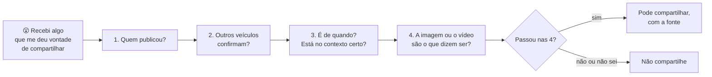

# 05 — Projeto do módulo: notícias falsas e o mapa de ajuda

> **Curso:** Segurança digital e cidadania online  
> **Módulo:** 04 — Cidadania e direitos  
> **Tempo estimado:** 1 h 30 min  

---

## 🎯 Objetivos

Ao final desta aula, você terá:

- Aprendido um roteiro de **4 perguntas** para checar uma notícia antes de compartilhar.
- Checado **3 casos simulados** usando o roteiro.
- Montado o **mapa de ajuda** da sua cidade: quem procurar em cada situação dos Módulos 01 a 04.

## Pré-requisitos

- Aulas [01](01_conta_gov_br.md) a [04](04_cyberbullying_e_denuncia.md) deste módulo.

---

## Parte 1 — Checar antes de compartilhar

Notícias falsas usam os mesmos gatilhos dos golpes ([Módulo 02](../modulo_02_golpes/01_engenharia_social.md)): **medo**, **revolta**, **urgência** ("compartilhe antes que apaguem!"). Algumas são criadas para enganar, outras para ganhar cliques, outras são só um boato que alguém repassou sem conferir. O resultado é o mesmo: gente tomando decisões erradas e pessoas inocentes sendo atacadas.

### O roteiro das 4 perguntas

**1. Quem publicou?** Um veículo de imprensa conhecido, um órgão oficial (`.gov.br`), um especialista identificado? Ou um perfil sem nome, um "site de notícias" que você nunca viu, um áudio "de um médico amigo do meu primo"? Sem autor identificável, desconfie.

**2. Outros veículos confirmam?** Copie o assunto principal e pesquise. Se uma notícia importante for verdadeira, **vários** veículos sérios vão estar falando dela. Se só aparece em correntes de mensagem, é sinal de alerta. Procure também nas **agências de checagem**: Agência Lupa, Aos Fatos, Fato ou Fake (g1), Estadão Verifica e Projeto Comprova.

**3. É de quando? Está no contexto certo?** Muitas "notícias" são **velhas** (uma enchente de 2015 circulando como se fosse hoje) ou **de outro lugar**. Confira a data e o local.

**4. A imagem ou o vídeo são o que dizem ser?** Faça uma **pesquisa reversa de imagem**: no Google, use o **Google Lens** (ícone da câmera na busca) ou toque e segure a imagem ➔ *Pesquisar imagem*. Ela mostra onde a imagem já apareceu antes. Em vídeos e áudios, lembre que a IA consegue **imitar rostos e vozes**: lábios fora de sincronia, voz "robótica", iluminação estranha e cortes bruscos são pistas, mas a checagem nas fontes é o que decide.

!!! tip "Sinais de alerta no próprio texto"
    TUDO EM MAIÚSCULAS, muitos pontos de exclamação, "a mídia não quer que você saiba", "compartilhe antes que apaguem", erros de português, falta de data e de fonte, promessas milagrosas ("cura em 3 dias").

!!! warning "Na dúvida, não compartilhe"
    Não compartilhar não custa nada. Compartilhar uma mentira pode prejudicar alguém e a sua credibilidade. E, se você já compartilhou algo falso, **apague e avise** o grupo: isso também é ser responsável.

### Os 3 casos simulados

Para cada caso, responda às **4 perguntas** e decida: compartilhar ou não? Depois, abra a resposta. Os casos são inventados.

**Caso 1.** Mensagem recebida no grupo da família:

> 🚨 URGENTE 🚨 Chá de folha de goiaba com limão CURA a gripe em 24 horas!!! Médicos estão escondendo isso porque não dá lucro. COMPARTILHE com todos os seus contatos!!!

??? success "Resposta — Caso 1"
    **Não compartilhar.** (1) Sem autor ("médicos" sem nome). (2) Nenhum órgão de saúde ou veículo sério confirma; agências de checagem costumam desmentir esse tipo de "cura". (3) Sem data nem contexto. (4) Sem imagem, mas o texto tem todos os sinais de alerta: maiúsculas, exclamações, promessa milagrosa, "estão escondendo", pedido de compartilhamento. Saúde se confere com profissionais e com fontes como o Ministério da Saúde.

**Caso 2.** Post com a foto de uma rua alagada:

> Olha como está o centro da nossa cidade AGORA! A prefeitura não fez nada!

*A pesquisa reversa mostra a mesma foto num site de notícias de outro estado, publicada há 6 anos.*

??? success "Resposta — Caso 2"
    **Não compartilhar.** A pergunta 3 (data e contexto) e a 4 (imagem) derrubam o post: a foto é **antiga** e de **outro lugar**. Mesmo que haja problemas reais na cidade, usar uma foto falsa engana as pessoas. Se quiser falar do problema, use fontes e imagens verdadeiras.

**Caso 3.** Notícia num site de um jornal conhecido da sua região, com data de hoje:

> Prefeitura anuncia mudança no horário dos ônibus a partir de segunda-feira.

*O mesmo aviso aparece no site oficial da prefeitura (terminado em `.gov.br`) e em outro jornal.*

??? success "Resposta — Caso 3"
    **Pode compartilhar, de preferência com o link da fonte oficial.** (1) Autor identificável (jornal conhecido). (2) Confirmado pelo site da prefeitura e por outro veículo. (3) Data atual e local certo. (4) Não depende de imagem. Passou nas 4 perguntas.

## Parte 2 — O mapa de ajuda da sua cidade

Em cada módulo, você viu **quem procurar** quando algo dá errado. Agora monte o seu **mapa de ajuda**: uma tabela com os contatos certos, prontos **antes** de precisar. Pesquise os contatos da **sua cidade** e do **seu estado** nos **sites oficiais** (nunca em anúncios).

| Situação | Quem procurar | Contato (preencha) |
|---|---|---|
| Conta invadida | Recuperação oficial do serviço ([Módulo 01](../modulo_01_senhas_e_contas/05_projeto_plano_de_protecao.md#passo-3-se-uma-conta-for-invadida)) | (site/app de cada serviço) |
| Caí num golpe com Pix | Meu banco (app ou número atrás do cartão) e MED ([Módulo 02](../modulo_02_golpes/03_golpes_com_pix.md#cai-num-golpe-com-pix-o-med)) | |
| Celular roubado | Celular Seguro, operadora, bancos ([Módulo 03](../modulo_03_aparelhos_seguros/03_bloqueio_roubo_e_backup.md#fui-roubadoa-o-roteiro)) | |
| Boletim de ocorrência | Delegacia eletrônica do meu estado | |
| Conta, chave Pix ou empréstimo desconhecido | SAC da instituição, Registrato, Banco Central ([aula 02](02_registrato.md)) | |
| Problema com empresa ou dados pessoais | consumidor.gov.br, **Procon** da minha cidade, ANPD ([aula 03](03_lgpd_no_dia_a_dia.md)) | |
| Cyberbullying ou exposição | Escola, SaferNet, delegacia ([aula 04](04_cyberbullying_e_denuncia.md#canais-de-ajuda-e-de-denuncia)) | |
| Criança ou adolescente em risco | **Conselho Tutelar** da minha cidade, Disque 100 | |
| Precisa conversar | CVV 188 | 188 |
| Emergência | Polícia Militar | 190 |

!!! tip "Onde guardar o mapa"
    Uma cópia em **papel** (perto dos documentos da casa) e outra no **celular de alguém da família**. Num roubo de celular, a lista no seu próprio celular não ajuda.

## Entrega

- [ ] As respostas dos **3 casos** (as 4 perguntas de cada um), feitas antes de abrir os gabaritos.
- [ ] O **mapa de ajuda** preenchido com os contatos da sua cidade e do seu estado.
- [ ] Uma frase: qual situação do mapa você acha que é **mais provável** acontecer com alguém da sua família, e por quê.

!!! note "Para o professor"
    O mapa de ajuda pode ser feito em grupo e virar um cartaz da turma (os contatos de serviços públicos não são dados pessoais). Confira se os contatos vieram de **sites oficiais** e se o Conselho Tutelar, o Procon e a delegacia eletrônica são mesmo os da cidade e do estado. O mapa será usado no **Guia de segurança da minha família**, do Módulo 05.

---

## ⚠️ Erros comuns

- **Compartilhar porque "veio de alguém de confiança".** A pessoa de confiança também pode ter sido enganada.
- **Ler só a manchete.**
- **Achar que foto e vídeo são prova.** Imagens antigas, fora de contexto ou feitas com IA enganam.
- **Pegar telefones de ajuda em anúncios** ou em sites não oficiais.
- **Deixar o mapa de ajuda só no próprio celular.**

---

## 💡 Resumo

- Antes de compartilhar: **quem publicou? outros confirmam? é de quando e de onde? a imagem é o que diz ser?** Na dúvida, não compartilhe.
- Use **agências de checagem** e a **pesquisa reversa de imagem**.
- O **mapa de ajuda** reúne os contatos certos de cada situação, prontos antes de precisar, em papel e com alguém da família.

## ➡️ Próximo passo

**[Módulo 05 — Projeto final](../modulo_05_projeto_final/index.md)**: o plano "e se eu cair num golpe?" e o **Guia de segurança da minha família**.
